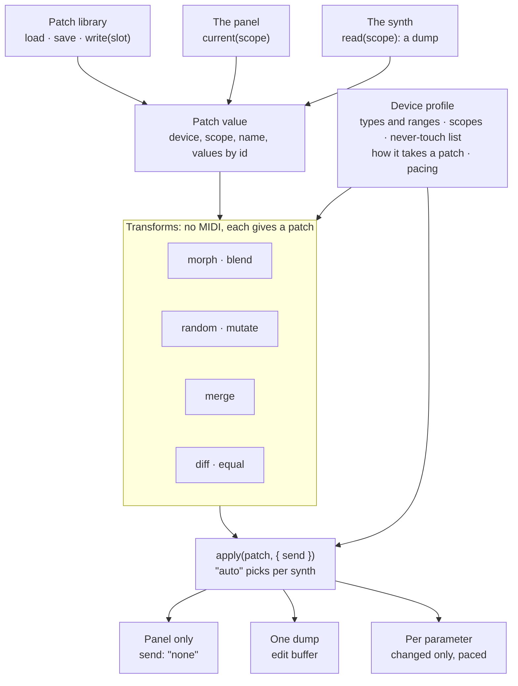

# `ce.patch`: a synth's sound as a value

*Designed and approved by the owner on 2026-10-27. Nothing built.* The design for a scripting
module that lets a script hold, change, compare, send and keep a synth's sound. Every command entry
below is written in the scripting manual's form (summary, example, parameters with their rules,
"Good to know", options), so it can go into `panelApi.js` as it stands when the module is built.

It began as a question about which modules the scripting API lacks. Of the 41 modules then, 28 are
one per component and mostly mirror inspector settings; the general ones are strong on mechanics
(bytes, encoders, values, timers, drawing) and thin on the jobs a synth editor is used for. The
manual itself showed people building those jobs by hand: `ce.panel.snapshot` says "use it to morph
between two snapshots", and the example for `defineAction` is "randomize". `ce.patch` was ranked
first of the proposed modules; the rest are in [Script modules: what is missing](script-modules-roadmap.md).

## How a patch moves

Every patch passes through one value. Only `apply` (and `read` and `write`, at the edges) touches
the synth; the transforms in between send nothing, so they can be called as often as a hand moves.



**When the module ships, its chapter in the scripting manual opens with this diagram.** The owner
asked for it there on 2026-10-27. The in-app manual's renderer (`utils/markdown.js`) does not draw
Mermaid, so the manual needs it as an image or the renderer needs a diagram block.

## What it builds on

Most of step 1 exists already, under other names. Building `ce.patch` is largely exposing it to
scripts with profile parameter ids, and adding what it lacks.

| Exists | Where | What `ce.patch` takes from it |
|---|---|---|
| Morph rules per kind of value: `lerp`, `nearest` (a choice is one end or the other, never between), `hold` (a name has no midpoint) | `utils/snapshotModel.js`: `morphPolicyFor`, `morphValue` | The rules for `morph`, `blend` and the kind table below, unchanged. |
| Weighted blending of N snapshots, renormalised over the ones that hold each parameter | `snapshotModel.js`: `morphWeighted` | `blend`. |
| A partial snapshot carried through rather than dragged toward nothing | `snapshotModel.js`: `morphSnapshots` | A parameter only one patch holds keeps its value. |
| A send budget that sends the parameters that moved most first, and counts what it deferred | `snapshotModel.js`: `morphSendPlan`; `stores/snapshots.js`: `SEND_BUDGET = 32` | `apply(p, { live = true })`. |
| Diff | `snapshotModel.js`: `diffSnapshots` | `diff`, `equal`. |
| Capture, recall, morph and compare on the running panel, as one undo step | `stores/snapshots.js`, `components/SnapshotsTab.svelte` | `current`, and `apply` with `send = "none"`. |
| Timbre Space and Preset Constellation blend whole patches across the profile's ranges | The two components | Evidence the rules hold on real panels. |
| Patch algebra, patches as diffs | [The MIDI frontier](midi-frontier.md), thesis 4 | An idea record, not built. `ce.patch` is the scripting surface those ideas would stand on. |

Two things to settle while building, both from that record and the code:

- **Snapshots are keyed by export parameter id** (one per control), and **a patch is keyed by
  profile parameter id**. A panel without a profile uses control names. The mapping between the
  two exists (`utils/panelValueAccess.js`); it must be one function both use.
- **Numbers blend through the parameter's curve, not in a straight line.** 5,910 of the 6,050
  profile parameters carry `normalization`; a cutoff halfway between two patches is halfway along
  its curve. `morphValue` blends raw values today.

Not there at all: a randomizer, reading a patch through a profile's dumps, keeping patches per
synth, writing a slot, and the profile's `patch` section.

## The patch value

Every command takes or gives the same table:

| Field | What it holds |
|---|---|
| `device` | The device profile's id, or `"panel"` when the panel has no profile. |
| `role` | The device, by its role as the panel names it, such as `"mainSynth"`. |
| `scope` | Which part of the synth it holds: `"voice"`, `"multi"`, `"system"`, or a scope the profile or `define()` names. |
| `name` | The patch's name, when the synth has one. |
| `values` | Parameter id → value, in the parameter's own units, as `ce.device.write()` takes them. A choice is its id, such as `"saw"`. |
| `missing` | The ids of parameters in the scope that no value is known for. Empty when the patch is complete. |
| `source` | Where it came from: `"synth"`, `"panel"`, `"library"`, `"bytes"` or `"made"` (a transform). |

A panel without a device profile still works: `values` is then keyed by control name, with the
values the controls hold, as `ce.panel.snapshot()` gives them.

### How each kind of value is treated

| Kind | morph and blend | random | mutate | Sent by apply |
|---|---|---|---|---|
| Number (`integer`, `bipolar`) | Blended along the parameter's curve, then rounded to its step and held inside its range | Any value in its range | Moves by up to `amount` of its range | Yes |
| Choice, on/off | Taken from the first patch below `switchAt`, from the second at or above it | Any of its choices | Changes to another choice with a chance of `amount` | Yes |
| Text (a patch name) | Taken from the first patch | Never changed | Never changed | Yes, when it is in the patch |
| Action, momentary | Never in a patch | Never in a patch | Never in a patch | Never |

### Which parameters a patch holds

A scope decides it. The profile's `patch` section names each scope's parameters. When a profile has
none, `ce.patch` builds the `"voice"` scope itself:

- the parameters of the profile's patch dump, when it has one;
- otherwise every writable parameter, except actions, text, and those in a group named System,
  Global, Utility or Performance.

The transforms leave three more things alone unless a script names them in `include`: the patch
name, parameters the synth cannot be sent, and parameters the profile lists in `leaveOut` (a master
tune, a MIDI channel, a mod wheel).

### Where it runs

Everywhere a script runs: the panel view and the exported plug-in, in all seven languages. `save`,
`load`, `list` and `forget` keep patches in the synth's patch library in the editor, and in the
plug-in's own saved state in an exported plug-in.

## Choosing parameters: the options every command shares

Every command that works on parameters takes these options in its `opts`. Without any of them, it
works on the whole scope, less what is left out by default.

| Name | Type | Default | What it does |
|---|---|---|---|
| `groups` | list of text | every group | Only parameters in these groups, as the profile names them, such as `{"Filter", "Amp Env"}`. In any case. A name from the profile's `sections` stands for its groups. |
| `only` | list of text | every parameter | Only these parameters, by id. With `groups`: those in either. |
| `except` | list of text | none | Never these parameters, by id or group name. Wins over `groups` and `only`. |
| `lock` | list of text | none | These keep their value from the first patch. Unlike `except`, they stay in the result. |
| `include` | list of text | none | Take in what is left out by default, by id, group, or one of `"name"`, `"leaveOut"`, `"readOnly"`. |
| `role` | text | `"mainSynth"` | The device, by its role as the panel names it. |
| `scope` | text | `"voice"` | The part of the synth, when the command takes no patch to read it from. |

Good to know:

- An id or group the profile does not have: a console warning naming it; the rest goes ahead.
- `only` and `groups` that leave nothing chosen: rejected with a console error, so a typing mistake
  does not pass for "nothing changed".
- `except` and `lock` read the same names, so `lock = {"Filter"}` keeps a whole section.

## Getting a patch

Four ways in. `current` and `load` answer at once; `read` waits for the synth; `fromBytes` decodes
bytes the script already holds.

### `ce.patch.current([scope [, opts]]) -> patch`

Capture the patch as the panel knows it now: the values the controls and the synth last reported.

Example: `local before = ce.patch.current()` keeps the voice as it is now.

- `scope` (text, optional): The part of the synth.<br>Left out: `"voice"`.<br>Not a scope the profile or `define()` names: rejected with a console error.
- `opts` (options, optional): The options every command shares.

Good to know:

- Asks the synth nothing. A parameter never reported and not on a control is listed in `missing`.
- Returns a patch. Rejected: no result, with a console error.

```lua
-- Lua
local before = ce.patch.current()
```
```js
// JavaScript
const before = ce.patch.current();
```

### `ce.patch.read(scope, fn [, opts]) -> boolean`

Ask the synth for a patch, and get it when the reply arrives.

Example: `ce.patch.read("voice", function(p, info) … end)` asks the synth for the voice it is playing.

- `scope` (text, required): The part of the synth.<br>A scope with no dump to ask for: rejected with a console error saying the synth cannot be read.
- `fn` (function, required): Called as fn(patch, info) when the reply arrives, or when it does not.<br>`info.ok` false: nothing arrived within `opts.timeout`; `patch` is then what the panel knows.<br>`info.missing`: the ids the reply did not hold.
- `opts` (options, optional): The options below.

Good to know:

- Uses the scope's dumps: `ce.device.requestDump()` underneath, one after another when a scope has
  several.
- The panel's controls are filled from the reply, as a dump always fills them, unless `fill` is false.
- Returns true when the request went out. Rejected: false, with a console error.

**`opts`** can contain:

| Name | Type | Default | What it does |
|---|---|---|---|
| `timeout` | number (milliseconds) | 3000 | How long to wait before calling `fn` with `info.ok` false. |
| `fill` | on/off | on | Whether the reply also fills the panel's controls. |
| `role` | text | `"mainSynth"` | The device. |

```lua
-- Lua
ce.patch.read("voice", function(p, info)
  if info.ok then state.original = p end
end)
```
```js
// JavaScript
ce.patch.read("voice", (p, info) => {
  if (info.ok) state.original = p;
});
```

### `ce.patch.load(name [, opts]) -> patch`

Get a patch saved with `ce.patch.save()`, by its name.

Example: `ce.patch.load("Warm pad")` gives the patch saved as "Warm pad".

- `name` (text, required): The name it was saved under, in any case.<br>No patch by that name: no result, with a console error.
- `opts` (options, optional): `role`.

Good to know:

- Loading sends nothing. Pass the result to `apply()` to hear it.
- A patch saved for another synth: rejected with a console error naming that synth.

```lua
-- Lua
ce.patch.apply(ce.patch.load("Warm pad"))
```
```js
// JavaScript
ce.patch.apply(ce.patch.load("Warm pad"));
```

### `ce.patch.fromBytes(bytes [, opts]) -> patch`

Decode a dump's bytes into a patch, through the device profile.

Example: `ce.patch.fromBytes(sysex)` turns a received patch dump into a patch.

- `bytes` (bytes, required): A list of numbers, or hex text, as `sendSysex()` reads it.<br>Bytes no dump of the profile recognises: no result, with a console error.
- `opts` (options, optional): The options below.

Good to know:

- The scope is the one whose dump recognised the bytes.
- A checksum that does not match: rejected with a console error, unless `opts.checksum` is off.

**`opts`** can contain:

| Name | Type | Default | What it does |
|---|---|---|---|
| `dump` | text | the one that matches | The dump to decode with, by id. |
| `checksum` | on/off | on | Whether a wrong checksum refuses the bytes. |
| `role` | text | `"mainSynth"` | The device. |

## Changing a patch

Each of these gives a new patch and leaves the ones it was given as they were. None sends anything:
pass the result to `apply()` to hear it.

### `ce.patch.morph(a, b, t [, opts]) -> patch`

A patch part of the way from one patch to another.

Example: `ce.patch.morph(warm, bright, 0.25)` gives a patch a quarter of the way from warm to bright.

- `a` (patch, required): The patch at 0.
- `b` (patch, required): The patch at 1.<br>A patch of another synth or scope: rejected with a console error.
- `t` (number, required): Range: 0 ↔ 1 (`a` ↔ `b`).<br>Outside the range: held at 0 or 1.
- `opts` (options, optional): The options every command shares, and the one below.

Good to know:

- A parameter only one of the two patches holds keeps that patch's value.
- To morph from a knob, call it in the knob's `onValueChange` and pass the result to `apply(p, { live = true })`.

**`opts`** can contain:

| Name | Type | Default | What it does |
|---|---|---|---|
| `switchAt` | number (0 to 1) | 0.5 | Where a choice or an on/off changes from `a`'s value to `b`'s. |

```lua
-- Lua
function onValueChange(value)
  ce.patch.apply(ce.patch.morph(state.a, state.b, value / 127), { live = true })
end
```
```js
// JavaScript
function onValueChange(value) {
  ce.patch.apply(ce.patch.morph(state.a, state.b, value / 127), { live: true });
}
```

### `ce.patch.blend(patches, weights [, opts]) -> patch`

One patch made of several, each counting as much as its weight.

Example: `ce.patch.blend({ a, b, c }, { 0.5, 0.3, 0.2 })` leans mostly towards a.

- `patches` (list of patches, required): Two or more patches of the same synth and scope.
- `weights` (list of numbers, required): How much each counts. They need not add up to 1.<br>Adding up to 0 or less: rejected with a console error.<br>Shorter than `patches`: the patches without a weight count 0.
- `opts` (options, optional): The options every command shares.

Good to know:

- A choice or an on/off takes the value of the patch with the largest weight.
- This is the morph-pad case: the weights from `ce.math.weightsFor()` go straight in.

### `ce.patch.random([opts]) -> patch`

A new patch with random values, within each parameter's range.

Example: `ce.patch.random({ groups = {"Filter"}, seed = 7 })` gives the current patch with a new filter section.

- `opts` (options, optional): The options every command shares, and the ones below.

Good to know:

- What is not chosen keeps its value from `from`.
- The same `seed` gives the same patch, in every language.
- The profile's `patch.random` narrows ranges for every script; `within` narrows them for this call.

**`opts`** can contain:

| Name | Type | Default | What it does |
|---|---|---|---|
| `from` | patch | `current()` | The patch whose unchosen values are kept. |
| `seed` | number | the script's random stream | Where the random numbers start. |
| `within` | table | each parameter's whole range | Narrower ranges by id, such as `{ cutoff = { 40, 100 } }`. Outside the parameter's range: held inside it. |

### `ce.patch.mutate(patch, amount [, opts]) -> patch`

A variation of a patch: every chosen value moved a little, at random.

Example: `ce.patch.mutate(p, 0.1)` moves each number by up to a tenth of its range.

- `patch` (patch, required): The patch to vary.
- `amount` (number, required): Range: 0 ↔ 1 (no change ↔ any value).<br>Outside the range: held at 0 or 1.
- `opts` (options, optional): The options every command shares, and `seed`, as `random` takes it.

Good to know:

- Numbers move by up to `amount` of their range, more often a little than a lot.
- A choice or an on/off changes with a chance of `amount`, to any other of its values.
- Text never changes.

```lua
-- Lua
state.p = ce.patch.mutate(state.p, 0.1, { lock = {"Amp Env"} })
ce.patch.apply(state.p)
```
```js
// JavaScript
state.p = ce.patch.mutate(state.p, 0.1, { lock: ["Amp Env"] });
ce.patch.apply(state.p);
```

### `ce.patch.merge(base, other, opts) -> patch`

A patch with the chosen parameters taken from another patch.

Example: `ce.patch.merge(mine, theirs, { groups = {"Filter"} })` keeps mine with the filter from theirs.

- `base` (patch, required): The patch that gives everything not chosen.
- `other` (patch, required): The patch that gives the chosen parameters.
- `opts` (options, required): The options every command shares. One of `groups` or `only` is needed.<br>Neither: rejected with a console error, since taking every value is `other` itself.

## Comparing

### `ce.patch.diff(a, b [, opts]) -> list`

List the parameters whose values differ between two patches.

Example: `ce.patch.diff(saved, ce.patch.current())` lists what has been changed since the patch was saved.

- `a` (patch, required): The first patch.
- `b` (patch, required): The second patch.<br>A patch of another synth or scope: rejected with a console error.
- `opts` (options, optional): The options every command shares.

Good to know:

- Returns a list of `{ id, name, group, from, to }`, in the profile's parameter order; the same patches: an empty list.
- A parameter only one patch holds is listed, with no value on the other side.
- Two numbers closer than the parameter's step count as the same.

```lua
-- Lua
for _, d in ipairs(ce.patch.diff(state.saved, ce.patch.current())) do
  log(d.name .. ": " .. tostring(d.from) .. " → " .. tostring(d.to))
end
```
```js
// JavaScript
for (const d of ce.patch.diff(state.saved, ce.patch.current())) {
  log(`${d.name}: ${d.from} → ${d.to}`);
}
```

### `ce.patch.equal(a, b [, opts]) -> boolean`

Tell whether two patches hold the same values.

Example: `if not ce.patch.equal(state.saved, ce.patch.current()) then … end` runs when the patch has been changed.

- `a`, `b` (patches, required): The two patches.
- `opts` (options, optional): The options every command shares.

Good to know:

- The same as `#ce.patch.diff(a, b, opts) == 0`, without building the list.

## Sending and keeping

### `ce.patch.apply(patch [, opts]) -> table`

Put a patch on the panel and send it to the synth, the way this synth takes a patch.

Example: `ce.patch.apply(p)` makes the panel and the synth play p.

- `patch` (patch, required): The patch to apply.<br>A patch of another synth: rejected with a console error naming it.
- `opts` (options, optional): The options every command shares, and the ones below.

Good to know:

- The panel's controls always take the values, whatever `send` says.
- Returns `{ ok, via, applied, sent, skipped }`: `via` is `"parameters"`, `"dump"` or `"none"`; `skipped` lists `{ id, why }`. Rejected: `ok` false, with a console error.
- What `"auto"` chooses, in order:
    1. what the profile's `patch.deliver` says, when it says;
    2. one message per parameter, when every changed parameter can be sent on its own;
    3. the scope's dumps, when the profile can build them;
    4. otherwise the panel only, and every unsent parameter in `skipped` with the reason.
- Messages are spaced by the profile's timing (`ce.device.timing()`), so a large patch takes a moment.

**`opts`** can contain:

| Name | Type | Default | What it does |
|---|---|---|---|
| `send` | text | `"auto"` | `"auto"`, `"parameters"`, `"dump"` or `"none"`. A way this synth cannot take: rejected with a console error. |
| `changedOnly` | on/off | on | Send only values that differ from what the synth last had. Off: send every chosen value. |
| `live` | on/off | off | For a value moving under a hand: send only what the profile's `patch.live` allows, at its rate, the parameters that moved most first, and the rest when `apply` is next called without `live`. |
| `pace` | number (milliseconds) | the profile's | Overrides the spacing between messages. |

```lua
-- Lua
local result = ce.patch.apply(p)
if #result.skipped > 0 then logWarn(#result.skipped .. " parameters not sent") end
```
```js
// JavaScript
const result = ce.patch.apply(p);
if (result.skipped.length) logWarn(`${result.skipped.length} parameters not sent`);
```

### `ce.patch.toBytes(patch [, opts]) -> list`

The bytes of the scope's dump, built from a patch, without sending them.

Example: `ce.patch.toBytes(p)` gives the SysEx that would load p.

- `patch` (patch, required): The patch.
- `opts` (options, optional): `dump`, the dump to build by id; left out: the scope's dumps, one after another.

Good to know:

- A parameter the patch does not hold is filled from what the panel knows; never known: its default, with a console warning naming it.
- Returns a list of bytes. A scope with no dump to build: no result, with a console error.

### `ce.patch.save(name, patch [, opts]) -> boolean`

Keep a patch by name, for this synth.

Example: `ce.patch.save("Warm pad", p)` keeps p as "Warm pad".

- `name` (text, required): Up to 64 characters.<br>Empty: rejected with a console error.
- `patch` (patch, required): The patch.
- `opts` (options, optional): The option below.

Good to know:

- In the editor the patch goes to the synth's patch library, where the device profile's preset screen and Hostage find it too. In an exported plug-in it is kept with the plug-in's saved state.
- Returns true when it was kept.

**`opts`** can contain:

| Name | Type | Default | What it does |
|---|---|---|---|
| `replace` | on/off | on | Off: a name already in use is refused, with a console error. |

### `ce.patch.list([opts]) -> list`

List the patches kept for this synth.

Example: `ce.patch.list()` gives every saved patch's name.

- `opts` (options, optional): `scope`, to list only that scope's; `role`.

Good to know:

- Returns a list of `{ name, scope, savedAt }`, newest first; none: an empty list.

### `ce.patch.forget(name [, opts]) -> boolean`

Remove a kept patch.

Example: `ce.patch.forget("Warm pad")` removes it.

- `name` (text, required): Its name, in any case.

Good to know:

- Returns true when one was removed; no patch by that name: false, without a word.

### `ce.patch.write(patch, slot [, opts]) -> table`

Store a patch in the synth's own memory, in a writable slot.

Example: `ce.patch.write(p, 130)` stores p in preset 130.

- `patch` (patch, required): The patch.
- `slot` (number, required): The preset number across all banks, counted from 0, as `ce.device.recallPreset()` takes it.<br>A slot in a factory (ROM) bank: rejected with a console error.<br>Not a slot the profile knows: rejected with a console error.
- `opts` (options, optional): `role`.

Good to know:

- Overwrites what the slot held. The synth does not ask, so ask first with `ce.ui.choose()`.
- How it is stored is the profile's: a dump addressed to the slot, or the patch sent and then a write command.
- Returns `{ ok, slot, error }`.

## Per synth

The differences between synths live in the device profile, so a script stays the same on every
synth. `scopes` says what a synth offers; `define` says it for a synth the profile does not cover.

### `ce.patch.scopes([role]) -> list`

Describe the parts of the synth a patch can hold.

Example: `ce.patch.scopes()` might give a voice, a multi and a system scope.

- `role` (text, optional): The device.<br>Left out: `"mainSynth"`.

Good to know:

- Returns a list of `{ id, name, parameters, canRead, canSend, via }`: `parameters` is how many it holds; `canRead` whether `read()` can ask for it; `via` how `apply` sends it by default.
- A panel without a device profile: one scope, `"voice"`, holding the panel's controls.

### `ce.patch.define(scope, spec [, role]) -> boolean`

Describe a scope from the script, for a synth whose profile has no `patch` section, or to change one.

Example: `ce.patch.define("voice", { groups = {"Osc", "Filter", "Amp"}, dumps = {"voice"} })` makes the voice those three groups, read and sent as the voice dump.

- `scope` (text, required): The scope's id. An existing one is replaced for this panel.
- `spec` (table, required): The fields below, the same as the profile's `patch` section takes for one scope.<br>Anything wrong in it: rejected with a console error saying what.
- `role` (text, optional): The device.

Good to know:

- Lasts while the panel is open; call it in `onPanelLoad`.
- Returns true when it was defined.

### The profile's `patch` section

One optional block per device profile, written once per synth and used by every panel for it.
`define()` takes the same fields for one scope. Most synths need three to six lines of it; every
field left out is worked out from what the profile already holds. It goes into `dpd.schema.json`
as an optional object; no profile needs one to load.

It exists for what today's profiles do not say. Measured on the 18 profiles in the repository
(6,050 parameters) on 2026-10-27:

- **Which dumps make up one patch.** On the AN1x a voice is five dumps: Voice Common (840 values),
  Scene 1, Scene 2, Scene Ctrl and Step SEQ. A profile lists dumps, not patches.
- **What is not part of the sound.** Only group names hint at it (System, Global, Performance), and
  they differ per profile.
- **What may follow a hand.** Every one of the 6,050 parameters is marked `realtimeSafe`, so the
  mark cannot tell a live morph what to leave until the hand lets go.
- **How a patch is stored in a slot.** Banks say which slots are writable, not how to write one.
- **Sections a person would name.** The AN1x has 28 groups, 768 parameters in Free EG Curve alone;
  "take the oscillators from B" needs VCO1, VCO2, Sync/FM, Oscillator, Pitch and Pitch EG together.

| Field | What it says | Left out |
|---|---|---|
| `scopes` | Each part of the synth a patch can hold: `id`, `name`, and its parameters by `groups`, `only`, `except`. | One `"voice"` scope, built as "Which parameters a patch holds" says. |
| `scopes[].dumps` | The dumps that together read and send the scope, in the order they are sent. | The profile's one dump, when it has exactly one; else none. |
| `scopes[].read` | `"dumps"`, or `"parameters"` for a synth asked one address at a time (Roland's RQ1). | `"dumps"` when the scope has dumps with a request; else the scope cannot be read. |
| `scopes[].transform` | Off for a scope no transform may touch, such as `"system"`. | On. |
| `name` | The parameter that holds the patch name. | The one text parameter in the scope, when there is exactly one. |
| `sections` | Names for sets of groups, for `merge`, `lock` and a randomize screen: `"Oscillators"` = several groups. | Each group is its own section. |
| `leaveOut` | Parameters or groups the transforms leave alone unless `include` names them. | Groups named System, Global, Utility or Performance. |
| `random` | Narrower ranges for `random` and `mutate`, by parameter or group, as a part of each range: `{ "Mixer": { "range": [0.3, 1] } }`; or `{ "never": true }`. | Each parameter's whole range. |
| `deliver` | How `apply` sends by default: `"parameters"` or `"dump"`, as `apply`'s `send` names them. | Decided as `"auto"` says. |
| `dumpGapMs` | The pause between two dumps of one patch. | The profile's `timing`. |
| `afterProgramChangeMs` | How long the synth needs after a program change before it takes a patch. | 0. |
| `live` | What `apply(p, { live = true })` sends while a hand moves: `groups`, and `maxPerSecond`. | CC and NRPN parameters only, at most 30 a second; SysEx parameters wait for the hand to let go. |
| `write` | How `write()` stores a slot: `{ "via": "dump", "dump": "userVoice" }` (a dump addressed to the slot), or `{ "via": "command", "recipe": "writeVoice" }` (the patch, then a write message). | `write()` is refused for this synth. |

Three synths, three amounts of work. The numbers in the examples are placeholders until measured on
the synth.

**Yamaha AN1x:** a voice in five dumps, a name parameter, and sections that join its 28 groups.

```json
"patch": {
  "scopes": [
    { "id": "voice", "name": "Voice",
      "dumps": ["voiceCommon", "scene1", "scene2", "sceneCtrl", "stepSeq"],
      "except": ["System", "Performance"] },
    { "id": "system", "name": "System", "dumps": ["system"], "transform": false }
  ],
  "name": "vcName",
  "sections": {
    "Oscillators": ["VCO1", "VCO2", "Sync/FM", "Oscillator", "Pitch", "Pitch EG"],
    "Filter": ["VCF", "Filter", "Filter EG"],
    "Amp": ["Amp EG", "Mixer"],
    "Modulation": ["LFO", "Mod Matrix", "Free EG", "Free EG Curve"]
  },
  "leaveOut": ["Free EG Curve"],
  "random": { "Mixer": { "range": [0.3, 1] } },
  "deliver": "dump",
  "dumpGapMs": 120,
  "live": { "groups": ["VCF", "Filter", "LFO"], "maxPerSecond": 20 },
  "write": { "via": "dump", "dump": "userVoice" }
}
```

**Roland GAIA:** read in address blocks, each asked for with an RQ1 and answered by one DT1 (the
profile the GAIA panel uses, `roland-gaia-sh01`, has 26 such blocks); written one address at a time;
has writable user banks.

```json
"patch": {
  "scopes": [{ "id": "voice", "name": "Tone",
               "dumps": ["common", "tone1", "tone2", "tone3", "distortion", "flanger", "delay", "reverb"] }],
  "write": { "via": "command", "recipe": "writeTone" }
}
```

**A synth controlled by CC alone:** no section. The voice is every writable parameter, sent one by
one; it cannot be read, so `read()` is refused and `current()` holds what the panel last sent.

## Build steps

Three steps, each usable on its own. Every command is written once in `panelApi.js` and in all
seven languages' preludes, with the parity tests the other modules have; the plain-description
rules in [api-descriptions-handoff.md](api-descriptions-handoff.md) apply to every text above.

| Step | Commands | Builds on |
|---|---|---|
| 1. Values and transforms | `current`, `apply` (`send` `"parameters"` and `"none"`), `diff`, `equal`, `morph`, `blend`, `random`, `mutate`, `merge`, `scopes` | `snapshotModel.js` (policies, weighted morph, send plan, diff), `ce.device.write`, the `ce.math` random streams |
| 2. Dumps | `read`, `apply` with `"dump"`, `"auto"` and `live`, `toBytes`, `fromBytes`, `define` | `ce.device.requestDump`, `buildDump`, `applyDump`, the profile's timing |
| 3. Keeping | `save`, `load`, `list`, `forget`, `write`, the profile's `patch` section in `dpd.schema.json` | `stores/presetLibrarian.js`, the profile's preset banks |

## Open decisions

- [ ] Where saved patches live: the synth's patch library, shared with the preset screen and Hostage
  (proposed), or inside the `.cepanel`, as panel snapshots are today.
- [ ] Whether `apply` should ask before sending a patch of more than a set number of parameters while
  the synth is in a live set.
- [ ] Whether a `patchApplied` event is wanted, so another script can react to a patch changing.
- [ ] Whether `random` should also offer a musical mode (oscillators kept in tune, envelopes kept
  playable), or leave that to `within`, `lock` and the profile's `random`.
