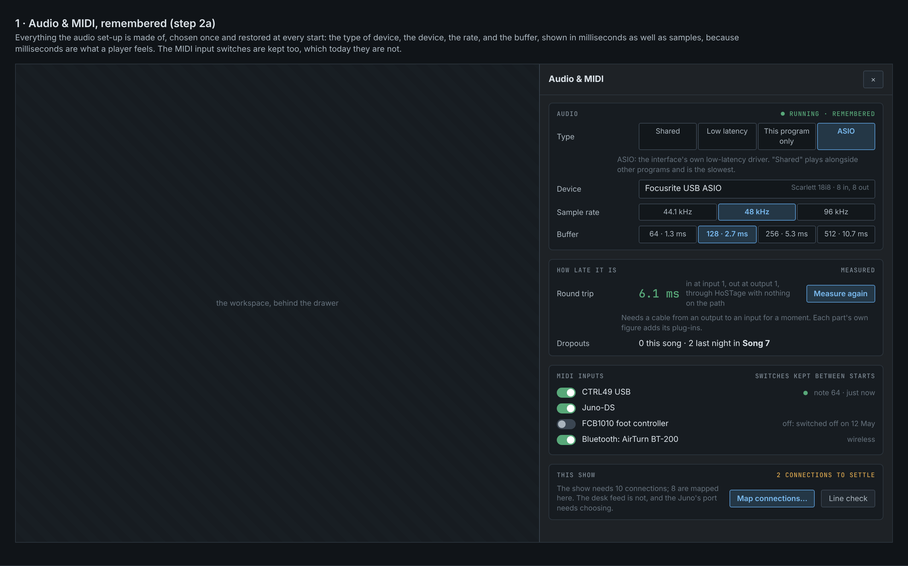
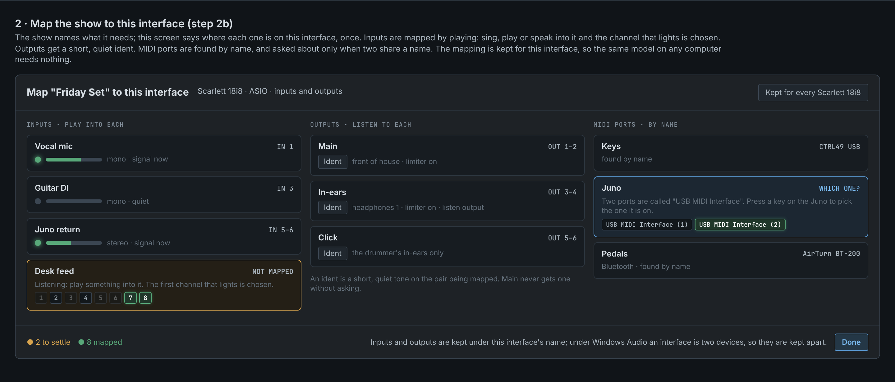
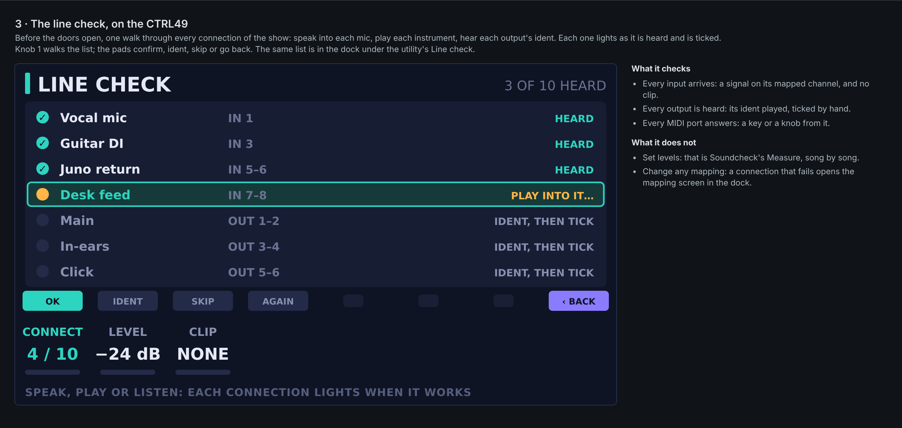

# HoSTage: Audio & MIDI set-up, the show's connections, and the line check

*Design with mockups for the owner to approve, 2026-11-17. Nothing built. It works out steps 2a and
2b of `hostage-wider-not-a-daw.md` ("Step 2: Audio & MIDI") and the line check ("More features",
5), all already decided there; this record decides only how they look and behave. Mockups:
`hostage-audio-setup-mockups.html`, pictures `docs/media/hostage-audio-setup-1.png` to `-3.png`.
When this and the code disagree, the code is right.*

## Why

From the code, as the HoSTage record found it: every start opens the system's default device with
two outputs, in Windows' shared mode, the slowest; the buffer and rate are the device's own; only
the output device can be chosen; the MIDI input switches are forgotten; a hardware synth's MIDI port
is opened by its system id and its audio return is a bare channel number, so a show opened on
another computer loses them. Live inputs (decision 2) cannot work like that.

## 1. Audio & MIDI, remembered (step 2a)

The Utilities drawer's **Audio & MIDI** page, in four parts. Everything in it is saved in the data
folder (a portable player's in its `Data/`) and restored at start; the default device is used only
on a first start, so HoSTage still makes sound out of the box.

- **Audio.** The device **type**, in plain words: *Shared* (plays alongside other programs, the
  slowest), *Low latency*, *This program only*, and *ASIO* (decision 8), with one line saying what
  the chosen one means. They are JUCE's Windows Audio, Windows Audio (Low Latency Mode), Windows
  Audio (Exclusive Mode) and ASIO; on Linux, ALSA and JACK (step 2f). Then the **device**, the
  **sample rate**, and the **buffer**, each choice shown in samples and in milliseconds ("128 ·
  2.7 ms"), because milliseconds are what a player feels.
- **How late it is.** The **round trip**, measured: a cable from an output to an input for a moment,
  a click sent and timed coming back, through HoSTage with nothing on the path. Each input part's
  own figure (the INPUT page) adds its plug-ins. Under it, the **dropouts**, per song (step 2d).
- **MIDI inputs.** Each with its switch, **kept between starts**, and when it was switched off.
  Bluetooth MIDI devices are listed with the rest (decided under "Still more", 2). The last message
  received stays, as now.
- **This show.** How many of its connections are settled on this interface, with **Map
  connections…** and **Line check**.

## 2. The show's connections, mapped once per interface (step 2b)

A show names what it needs (step 2b): its inputs ("Vocal mic", "Desk feed"), its output pairs
("Main", "In-ears", "Click") and its MIDI ports ("Keys", "Juno"). This screen says where each one is
on this interface, once (frame 2).

- **Inputs are mapped by playing.** Sing, play or speak into the one being mapped: its level shows,
  and the first channel that lights is chosen. Channels other connections already use are greyed.
- **Outputs are listened to.** An **ident** is a short, quiet tone on the pair being mapped. Main
  never gets one without asking. Each says what is on it: the limiter (decision 3), and which pair
  is the listen output (decision 10).
- **MIDI ports are found by id, then by name**; when two share a name, the screen asks, and a key
  pressed on the synth picks the port it is on.
- **Kept per interface** (decision 11), under the name the device type reports; under Windows Audio
  an interface's inputs and outputs are two devices and are kept apart. A spare of the same model
  needs nothing; another device type maps once more, and the screen says so.
- **When it opens.** By itself when a show is opened and something is not settled, as the
  missing-plug-in message does now; from **Map connections…** in Audio & MIDI; and from **Map
  inputs…** on an input part. In a player too (a stick player on a new computer must map); not under
  Stage Lock.
- **Old shows** convert as step 2b says: a hardware part's port and return become connections named
  after the part, already mapped to what they held.

## 3. The line check

Before the doors open, one walk through every connection (frame 3): a CTRL49 page, **LINE CHECK**,
and the same list in the dock.

- **Inputs tick themselves**: a signal on the mapped channel, and no clip.
- **Outputs are ticked by hand** after their ident is heard.
- **MIDI ports tick** when a key or a knob arrives from them.
- Knob 1 walks the list; the level and clip of the one being checked are on knobs 2 and 3. Pads:
  OK, ident, skip, again, back.
- **It sets nothing.** Levels are Soundcheck's Measure, song by song; a connection that fails opens
  the mapping screen in the dock.

## What it needs

- **2a**: the device set-up and the MIDI switches saved and restored; the type offered (ASIO built,
  decision 8); the round-trip measurement.
- **2b**: connections in the show's format and a store of mappings per interface; the mapping is a
  pure function of the show's connections, the interface's channels and the saved mappings, so it
  is tested without a device (step 2's tests).
- **The line check**: the page, and an ident tone.
- The commands placed in both lists: mapping allowed in a player, refused under Stage Lock
  (`stageSafeParity.test.js`, `hostagePlayerRole.test.js`).

## Decisions for the owner

1. **The device types in plain words** (Shared, Low latency, This program only, ASIO), with the
   buffer in milliseconds beside the samples?
2. **Mapping by playing**, outputs by a quiet ident, Main never without asking?
3. **The mapping screen opening by itself** when a show is opened with something unsettled?
4. **The line check** as drawn: inputs and MIDI ticking themselves, outputs ticked by hand?
