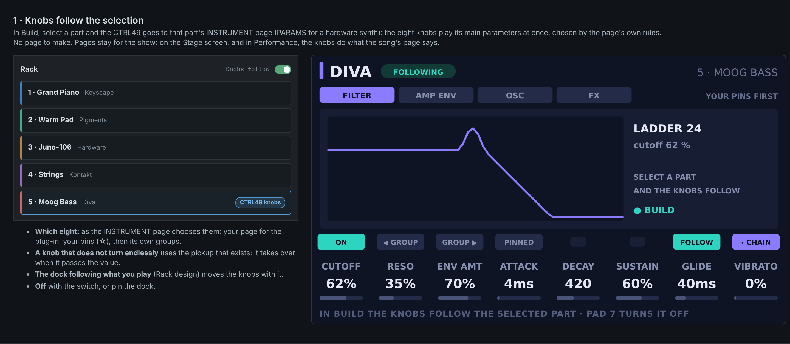
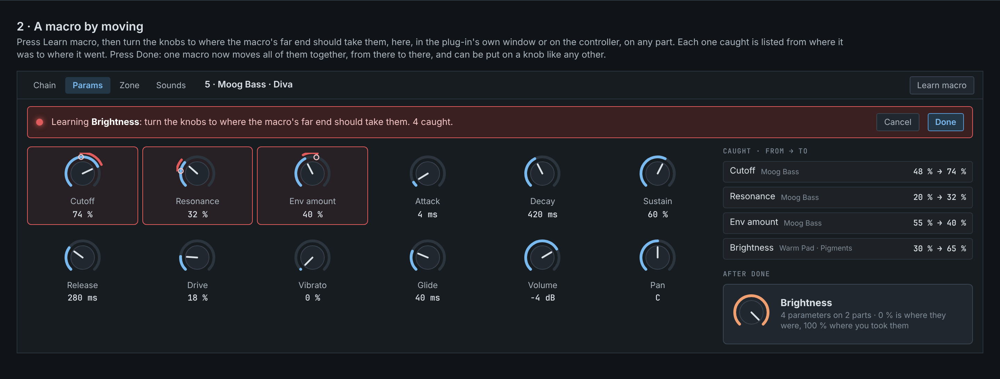
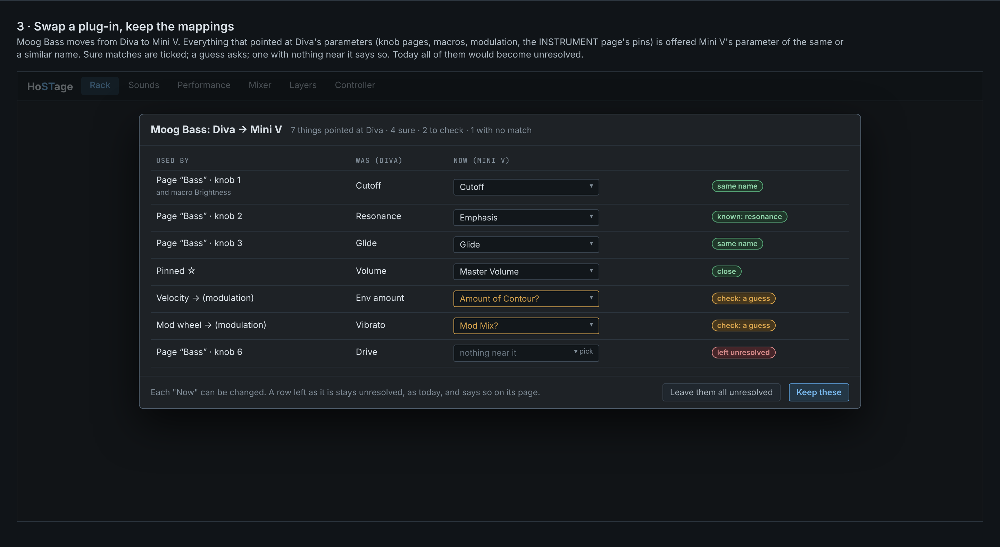
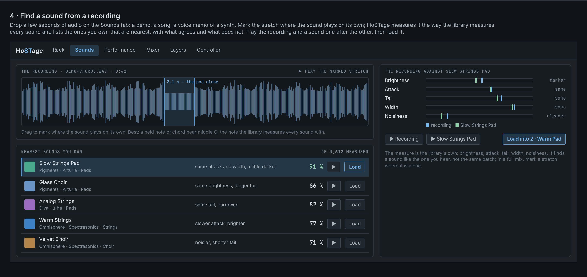

# HoSTage: Build mode, further

*Design with mockups for the owner to approve, 2026-11-17. Nothing built. It draws "Build mode,
further" 1 to 4 from `hostage-wider-not-a-daw.md`, which are taken (5, what each part costs, is in
`hostage-rack-build-design.md`); this record decides only how they look and behave. Mockups:
`hostage-build-further-mockups.html`, pictures `docs/media/hostage-build-further-1.png` to `-4.png`.
When this and the code disagree, the code is right.*

## 1. Knobs follow the selection

**Today** the controller's knobs do what the current control page says, whichever part is selected.

- **In Build, select a part and the CTRL49 goes to its INSTRUMENT page** (PARAMS for a hardware
  synth), the pages the Chain design already drew. The eight knobs play its main parameters at once.
  No page to make, so no new page either: "FOLLOWING" on the title says why it is there.
- **Which eight**: the INSTRUMENT page's own rules: your page for that plug-in, your pins (☆), then
  its own groups.
- **A knob that does not turn endlessly** uses the pickup HoSTage already has
  (`HostPickupIndicator.svelte`): it takes over when it passes the value.
- **With the dock following what you play** (Rack design, section 3), the knobs go with it.
- **Off** with the Rack's "Knobs follow" switch or pad 7 on the page. **Only in Build**: on the
  Stage screen and in Performance the song's pages rule.

## 2. A macro by moving

- **Learn macro** in the dock's Params tab. A red banner says it is learning.
- **Turn the knobs** to where the macro's far end should take them: in the dock, in the plug-in's
  own window, or on the controller; on any part. Each one caught is ringed and listed, from where it
  was to where it went.
- **Done** makes one macro: at 0 % everything is where it was, at 100 % where you took it. It can be
  put on a knob, a page or a modulation source like any macro. **Cancel** puts every caught knob
  back.
- Nothing new underneath: a macro's targets are `ControlBinding`s with a range (`RackModel.h`),
  and from and to are that range.

## 3. Swap a plug-in, keep the mappings

**Today**, when a part's plug-in is replaced, every page knob, macro target and modulation that
pointed at the old one becomes unresolved.

- **When a plug-in is replaced**, one screen lists everything that pointed at the old one (page
  knobs, macro targets, modulation, pins) with what it was and what it would become.
- **Matching, in this order**: the same name; a known other name for the same thing, from a short
  list HoSTage ships (resonance and emphasis, glide and portamento, cutoff and frequency…); a close
  name. The first two are ticked, a close name asks ("check: a guess"), and with nothing near, the
  row says so.
- **Every "Now" can be changed** from the new plug-in's parameter list. **Keep these** applies the
  screen; a row left without a match stays unresolved, as today, and says so on its page.
- **Leave them all unresolved** is today's behaviour, one click away.
- It is one undo step (Build tools design, section 2).

## 4. Find a sound from a recording

- **Drop a few seconds of audio** on the Sounds tab: a demo, a song, a voice memo of a synth.
- **Mark the stretch** where the sound plays on its own. Best is a held note or chord near middle C,
  the note the library measures every sound with (`SonicProbe.h`).
- **HoSTage measures the stretch** the way the library measures every sound: brightness, attack,
  tail, width, noisiness (`SonicProfile` in `Library.h`). Dynamics needs two velocities and cannot
  be had from a recording, so it is left out of the comparison.
- **The nearest sounds you own** are listed with a match and the reason in words ("same attack and
  width, a little darker"), from `sonicDistance` and `sonicDifferences`, which already exist.
- **Play the recording and a sound** one after the other; **Load** puts it on the selected part.
- **What it is not**: it finds a sound *like* the one you hear, not the same patch, and only among
  the sounds already measured. Nothing is sent anywhere.

## What it needs

- **Knobs follow**: the controller's page set from the selection while in Build; the pages exist.
- **A macro by moving**: a learning state that records the first and last value of every parameter
  moved, and makes one macro from them.
- **Swap**: the list of what pointed at a part's plug-in; the name matching with its list of other
  names, a pure function tested without a plug-in.
- **Find from a recording**: the library's measures run on a marked stretch of an audio file
  instead of a render; the comparison exists.

## Decisions for the owner

1. **Knobs follow the selection in Build only**, on the INSTRUMENT page, on by default?
2. **A macro by moving** on any part, from anywhere (dock, plug-in window, controller)?
3. **On a swap**, sure matches applied, guesses asked, the rest left unresolved and said so?
4. **Find a sound** among the sounds you own only, on a stretch you mark?
