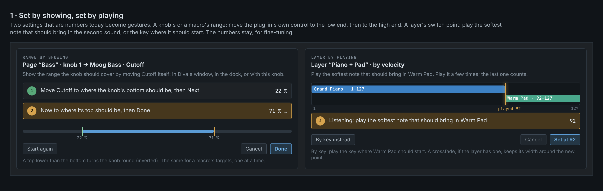
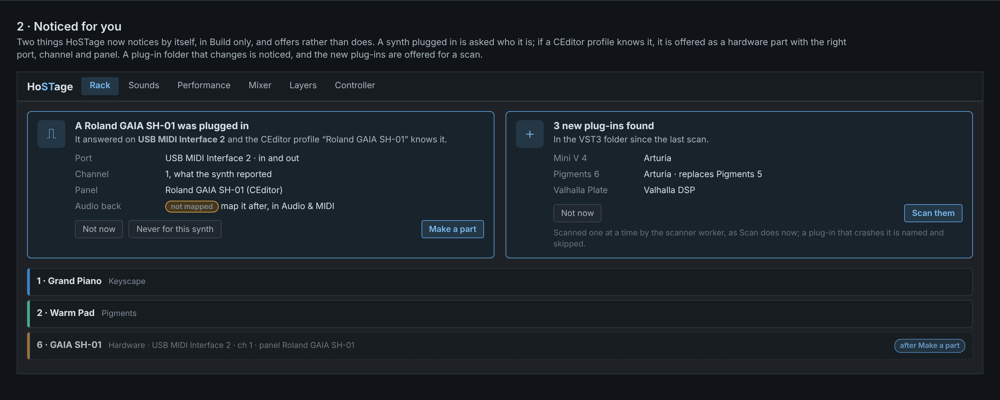
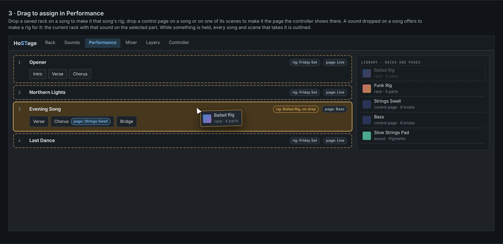
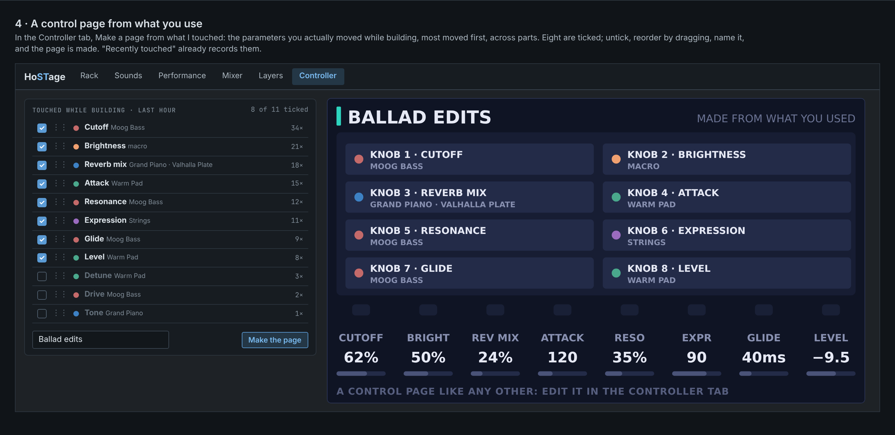

# HoSTage: the smaller Build features

*Design with mockups for the owner to approve, 2026-11-17. Nothing built. It draws the six
smaller Build-mode features the owner took in `hostage-wider-not-a-daw.md`: "Even more ease of use"
3 (ranges by showing), 4 (layers set by playing), 6 (plug in a synth, get a part), 7 (new plug-ins
noticed) and 8 (drag to assign in Performance), and "Build mode" 6 (control pages from what you
use). They are decided; this record decides only how they look and behave. Mockups:
`hostage-build-small-mockups.html`, pictures `docs/media/hostage-build-small-1.png` to `-4.png`.
When this and the code disagree, the code is right.*

## 1. Set by showing, set by playing

**Ranges by showing.** Today a page knob's or a macro target's range is typed as two numbers.

- **Show the range** on a page knob or a macro target: move the plug-in's own control (in its
  window, in the dock, or with the knob itself) to where the bottom should be, **Next**, then to
  where the top should be, **Done**.
- A top lower than the bottom turns the knob round. A macro's targets are shown one at a time.
- It sets the binding's `rangeMin`, `rangeMax` and `inverted` (`ControlBinding`, `RackModel.h`).
  The numbers stay, for fine-tuning.

**Layers set by playing.** Today a layer's switch point is a number on a 0 to 1 range.

- **Set by playing** on a layer member: play the softest note that should bring in the second
  sound; play it a few times, the last one counts; **Set at 92**.
- For a layer by key (**By key instead**), play the key where it should start.
- It sets the member's `minimum` (`LayerMember`); a crossfade keeps its width around the new point.

## 2. Noticed for you

Both are **in Build only** and **offered, never done**: on the Stage screen nothing is asked and
nothing appears.

**Plug in a synth, get a part.** Today HoSTage never asks a synth who it is, though CEditor's
device profiles can recognise the answer (`DeviceProfileEngine::matchIdentityReply`).

- When a new MIDI port appears, HoSTage sends it the standard **identity request** (a short MIDI
  message most synths answer with their maker and model). Only new ports, only once.
- If a profile knows the answer, a card offers **Make a part**: the port, the channel the synth
  reported, and its CEditor panel. The audio coming back is mapped afterwards, in Audio & MIDI
  (Audio & MIDI design, section 2).
- **Not now**, or **Never for this synth**. A synth that does not answer, or that no profile
  knows, is left alone; a hardware part is made by hand, as today.

**New plug-ins noticed.** Today plug-ins are scanned only when Scan is pressed.

- HoSTage watches the plug-in folders. When one changes, a card says what is new ("3 new plug-ins
  found") and, where it can tell, what a new one replaces ("replaces Pigments 5").
- **Scan them** runs the scanner worker on just those, as Scan does now: one at a time, and a
  plug-in that crashes it is named and skipped. **Not now** waits for the next change.

## 3. Drag to assign in Performance

Today a song's rig and a song's or a scene's control page are chosen from lists.

| Dropped | On a song | On a scene |
| --- | --- | --- |
| A saved rack | becomes the song's rig (`rackRecordId`) | — |
| A control page | becomes the song's page (`pageId`) | becomes the scene's page (`Scene.pageId`) |
| A sound | offers to make a rig for the song: the current rack with that sound on the selected part | — |

- While something is held, every song and scene that takes it is outlined; the one under the
  pointer fills and says what will happen.
- One undo step each (Build tools design, section 2).

## 4. A control page from what you use

- **Make a page from what I touched**, in the Controller tab: the parameters you moved while
  building, from the "Recently touched" record that exists (`HostSurfacePanel.svelte`), most moved
  first, across parts and macros.
- The first eight are ticked. Untick, reorder by dragging, name it, **Make the page**.
- The result is an ordinary control page: it can be edited, put on a song or scene (section 3),
  and played on the CTRL49.

## What it needs

- **Showing and playing**: a two-step capture of a parameter's value, and of a note's velocity or
  key, writing fields that exist.
- **The synth**: the identity request sent on a new port, and the profiles' match brought into the
  host.
- **New plug-ins**: a watch on the plug-in folders on the native side, and the scanner told to scan
  only the new ones.
- **Performance**: drop targets on songs and scenes, writing fields that exist.
- **A page from what you touched**: a count kept with "Recently touched", and a page made from
  the ticked list.

## Decisions for the owner

1. **Range by showing** (bottom, then top; a lower top inverts) and **layer switch by playing**
   (the last note counts), as drawn?
2. **A synth plugged in is asked who it is**, in Build only, on new ports only, and offered as a
   part?
3. **New plug-ins noticed** and offered for a scan, in Build only?
4. **Drag to assign in Performance**, and **a page from what you touched**, as drawn?
