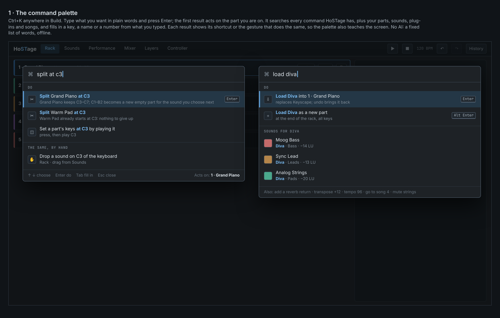
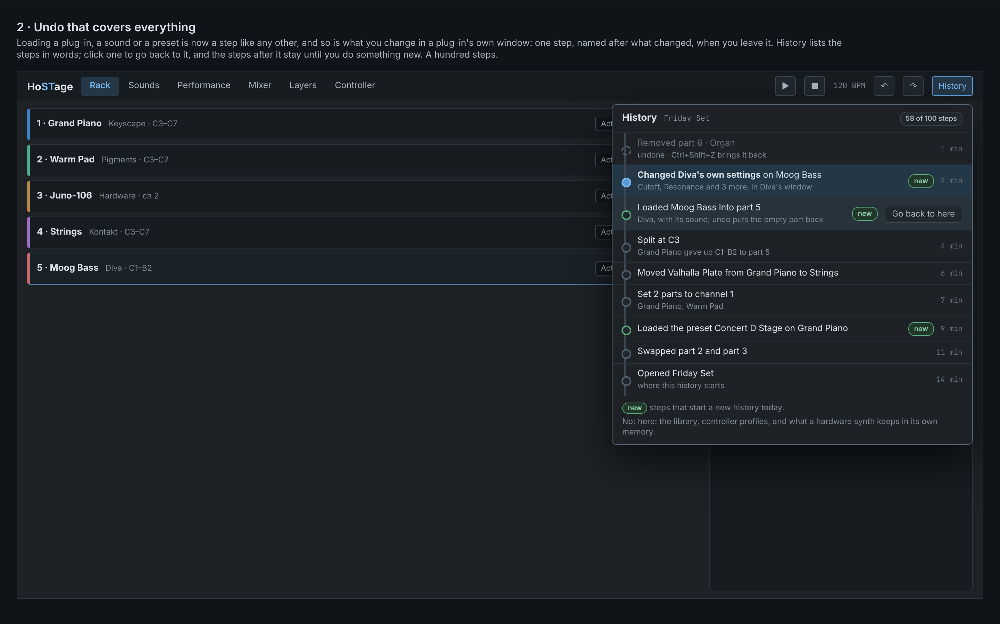
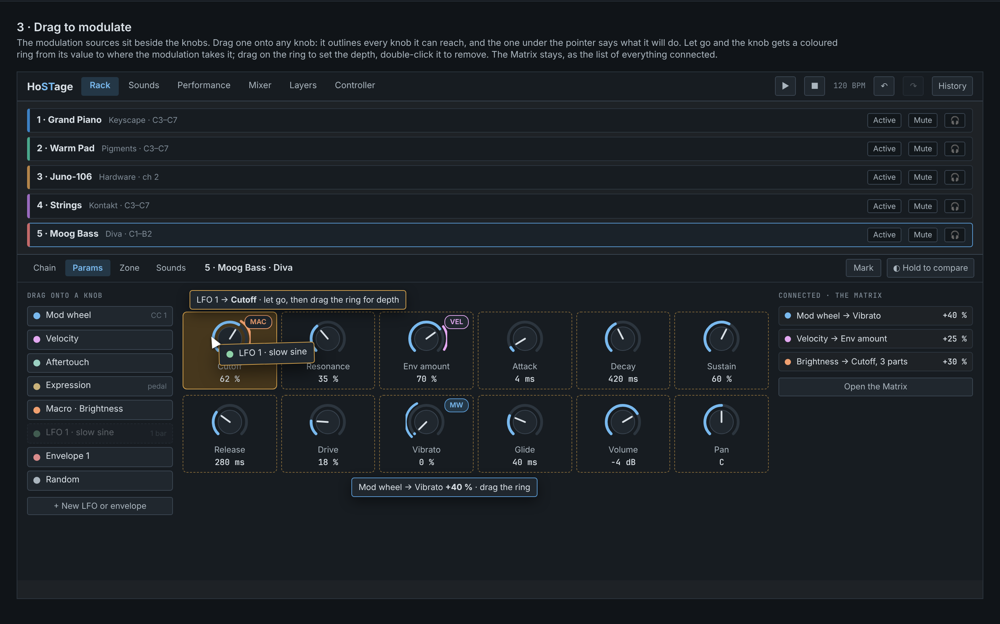
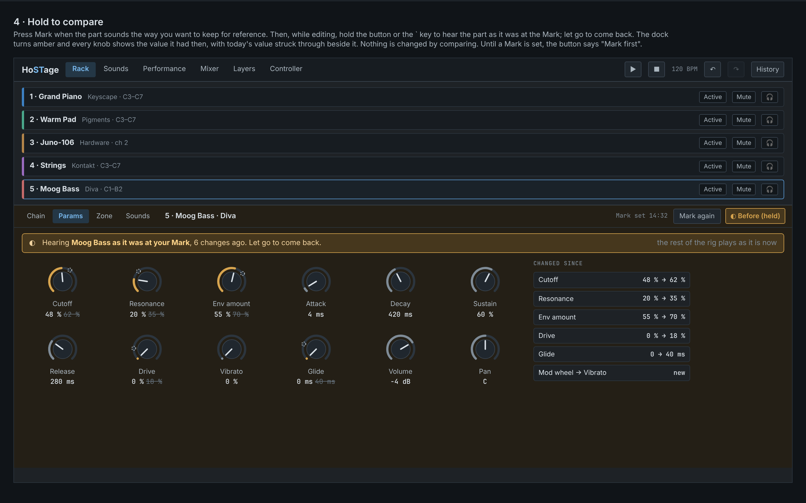

# HoSTage: Build-mode tools

*Design with mockups, approved by the owner on 2026-11-17 with one change: "before" in hold to
compare is only ever the Mark you set (decision 4). Nothing built. It draws four features
the owner took in `hostage-wider-not-a-daw.md`: the command palette ("Build mode", 7), undo that
covers everything ("Build mode", 1), drag to modulate and hold to compare ("Even more ease of use",
2 and 5). They are decided; this record decides only how they look and behave. Mockups:
`hostage-build-tools-mockups.html`, pictures `docs/media/hostage-build-tools-1.png` to `-4.png`.
When this and the code disagree, the code is right.*

## 1. The command palette

- **Ctrl+K** anywhere in Build. Type what you want in plain words; Enter does the first result.
- **It acts on the part you are on**, or on the parts selected (Rack design, section 2). The
  palette's foot says which.
- **What it searches**: every command HoSTage has, plus your parts, sounds, plug-ins and songs. A
  command can take one value from what was typed: a key ("split at C3"), a name ("load Diva"), a
  number ("transpose +12", "tempo 96").
- **No AI.** A fixed list of words and a few synonyms ("split" or "divide"), so it works offline
  and does the same thing every time.
- **It teaches the screen.** Each result shows its shortcut, or the gesture that does the same
  ("drop a sound on C3 of the keyboard").
- With an empty box, the commands used last come first.
- **Under Stage Lock** it offers only what Stage Lock allows, from the same list
  (`stageSafeParity.test.js`).

## 2. Undo that covers everything

**Today** (`host-edit-history.md`): 20 steps; loading a plug-in, a sound or a preset starts a new
history, so it cannot be undone; changes made in a plug-in's own window are never undone.

**New:**

- **Loading is a step.** Loading a plug-in, a sound or a preset keeps what was there with the step,
  so undo puts it back.
- **A plug-in's own window is a step**, one per visit: when you close the window or move to another
  part, HoSTage compares the plug-in's state with the last step and, if it differs, adds one step
  named after the parameters that changed ("Cutoff, Resonance and 3 more").
- **A hundred steps**, fewer when plug-in states are large; memory is the limit, as now.
- **History**, beside Undo and Redo, lists the steps in words, newest first. Click one to go back
  to it; the steps after it stay, for redo, until you do something new.
- **As today**: undo needs the transport stopped; it does not reach the library, controller
  profiles, or what a hardware synth keeps in its own memory.
- Once this is built, dropping onto a part to replace its instrument stops asking first (Rack
  design, decision 3).

## 3. Drag to modulate

- **The sources sit beside the knobs** in the dock's Params tab: mod wheel, velocity, aftertouch,
  expression, the macros, the LFOs and envelopes, random. "+ New LFO or envelope" makes one.
- **Drag one onto any knob.** Every knob it can reach is outlined; the one under the pointer says
  what will happen. The same works on the Chain pages' knobs and on mixer strips.
- **Let go**, and the knob gets a coloured ring from its value to where the modulation takes it,
  and a badge naming the source (MW, VEL, MAC). A new connection starts at 25 %.
- **Drag on the ring** to set the depth; below the knob's value inverts it. **Double-click** the
  ring to remove it. Several sources on one knob stack their rings outward.
- **The Matrix stays**, as the list of everything connected, beside the knobs.
- Nothing new underneath: each connection is a `ModulationRoute` (`RackModel.h`), as the Matrix
  makes now.

## 4. Hold to compare

- **Mark first.** Press **Mark** in the dock when the part sounds the way you want to keep for
  reference. "Before" is only ever that Mark (decision 4): selecting a part sets nothing. Each part
  keeps its own Mark until you press **Mark again**, for as long as the show is open. Until a part
  has one, the compare button says "Mark first".
- **Hold** the "◐ Hold to compare" button, or the ` key, and you hear the part as it was at the
  Mark. **Let go** to come back.
- **While held**, the dock turns amber; every knob shows its value then, with today's struck
  through; "Changed since" lists what differs. Only this part changes; the rest of the rig plays as
  it is now.
- **Comparing changes nothing** and adds no step.
- **If the part's plug-in was replaced** since then, compare is off: that is undo's job.
- Some plug-ins take a moment to take on another state; the banner says "loading…" until it has.

## What it needs

- **The palette**: one list of commands with their words, shortcut, gesture and Stage Lock rule,
  which the palette, the shortcuts and Stage Lock all read; a parser for a command and its value,
  tested without a screen.
- **Undo**: the plug-in's state kept with a loading step; a state comparison when a plug-in's
  window closes; the step limit by memory; the History list.
- **Drag to modulate**: the sources as drag sources, every knob as a drop target, and the ring.
- **Hold to compare**: a snapshot of the part when it is marked, swapped in and out without a
  history step.

## Decisions (owner, 2026-11-17)

1. **The palette**: Ctrl+K, a fixed list of words (no AI), acting on the part you are on. **Yes.**
2. **A plug-in's own window as one undo step** per visit, and a hundred steps. **Yes.**
3. **Modulation depth by dragging the ring**, double-click to remove, new connections at 25 %.
   **Yes.**
4. **What "before" is.** Proposed: when you selected the part, or Mark. **Taken: the Mark only**
   ("when you selected the mark"). Selecting a part sets nothing; until a part is marked, there is
   nothing to compare with. Held with the button or the ` key, as proposed.
