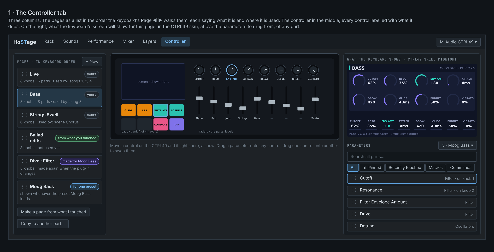
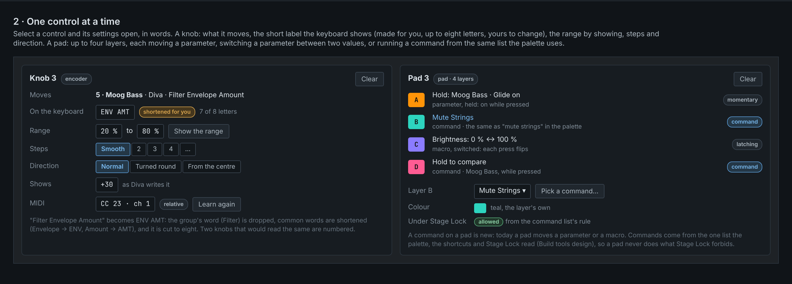
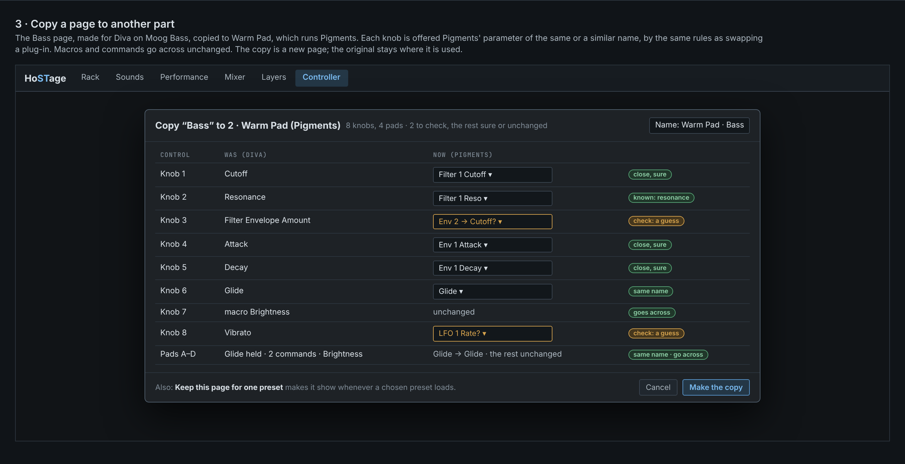

# HoSTage: the Controller tab

*Design with mockups, approved by the owner on 2026-11-17 ("Yes, all 4 of them"). Nothing built. The
owner chose the Controller tab, where control pages are made, as the next Build screen. Mockups:
`hostage-controller-mockups.html`, pictures `docs/media/hostage-controller-1.png` to `-3.png`. When
this and the code disagree, the code is right.*

## What it is for, in short

A **control page** says what each knob, fader and pad on the controller does: "Bass" might put the
bass synth's cutoff on knob 1 and "mute the strings" on pad 3. The CTRL49 holds several pages,
stepped through with Page ◀ ▶, and a song or scene can call up its own. The Controller tab is where
pages are made and changed. It exists; this design fixes four things that are awkward in it today:
you cannot see your pages or where they are used, you cannot see what the keyboard's screen will
show, a pad cannot do an action, and giving another synth the same layout means starting over.

## What is there today

The tab already does most of the hard work (`HostSurfacePanel.svelte`; the model is `ControlPage`,
`ControlSlot` and `ControlBinding` in `RackModel.h`):

- a drawing of the chosen controller, from its profile, a region at a time or whole;
- one page shown at a time, picked from a drop-down, renamed or removed there;
- the focused instrument's parameters (all, favourites, recently touched) and the macros, dragged
  onto a control or selected and assigned;
- an assignment's settings: its range, inverted or from the centre, stepped, a pad that latches,
  a label of your own; MIDI learn with pickup and relative encoders;
- pads with up to four layers, each with its own colour, and the faders' layers;
- pages made automatically for a part's plug-in, and pages that show whenever one preset loads.

The CTRL49 shows a page as its eight-knob screen, each knob's label and value
(`Hostage_MultiKnob.lua`).

What is missing is mostly seeing: which pages there are and where they are used, what the keyboard
will show, and what a setting means. And two things a page cannot do yet: a pad that runs a
command, and a page copied to another part.

## 1. The tab

- **The pages as a list**, not a drop-down, in the order the keyboard's Page ◀ ▶ walks them; drag
  to change the order. Each says what it is (**yours**, **from what you touched**, **made for** a
  part, **for one preset**) and **where it is used**: which songs and scenes show it
  (`SetlistItem.pageId`, `Scene.pageId`).
- **The controller** in the middle, as now, with every control labelled with what it does. Moving
  a control on the hardware lights it, as now. **Drag one control onto another** to swap them.
- **What the keyboard shows**: the page drawn as the CTRL49's screen will show it, in the CTRL49
  skin, changing as you assign. A label too long for the keyboard is seen here first.
- **Parameters from any part**, not only the focused one: a part picker and a search across all
  parts. Filters: all, pinned, recently touched, macros, and **commands** (section 2).
- **Make a page from what I touched** (smaller Build features design, section 4) and **Copy to
  another part** (section 3) sit under the list.

## 2. One control at a time

**A knob** says, in words: what it moves (part, plug-in, parameter); the label the keyboard shows;
its range, with **Show the range** (smaller Build features design, section 1); its steps; its
direction (**normal**, **turned round**, **from the centre**: today's inverted and bipolar); how its
value is written; its MIDI.

**Short labels, made for you.** The keyboard shows eight letters a knob. HoSTage makes the label
from the parameter's name: the group's word is dropped ("Filter"), common words are shortened from
a short list (Envelope to ENV, Amount to AMT, Resonance to RESO, Frequency to FREQ), it is cut to
eight, and two knobs that would read the same are numbered. The label says it was shortened, and
is yours to change (`ControlBinding.label`, which exists).

**A pad** shows its four layers at once, each with its colour and what it does:

- **a parameter**, held (momentary) or switched (latching), as today;
- **a macro**, the same way, as today;
- **a command**, new: anything in the one list of commands the palette, the shortcuts and Stage
  Lock read (Build tools design, section 1): mute a part, a scene, tap tempo, hold to compare.
  A command on a pad obeys the same Stage Lock rule it has everywhere, and the pad says so.

## 3. Copy a page to another part

- **Copy to another part**: each knob that moved the old part's plug-in is offered the new
  plug-in's parameter of the same or a similar name, by the same rules as swapping a plug-in
  (Build mode, further, section 3): same name and known other names are sure, a close name asks,
  nothing near leaves the knob empty and says so.
- **Macros and commands go across unchanged**; a parameter on a pad is matched like a knob.
- **The copy is a new page**, named after the part; the original stays where it is used. It can be
  kept for one preset instead, as pages already can be.
- One undo step (Build tools design, section 2).

## What it needs

- **The page list**: the pages' order as the order Page ◀ ▶ walks; "used by" read from the songs
  and scenes.
- **The keyboard's screen in the tab**: the page drawn in the web UI the way the CTRL49 draws it,
  with the CTRL49 skin's colours, the same drawing the dock uses.
- **Short labels**: a pure function from a parameter's name, its group and the page's other labels
  to eight letters, tested without a plug-in.
- **Commands on pads**: a slot that names a command instead of a parameter, and the command list's
  Stage Lock rule checked when it runs.
- **Copy**: the swap's matching (Build mode, further) run over a page instead of a part.

## Decisions (owner, 2026-11-17: "Yes, all 4 of them")

1. **The pages as an ordered list**, each saying what it is and where it is used, with the
   keyboard's screen shown beside the controller. **Yes.**
2. **Short labels made for you**, up to eight letters, yours to change. **Yes.**
3. **A pad can run a command** from the command list, obeying Stage Lock. **Yes.**
4. **Copy a page to another part**, matched by the swap rules. **Yes.**
