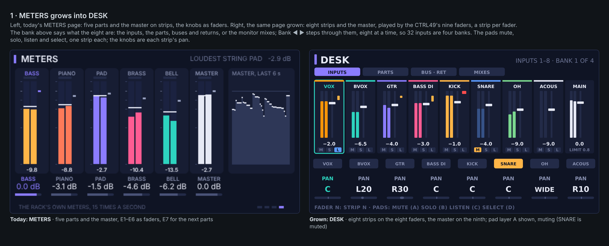
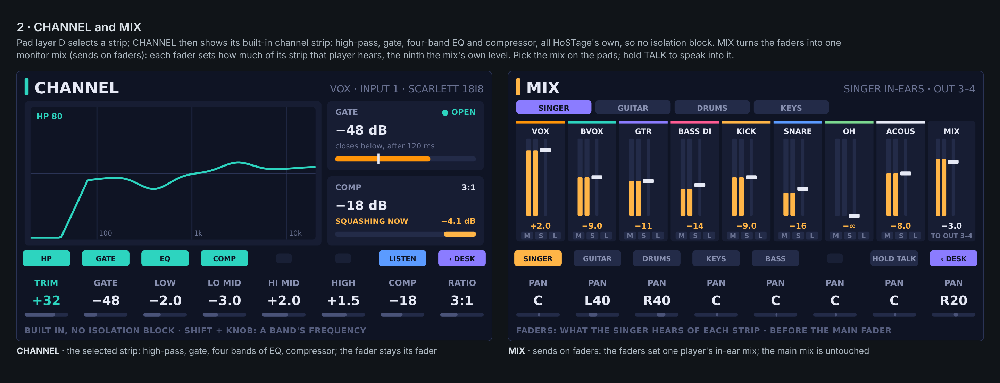
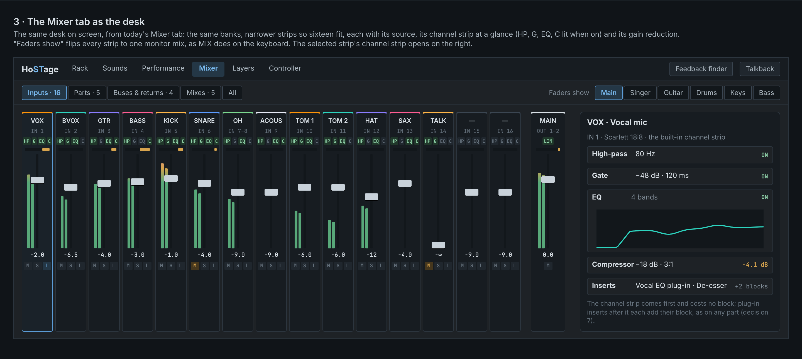

# HoSTage: the mixing desk

*Design with mockups for the owner to approve, 2026-11-18. Nothing built. It works out decision 9
of `hostage-wider-not-a-daw.md` ("HoSTage becomes a mixing desk, as a future improvement") on the
owner's instruction: "We already have a meters page that has the groundwork to become the mixing
desk. Build upon it." Mockups: `hostage-desk-mockups.html`, pictures `docs/media/hostage-desk-1.png`
to `-3.png`. When this and the code disagree, the code is right.*

## What it is for

The band plugs every microphone and instrument into HoSTage's audio interface. HoSTage mixes them:
the main mix to the PA, and a mix of its own for each player's in-ears. It is still a future
improvement: it comes after the planned work, because it needs the live inputs, the output pairs
and the monitor mixes that work builds (decision 9).

## What it is built on

- **The CTRL49's METERS page** (`tools/ctrl49/README.md`, "The stage pages"): five parts and the
  master on strips, each part's level after its inserts and fader, peak hold, clip lamp, the fader
  in decibels, muted parts, the master's last six seconds; knobs 1 to 5 as the parts' faders, knob 6
  the master, knob 7 the next five parts.
- **The Mixer tab** (`HostMixerPanel.svelte`): strips side by side for the parts, buses, returns
  and the master, with pan, sends, mute, solo, on, the destination, the output pair, meters with
  peaks, and the processor load. Every control sends the same command the part rows send.
- **The fader layers** a control page already has (`ControlPage::faderLayers`), switched all
  together: the banks below are those layers.

## 1. METERS grows into DESK

- **Eight strips and the master, on the CTRL49's nine faders**: fader N is strip N, the ninth the
  master. METERS used knobs as faders because it showed parts only; a desk wants real faders.
- **Banks**: what the eight strips are: **inputs**, **parts**, **buses and returns**, or the
  **monitor mixes**. Bank ◀ ▶ steps eight at a time, so 32 inputs are four banks (decision 9, 2).
  With no live inputs the parts bank is today's METERS, with three more strips.
- **Each strip**: its name, its meter, its fader, the clip lamp, how much its compressor is taking
  off, and M, S, L (mute, solo, listen; decision 10).
- **Pads**, one strip each, on four layers: **A mute**, **B solo**, **C listen**, **D select**
  (selecting opens CHANNEL for that strip).
- **Knobs**: each strip's pan.
- To fit eight strips it gives up the master's six-second history; it shows when MAIN is selected.

## 2. CHANNEL and MIX

**CHANNEL**: the selected strip's **built-in channel strip** (decision 9, 1), in this order: trim,
high-pass, gate, a four-band EQ, a compressor. It is HoSTage's own, so it needs no isolation block;
plug-in inserts come after it and each adds its block, as on any part (decision 7). Knobs: trim,
gate, the four bands, the compressor's threshold and ratio; Shift and a band's knob moves its
frequency. Pads: each section on or off, listen, back to DESK. The strip's fader stays its fader.

**MIX**: **sends on faders** for one player's in-ears (decision 9, 3). The eight faders now set how
much of each strip that player hears; the ninth is the mix's own level, out to its pair with the
limiter on it (decision 3). The sends are taken **before** the main fader, as step 2c builds monitor
mixes, so turning down the PA does not change anyone's ears. Pads pick the mix; **hold TALK** to
speak into it (decision 9, 4). Knobs: each strip's pan in that mix.

## 3. The Mixer tab as the desk

- **The same banks** as on the keyboard, and **All**.
- **Narrower strips**, so sixteen fit on a screen and 32 scroll: each with its source (IN 1), its
  channel strip at a glance (HP, G, EQ, C lit when on), how much its compressor takes off, meter,
  fader, M S L.
- **Faders show**: Main, or one monitor mix, flipping every strip's fader to that mix's sends, as
  MIX does on the keyboard.
- **The selected strip's channel strip** on the right, with its EQ drawn, and the plug-in inserts
  after it with their cost in blocks.
- **Feedback finder** and **talkback** in the header (decision 9, 4). The feedback finder listens to
  a mix, names the frequency that rings and offers a notch on that mix; its own page is drawn when
  it is built.

## Not in this design

Reliability for the whole band (decision 9, 5): the spare machine (direction 6) and a lost interface
(step 2d) are their own work. Which knob, fader and pad does what on these pages is checked against
everything else the keyboard does when they are built, as for every page (Chain design, audio
effects, "Which knob does which is left open").

## What it needs

- **The live inputs, output pairs and monitor mixes** of the order of work (Stage 2 to 5) first.
- **The channel strip**: high-pass, gate, four-band EQ and compressor as built-ins, the largest new
  piece; on every input, run in the audio thread, no worker.
- **Sends taken before the fader**, which today's sends are not (the part's effects are pre-fader,
  its sends are not); step 2c needs them anyway.
- **DESK**: today's METERS payload grown to eight strips with their state, the banks as fader
  layers, the pads' four layers.
- **Talkback**: an input heard only in the mixes while TALK is held.
- **The Mixer tab**: compact strips, the banks, "Faders show", the channel strip panel.

## Decisions for the owner

1. **METERS becomes DESK**: eight strips and the master on the nine faders, the four banks, pads
   for mute, solo, listen and select, knobs for pan?
2. **CHANNEL**: the built-in channel strip in this order (trim, high-pass, gate, EQ, compressor),
   before any plug-in inserts?
3. **MIX**: sends on faders for each player's in-ears, taken before the main fader, with talkback
   held on a pad?
4. **The Mixer tab** with the same banks, "Faders show", and the channel strip beside it?
