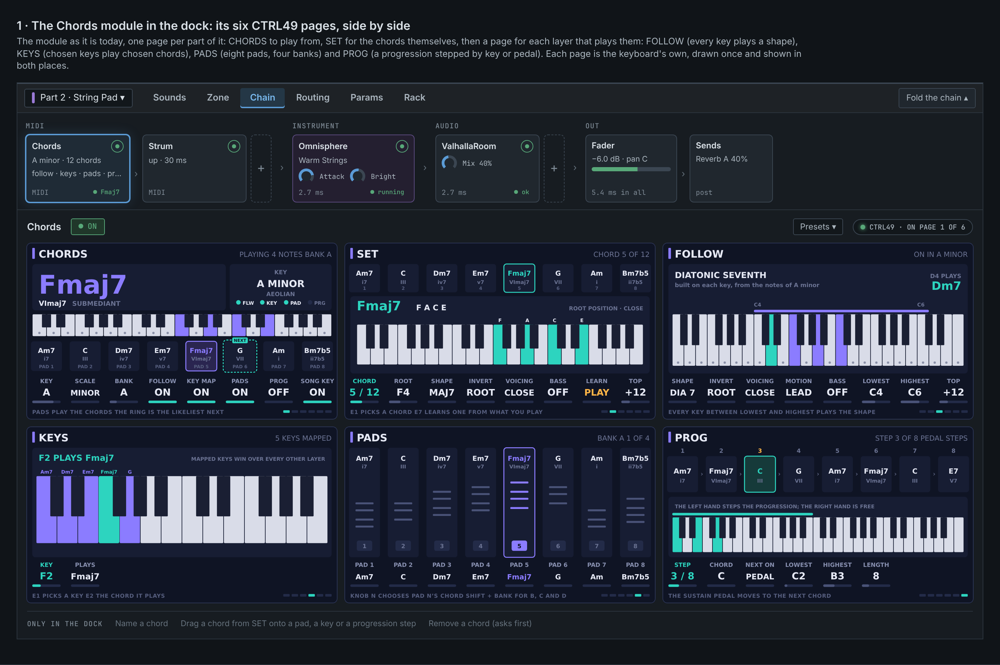
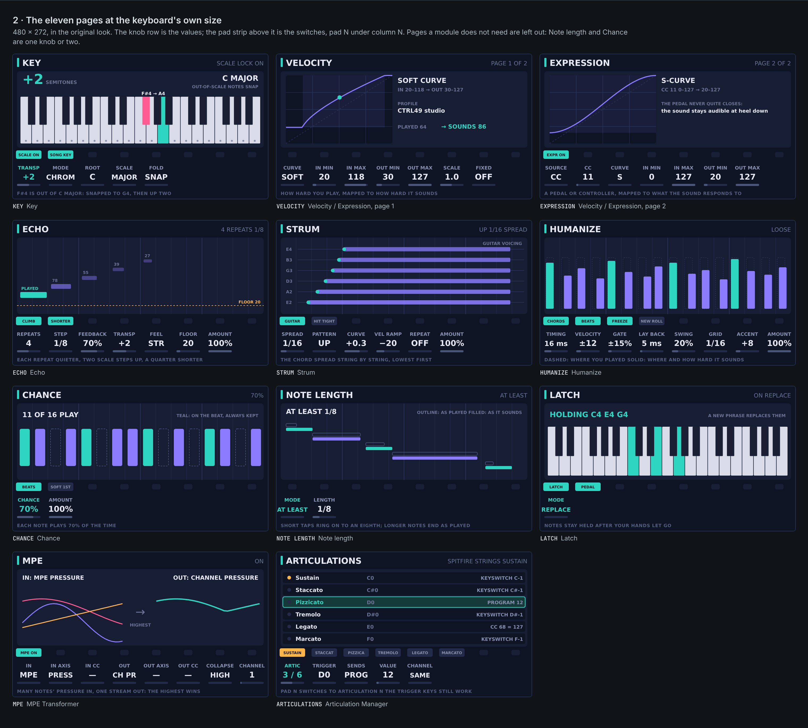
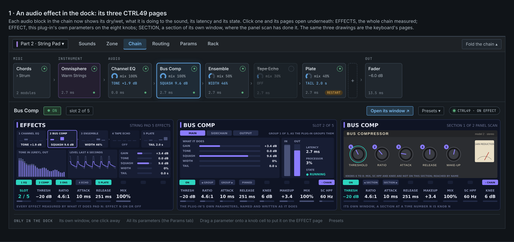

# HoSTage dock: the Chain tab, the arpeggiator and the step sequencer

*Design with mockups, **approved by the owner on 2026-11-17** ("Approved.."). Nothing built. It works out "a better
effects screen in the dock" (`hostage-wider-not-a-daw.md`, Effects, 8), taken on 2026-11-16,
starting with the arpeggiator, as the owner asked. Mockups: `hostage-dock-chain-mockups.html`, and
the same four frames as pictures in `docs/media/hostage-dock-chain-1.png` to `-4.png`. When this
and the code disagree, the code is right.*

## Why, and what the owner decided along the way

The owner: the dock's effects screens "could be improved a lot". Today a part's effects are spread
over two tabs, and the arpeggiator's editor does not match the CTRL49 pages designed for it. Three
decisions, all 2026-11-17, shaped the rest:

1. **Two modules.** "This the step sequencer.. I also want a fully fledged arpeggiater which we had
   designs for in the skin sets." Today's one Arpeggiator module becomes an **Arpeggiator** and a
   **Step sequencer**.
2. **Almost identical on the dock and the CTRL49.** "They should have almost identical Gui's."
3. **The skin applies to both, and can be just a colour change.** "The whole idea of a skin is that
   it also applies to the arpeggiater and step sequencer.. but that could be just a "color"
   change." Proven here on the original CTRL49 look only: "there are fourteen skin sets, they can be
   done later. Just a proof of concept on the original ctrl49 set."

## What is there today

- **The MIDI tab** lists a part's MIDI modules (up to eight): a grip to reorder, ▲▼, Byp, presets,
  and each module's editor (`MidiChainPanel.svelte`, `sections/midiModules/`).
- **The Inserts tab** lists the audio effects: reorder, Byp, Editor (the plug-in's window), P (its
  parameters), remove (`InstrumentHostView.svelte`).
- **One Arpeggiator module** does both jobs (`ArpEngine.h`, settings `ArpSettings` in
  `PatternModel.h`, editor `midiModules/ArpEditor.svelte`). Seven modes walk the held keys (up,
  down, up-down, down-up, as played, random, chord); **Drawn** gives every step a note, which is the
  step sequencer. Rate in steps per beat with a straight, triplet or dotted feel; octaves 1 to 4;
  gate; swing; latch; scale lock. A step lane of up to 32 steps with velocity (0 is a rest), tie,
  ratchet ×1 to ×4, octave −2 to +2 and chance. The playhead is the engine's own step.
- **CTRL49 designs** for both:
  - **The Live page**, a real HoSTage page (`tools/ctrl49/README.md`, "The stage pages"): sixteen
    steps over the zones and the keys, eight knobs, the pads turning steps on and off. Its layout is
    the step sequencer's first page.
  - **The six-page arpeggiator** (commit `5d72504`, "a full arpeggiator on six pages", in the
    Rhythm Box 1980 look, since removed from the tree; its pictures are restored as
    `docs/media/hostage-arp-ctrl49-*.png`): PLAY, MOTION, STEPS, VELOCITY, OCTAVE, CHANCE. Its
    layout is the arpeggiator's.
  - **The era designs' Arp Edit page** (`tools/ctrl49/screen-lab/era-presets`): a piano roll of
    sixteen steps. Its layout is the step sequencer's second page.
  - **The original look**, Midnight 2020 (`make_era_designs.py`, class `Midnight`): navy
    background, navy cards, teal, violet, pink and amber.

## One Chain tab

The MIDI and Inserts tabs become one **Chain** tab. Zone, Routing, Params and the rest stay.

At the top, the **chain strip**: the part in signal order, as blocks, grouped MIDI, Instrument,
Audio and Out (fader and sends). Each block shows:

- its name and an on/off switch (bypass);
- a line saying what it is set to (the arpeggiator's mode, rate and octaves);
- for audio blocks, dry/wet and one or two main knobs (Effects, 1);
- its latency, and its state: running, restarting (amber), failed.

Click a block and its editor opens underneath. A **+** at the end of the MIDI and Audio groups adds
one. Dragging to reorder and between parts, and trying a module before adding it, work here (More
ease of use, 1, 2 and 5). **Fold the chain** shrinks the strip to one line of names when an editor
needs the room (frames 2 and 3).

## The same picture on both screens

The proof of concept is in how the mockups are made: **each CTRL49 page is drawn once, at the
keyboard's 480 × 272, and the dock shows that same drawing scaled.** Frame 4 is the pages at the
keyboard's own size; frames 1 and 2 are the same pages in the dock.

- **The CTRL49 page is the master.** Its screen is the stricter one: eight knobs, and text the
  tightest budget (`tools/ctrl49/screen-lab/feature-mockups/README.md` measured it). A layout that
  works there is drawn larger in the dock, not the other way round.
- **The keyboard shows one page at a time** (Page ◀ ▶); **the dock shows them all**, and the mouse
  works on them: drag a bar, click a step, scrub a cell.
- **Knob N is cell N** on every page, and on the pattern pages also step N.
- **One layout, coloured by the skin**, on the keyboard and in the dock. The mockups use the
  original look only; the other skins come later. Colour is cheap on the keyboard: its pages draw
  colour as rectangles and as grey sprites it tints as it draws (`tint.png`, "The sound's colour"
  in the feature mockups' README). The owner's Linux branch already recolours the Meters, Cue and
  Browse pages; these pages should use the same mechanism. It is not on `main`, so it is not
  described here.
- **Labels short enough for the keyboard**, so the two screens say the same words.

## The arpeggiator: six pages

The Rhythm Box design's six pages, in the original look (frame 1, and frame 4 at size):

- **PLAY**: the keyboard with the held chord lit and the sounding note in teal; NOW (the note, its
  velocity, its step type, the place in the pattern); and a roll of the next sixteen steps,
  combining every lane. Height is pitch, thickness velocity, width gate. A tie joins its neighbour,
  a ratchet splits its step; accents are pink, chord steps white, and a step its chance left out is
  a dashed ghost. Knobs: mode, rate, octaves, gate, swing, tempo, **latch**, **scale lock**. In the
  Rhythm Box design knobs 7 and 8 chose a chord and a root to stand in for held keys; in HoSTage
  the held keys do that, so those knobs are free.
- **MOTION**: the walk as a contour of thirty-two notes, with a mark where the cycle starts again.
  Knobs: octave order, repeat, transpose, inversion, length, accent, random, reset.
- **STEPS, VELOCITY, OCTAVE, CHANCE**: the pattern, one lane per page, eight columns over the eight
  knobs, so knob N sets step N. Type is rest, note, accent, tie, ×2, ×3, ×4 or chord, each drawn
  and coloured its own way; velocity shows the accent's amount on top; octave is −2 to +2; chance
  is a column of dots. The pads turn steps on and off.

**Only in the dock**: a pattern longer than eight steps (up to 32, the engine's limit; the keyboard
shows eight at a time), patterns, and dragging across several steps at once.

### NOTES mode: the notes you place yourself

**Decided, 2026-11-17.** The owner: "the arpeggiater should also be assignable instead of just the
up/down etc modes.. all the keys to the left to see the range of the keyboard." So besides the
twelve walks there is a thirteenth mode, **NOTES** (frame 2):

- **Each step's note is set by hand** on a piano roll, with the whole keyboard on its side down the
  left, as on the era designs' Arp Edit page. Knob 2 sets the selected step's note; knob 3 scrolls
  the roll through the keyboard's whole range. A note outside the view is marked at the top or
  bottom edge of its step.
- **It still plays like an arpeggiator.** The key you hold moves the pattern from its **root**
  (knob 5), so one finger transposes it (**follow: key**). The pattern pages still apply: a step's
  type (accent, tie, ratchet, chord, rest), velocity, octave and chance.
- **The NOTES page takes MOTION's place as page 2** in this mode, because octave order, repeat,
  inversion and random shape a walk, and NOTES mode has none. So the arpeggiator has six pages in
  every mode.
- **PLAY** says NOTES as its mode, and its roll and NOW show the placed notes.
- **The sounding note is lit** on the side keyboard as well as on PLAY's.

The engine needs, for this: per-step notes over the whole MIDI range rather than today's free rows
(one octave either side of the lowest key held, `ArpEngine.h`, Drawn mode), a root, and follow.

### What the engine needs for it

What the six pages ask for and `ArpSettings` does not have yet:

- **Modes**: up+down (the ends played twice), converge, diverge, pinky (every note answered by the
  top one) and thumb (by the bottom one). With today's seven walk modes, twelve.
- **Octave order**: up, down, up-down, or interleaved (each note through every octave first).
- **Repeat**: each note of the walk played 1 to 4 times.
- **Transpose** ±12 and **inversion** (the chord's lowest notes lifted an octave), inside the arp.
- **Accent**, as a step type with an amount added to the velocity, and **chord** as a step type
  (every held note at once).
- **Random**: a share of the walk's notes swapped for others from it.
- **Reset**: the walk and the pattern restart every 1, 2 or 4 bars.
- **The walk moves on only on note, accent and ratchet steps**, so rests, ties and chord steps
  leave it where it was, and a pattern drifts against the walk as on a hardware arpeggiator. Check
  what today's engine does here before changing it.

The type lane needs little new storage: rest is velocity 0, tie and ×2 to ×4 are today's tie and
ratchet rows. Only accent and chord are new kinds of step.

## The step sequencer: two pages

Today's Drawn mode as a module of its own: every step carries a note (frame 3, and frame 4 at
size).

- **SEQ**: the Live page's layout. Sixteen steps (velocity as the bar, repeat dots above, the
  octave or chance below, the playhead under the step sounding), the zones, and the keys held and
  sounding. Knobs: step, velocity, octave, ratchet, chance, **tie**, gate, rate. On today's Live
  page knob 6 is gate, 7 rate and 8 the arpeggiator's mode; tie takes knob 6 so a step's settings
  are all on knobs 1 to 6, and the mode leaves with the arpeggiator.
- **NOTES**: the melody, on **the same piano roll as the arpeggiator's NOTES page**: the whole
  keyboard on its side down the left, sixteen steps, the selected step outlined, scrolled through
  the keyboard's range by knob 3. **Follow** says what the key you hold does: **key** moves the line
  from its root (today's free rows, widened from one octave either side to the whole range),
  **chord** fits its notes to the chord held (today's chord rows), **off** plays it as written.
  Knobs: step, note, scroll, follow, swing, feel, steps, scale lock.

So every setting has a knob on the keyboard. **Only in the dock**: painting across the grid or the
bars, and more than sixteen steps (up to 32).

A sequence that plays without keys held is a **pattern** in the Performance workspace, which
already has note, drum, CC and parameter lanes. Neither module repeats it.

## The Chords module: six pages

*Added 2026-11-17, when the owner asked for "the Chords module, same way". **Approved by the owner
the same day.** Mockups: `hostage-dock-chords-mockups.html`, pictures `docs/media/hostage-dock-chords-1.png`
(the dock) and `-2.png` (the pages at the keyboard's size).*

**What it is today** (`MidiFxSettings` in `PatternModel.h`, editor `midiModules/ChordsEditor.svelte`):
one **set** of up to 32 chords, built (root, shape, inversion, voicing, bass) or learned by playing,
and four **layers** that play them, each with its own on/off:

- **Follow**: every key in a range plays a shape built on itself.
- **Key map**: chosen keys play chosen set chords exactly, and win over everything.
- **Pads**: 8 pads × 4 banks, each a set chord. A CTRL49 pad with nothing else to do already plays
  them (`pressSurfacePad`).
- **Progression**: keys in a range play the set's chords in order, stepping on each press or on the
  sustain pedal.

There is no CTRL49 page for it yet, only a mockup: the Chords page of the feature mockups
(`tools/ctrl49/screen-lab/feature-mockups/hostage-features/preview-5-chords.png`), in the original
look.

**The pages** follow the module's own shape: one to play from, one for the set, one per layer.

1. **CHORDS**, after the feature mockup: the chord playing, large, with its numeral and its job in
   the key ("VImaj7, submediant"); the key, with a light per layer; the keyboard with the notes
   playing and the scale marked; the eight pads of the bank, with a dashed ring around the pad whose chord most
   likely comes next. Knobs: key, scale, bank, then the four layers on and off, then whether the
   module follows the song's key.
2. **SET**: eight of the set's chords at a time, the selected one large with its notes on the
   keyboard. Knobs: chord, root, shape, inversion, voicing, bass, **learn** (play a chord and it is
   kept), and the top voice's accent.
3. **FOLLOW**: the shape, the range as a band over the keyboard, and an example of what one key
   plays. Knobs: shape, inversion, voicing, motion (voice leading), bass, lowest, highest, top.
4. **KEYS**: the key map, each mapped key labelled with its chord, the selected key outlined. Knobs:
   the key, and the chord it plays.
5. **PADS**: the bank's eight pads, each with its chord and its notes. Knob N chooses pad N's chord,
   as on the pattern pages; Shift and the bank buttons choose the bank, as now.
6. **PROG**: the progression as a row of chords, the current one lit, and the range the left hand
   steps it from. Knobs: step, chord, next on (key or pedal), lowest, highest, length.

**Only in the dock**: naming a chord; dragging a chord from SET onto a pad, a key or a progression
step; removing a chord (it asks first).

**What it needs.** No engine work for the module's playing: every setting shown exists. New are the
pages themselves, the numeral and job of a chord in the key (worked out from its notes, which
`chordNameOf` already names), learning from the keyboard's knob 7, and the likeliest next chord
(below).

**The likeliest next chord.** A hint, not a change: the ring marks a pad, and every pad still plays
the chord it is set to. Two sources, in this order:

- **The player's own habit**: which chord they played after this one before, counted per part from
  what was played (the MIDI journal, `MidiCaptureJournal.h`, already records it). Once a few
  changes are counted, this decides.
- **The key, until then**: a short table of the usual moves by a chord's job in the key (tonic to
  subdominant or dominant, subdominant to dominant, dominant home), so a set with no history still
  gets a sensible ring. In A minor after Fmaj7 (VI), that is G (VII), as drawn.

Only chords on the bank's pads can be ringed; when the likeliest is elsewhere, nothing is.

**Decisions** (the owner, 2026-11-17: "Approved. 1 yes. 2. Yes. 3. No"):

1. **These six pages, in this order**: yes.
2. **The layers switched on CHORDS' knobs 4 to 7**: yes.
3. **The likeliest next chord**: in, not left out (the question was whether to leave it out).

## The other MIDI modules: one page each, or two

*Added 2026-11-17, when the owner asked to go on with the remaining modules "same way". **Approved by
the owner the same day.** Mockups: `hostage-dock-modules-mockups.html`, pictures
`docs/media/hostage-dock-modules-1.png` (one in the dock) and `-2.png` (all the pages at the
keyboard's size).*

The eleven modules after the arpeggiator and Chords are small: most have a handful of settings
(`NoteModuleSettings` and `MidiFxSettings` in `PatternModel.h`; editors in `sections/midiModules/`).
So **one page each**, and two for Velocity / Expression, which has two curves. Those two are one
module's two connected pages: pad 8 on each jumps to the other, as Page ◀ ▶ does on the keyboard,
and the dock shows them side by side.

**One rule for these pages: the knobs set the values, the pads switch the options.** A strip of
labelled pads sits above the knob row, pad N under column N, lit when its option is on. On the
arpeggiator's pattern pages the pads turn steps on and off, on Chords they play chords; here they
are the page's switches, so they are never idle. Pad labels are eight characters at most, because
the CTRL49's pads are small.

A module with one page shows it **large in the dock**, the same drawing as on the keyboard, with
what only the mouse can do beside it (frame 1: Humanize, with its presets, its frozen roll's seed,
and a test bar to hear it on).

| Page | What the picture shows | Knobs | Pads |
|---|---|---|---|
| **KEY** | The scale on the keyboard, the transpose, a note out of the scale and where it goes | transpose, mode (chromatic or diatonic), root, scale, fold (snap or drop) | scale lock, follow the song key |
| **VELOCITY** (1 of 2) | The response curve, the input and output windows, one played velocity and what it sounds as | curve, in min, in max, out min, out max, scale, fixed | — |
| **EXPRESSION** (2 of 2) | The expression curve for its source | source, controller, curve, in min, in max, out min, out max | expression on |
| **ECHO** | The played note and its repeats: quieter, climbing, shorter, down to the floor | repeats, step, feedback, transpose, feel, floor, amount | climb in the scale, each repeat shorter |
| **STRUM** | A chord spread string by string, lowest first | spread, pattern, curve, velocity ramp, repeat, amount | guitar voicing, a harder hit strums tighter |
| **HUMANIZE** | Where you played (dashed) and where and how hard it sounds | timing, velocity, gate, lay back, swing, grid, accent, amount | chords together, beats kept, freeze the roll, new roll |
| **CHANCE** | A bar of notes, those left out dashed, the beats kept | chance, amount | keep the beats, soft notes first |
| **NOTE LENGTH** | Each note as played and as it sounds | mode (as played, fixed, at most, at least, legato), length | — |
| **LATCH** | The notes held, on the keyboard | mode (replace, add, toggle) | latch on, the pedal lets go |
| **MPE** | Several notes' expression coming in, one stream going out | in, in axis, in controller, out, out axis, out controller, collapse, channel | MPE on |
| **ARTICULATIONS** | The articulation map as a list: name, trigger key, what it sends; the current one lit | articulation, trigger, sends, value, channel | pad N switches to articulation N |

Times are shown in milliseconds at the song's tempo but kept in beats, as now, so they stay right
when the tempo changes.

**Only in the dock**: presets (Humanize's tight, loose, human and drunk, and every module's saved
presets); the frozen roll's seed; naming articulations and the map; MPE's member channels; **hear
it**, a test bar played through the module and the part.

**Note shaping** gets no page. It is the old combined block (transpose, scale, chorder and
velocity in one), which a part from before the MIDI chain turns into (`migrateLegacyEventChain`).
Its parts are the Key, Chords and Velocity modules, each with its pages.

**What it needs.** No engine work for the settings: every one shown exists. New are the pages,
the pad switches, **hear it**, and the Articulation Manager's pads, which send what a trigger key
would.

**Decisions** (the owner, 2026-11-17: "Approved. 1. Yes. 2. If it is switchable, it is two
interconnected pages. 3. Yes, 4. Yes"):

1. **Knobs for values, pads for switches**, on these pages: yes.
2. **Velocity / Expression on two pages**: yes, as two connected pages one switch apart (pad 8 on
   each, and Page ◀ ▶), shown side by side in the dock.
3. **Note shaping** leaves "+ Add module…"; an old one is offered to be split into Key, Chords and
   Velocity when it is opened: yes.
4. **The Articulation Manager's pads** switch articulations, as the trigger keys do: yes.

## The audio effects: three pages

*Added 2026-11-17, when the owner asked for "the audio effects, same way". Proposed, not yet
approved. Mockups: `hostage-dock-effects-mockups.html`, pictures `docs/media/hostage-dock-effects-1.png`
(the dock) and `-2.png` (the pages at the keyboard's size).*

**What is there today.** A part's audio effects are VST3 plug-ins in its insert chain (`EffectSlot`,
`effects` on parts, buses, returns and the master, `RackModel.h`); HoSTage has no built-in effects
yet. The Inserts tab lists them with reorder, Byp, Editor (the plug-in's window), P (its
parameters) and remove. Every one runs isolated, at a block of latency each (the latency finding
in `hostage-wider-not-a-daw.md`). Two CTRL49 designs exist, in the original look: the Rig mockups'
**Effects** page, which measures each effect by what it does to the sound
(`feature-mockups/hostage-rig/preview-2-effects.png`), and the Live mockups' **Section** page, a
section of a plug-in's own window found by the panel scan (`ctrl49-panel-scan.md`: a spec, its
first tool built, waiting on a test with real plug-ins).

**In the chain strip**, each audio block shows what the effects decisions already asked for: its
on/off, its **dry/wet** (Effects, 1), **what it is doing** to the sound in one line ("SQUASH
9.6 dB"), its latency and its state.

**The pages.** Click a block and three pages open underneath, the keyboard's pages:

1. **EFFECTS**, after the Rig mockup: the part's whole chain as cards, each with five measures of
   what it does (**gain**: louder or quieter; **tone**: brighter or darker; **squash**: how far the
   loudest moments come down; **width**; **tail**: how long it rings on) and the one that matters
   named. Under the cards, the selected effect's spectrum in and out, its level over the last four
   seconds, and its five measures. An effect that changes nothing says so. Knobs: slot, the
   selected effect's first four parameters, its mix. **Pad N switches effect N on and off**,
   without a click (Effects, 2).
2. **EFFECT**: one plug-in's own parameters on the eight knobs, named and written the way the
   plug-in does ("−20 dB", "4.6:1"), a group at a time, the groups the plug-in itself declares
   (as Auto pages already uses them). Beside them, what it does, its level in and out, its latency,
   its processor load and its state. Pads: on/off, the previous and next group, the parameters you
   pinned (☆ in the Params tab), and back to EFFECTS.
3. **SECTION**: a section of the plug-in's own window, as the panel scan cuts it, with the number
   of each control the knob that turns it. Its pointers are painted over at the live value, as the
   Section mockup shows. Controls that are not on the section are reached by name on the knobs left
   over. Pads: on/off, the previous and next section, back to EFFECTS. **Only where the scan has
   done the plug-in**; until the panel scan is proven on real plug-ins, EFFECT is the page.

**Only in the dock**: the plug-in's own window, one click away; all its parameters (the Params
tab); dragging a parameter onto a knob cell to put it on the EFFECT page; presets.

**The same pages elsewhere.** Buses, returns and the master have chains too; selecting one in the
Rack tab or on its Mixer strip opens the same three pages for its effects.

**Built-in effects** (decision 3: limiter, tuner, click and count-in, file player, input trim;
later the channel strip for the desk) are HoSTage's own, so each gets a designed page like the
MIDI modules' when it is built, not the generic EFFECT page.

**What it needs:**

- **Measuring each effect**: taps before and after every slot for the five measures, the spectrum
  and the level. New, and it costs processing; the measures can be worked out off the audio thread
  at a low rate.
- **Dry/wet and click-free bypass**, already taken (Effects, 1 and 2).
- **The processor load per effect**, already taken ("what each part costs", Build mode, further 5),
  from each plug-in's worker.
- **SECTION** waits on the panel scan.
- The EFFECT page's groups and pins already exist (Auto pages, the Params tab).

### Which parameters the EFFECT page's knobs get

*Worked through on 2026-11-17 at the owner's request ("3. Elaborate").* Mostly the rules HoSTage
already uses for Auto pages (`generateControlPages`, `ParameterModel.h`).

The pages, in this order; the first one there is the one the page opens on:

1. **Your own page for this plug-in**, if you made one: parameters dragged onto the knob cells in
   the dock. Kept per plug-in, not per rack, so every copy of it you load opens on your page. New.
2. **Your pinned parameters** (☆ in the Params tab), as one page. The pins exist today.
3. **The plug-in's own groups**, eight to a page, by the Auto pages rules: only clearly named,
   automatable parameters; meta parameters and those without a real identity (the "#" cases) left
   out; each group in the plug-in's own order, split into pages of eight and named after it
   ("Main", "Sidechain", or "Main 1", "Main 2").
4. **A plug-in with no groups**: pages of eight in its own order, the same parameters left out.

How it behaves:

- **The pads** ◀ ▶ walk all of these in that order; **pinned** jumps to the pinned page; **‹
  chain** goes back to EFFECTS.
- **One group per page.** A group of five leaves three knobs empty rather than borrowing from the
  next group, so a knob means the same parameter every time that page is shown.
- **Names and values are the plug-in's.** A name is asked for at eight characters at most, which a
  plug-in can answer with its own short name (JUCE asks with a maximum length); the dock shows the
  full name. A value is the plug-in's own text ("−20 dB", "4.6:1").
- **Not a control page.** Control pages are the show's pages for playing, made in the editor, with
  parameters from any part. The EFFECT page is generated, for editing one effect, and is not part
  of the show. A control page can be started from it with one button.

**Decisions** (the owner, 2026-11-17: "1. Yes. 2. yes. 3. Elaborate 4. Yes"):

1. **These three pages**, SECTION where the scan has done the plug-in: yes.
2. **Measure what each effect does**, at the cost of taps around every slot: yes.
3. **The EFFECT page's knobs**: worked through above; open until the owner answers.
4. **Pad N switches effect N on and off** on EFFECTS: yes.

## What changes from today

- **Unchanged**: everything today's arpeggiator can do; the playhead from the engine.
- **Split**: one Arpeggiator module becomes two. An arpeggiator saved in Drawn mode opens as a step
  sequencer; one in any other mode opens as an arpeggiator, its lane kept.
- **Moved**: the MIDI and Inserts tabs into one Chain tab; the pattern chips into a menu; tie, gate
  and rate on the Live page's knobs 6 to 8.
- **New**: the chain strip; the arpeggiator's six pages, with its motion settings, five modes, two
  step types and NOTES mode needing engine work (above); the step sequencer's NOTES page, on the
  same piano roll; both modules' editors in the dock drawn from the keyboard's pages.

## Decisions

All settled on 2026-11-17. The owner approved the design as drawn, which settles the five that were
still open the way the mockups show them:

1. **One Chain tab** in place of the MIDI and Inserts tabs.
2. **The arpeggiator's PLAY knobs 7 and 8** are latch and scale lock.
3. **The arpeggiator's pattern** is up to 32 steps in the dock, eight at a time on the keyboard.
4. **The step sequencer's two pages**: SEQ with tie, gate and rate on knobs 6 to 8, and NOTES with
   the melody and the sequence's settings.
5. **Patterns as a menu** in place of a row of chips.

Decided before that, also 2026-11-17: two modules; almost identical on the dock and the CTRL49; the
skin applies to both (the other thirteen skins later); the arpeggiator's NOTES mode, with the whole
keyboard down the left.

## Next

The other thirteen skins on these pages. The MIDI modules and the audio effects are all above; the
built-in effects get their pages when they are built. Then an audio insert: dry/wet, its main
knobs, latency and state in the block, its parameters below, and the plug-in's own window one click
away.

## Mockups

`hostage-dock-chain-mockups.html`, static, with invented data. The CTRL49 pages are drawn by one
function each at 480 × 272, in the original look; the dock around them is in HoSTage's own colours.

1. **The arpeggiator in the dock**: the chain strip, then its six pages side by side
   (`docs/media/hostage-dock-chain-1.png`).
2. **The arpeggiator in NOTES mode**: PLAY and the NOTES page, larger (`-2.png`).
3. **The step sequencer in the dock**: the chain folded, then its two pages, larger (`-3.png`).
4. **The nine pages at the keyboard's own size** (`-4.png`).

The Rhythm Box pictures of the arpeggiator's design are `docs/media/hostage-arp-ctrl49-1-play.png`
to `-6-chance.png`.
