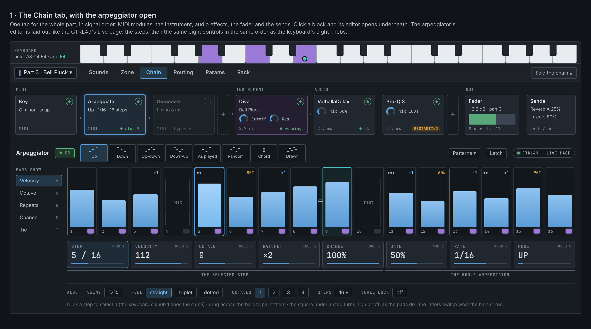

# HoSTage dock: the Chain tab, the arpeggiator and the step sequencer

*Design with mockups for the owner to approve, 2026-11-17. Nothing built. It works out "a better
effects screen in the dock" (`hostage-wider-not-a-daw.md`, Effects, 8), taken on 2026-11-16,
starting with the arpeggiator, as the owner asked. Mockups: `hostage-dock-chain-mockups.html`, and
the same four frames as pictures in `docs/media/hostage-dock-chain-1.png` to `-4.png`. When this
and the code disagree, the code is right.*

## Why

The owner: the dock's effects screens "could be improved a lot". Today a part's effects are spread
over two tabs, and the arpeggiator's editor does not match the CTRL49 pages designed for it.

The owner then set the shape: what the first version of this design drew is **the step
sequencer**, and HoSTage should also have **a fully fledged arpeggiator**, from the six-page design
made for the CTRL49. So: two MIDI modules, each with its own editor.

## What is there today

- **The MIDI tab** lists a part's MIDI modules (up to eight): a grip to reorder, ▲▼, Byp, presets,
  and each module's editor (`MidiChainPanel.svelte`, `sections/midiModules/`).
- **The Inserts tab** lists the audio effects: reorder, Byp, Editor (the plug-in's window), P (its
  parameters), remove (`InstrumentHostView.svelte`).
- **One Arpeggiator module** does both jobs today (`ArpEngine.h`, settings `ArpSettings` in
  `PatternModel.h`, editor `midiModules/ArpEditor.svelte`). Eight modes: up, down, up-down,
  down-up, as played, random and chord walk the held keys; **Drawn** gives every step a note,
  which is the step sequencer. Rate in steps per beat with a straight, triplet or dotted feel;
  octaves 1 to 4; gate; swing; latch; scale lock. A step lane of up to 32 steps with velocity (0
  is a rest), tie, ratchet ×1 to ×4, octave −2 to +2 and chance. The playhead is the engine's own
  step.
- **Two CTRL49 designs** show these on the keyboard:
  - **The Live page**, a real HoSTage page (`tools/ctrl49/README.md`, "The stage pages"): sixteen
    steps above the keys and zones, eight knobs (step, velocity, octave, ratchet, chance, gate,
    rate, mode), the pads turning steps on and off. That is the step sequencer's page.
  - **The six-page arpeggiator** (commit `5d72504`, "a full arpeggiator on six pages", in the
    Rhythm Box 1980 look, since removed from the tree; its pictures are restored as
    `docs/media/hostage-arp-ctrl49-*.png`). PLAY, MOTION, then four pages of an eight-step
    pattern: STEPS, VELOCITY, OCTAVE, CHANCE. Knob N is step N on every pattern page. That is the
    arpeggiator's design.

## One Chain tab

The MIDI and Inserts tabs become one **Chain** tab. Zone, Routing, Params and the rest stay.

At the top, the **chain strip**: the part in signal order, as blocks, grouped MIDI, Instrument,
Audio and Out (fader and sends). Each block shows:

- its name and an on/off switch (bypass);
- a line saying what it is set to (the arpeggiator's mode, rate and octaves);
- for audio blocks, dry/wet and one or two main knobs (Effects, 1);
- its latency, and its state: running, restarting (amber), failed.

Click a block and its editor opens underneath. A **+** at the end of the MIDI and Audio groups adds
one. Dragging to reorder and between parts, and trying a module before adding it, work here (More
ease of use, 1, 2 and 5). **Fold the chain** shrinks the strip to one line of names, when an editor
needs the room (frame 3).

## The arpeggiator

The six CTRL49 pages, shown at once (frames 1 and 2). From top to bottom:

1. **What plays, and how it walks.**
   - **Now**: the note sounding, its velocity, step type and place in the pattern.
   - **The next sixteen steps**: a roll combining every lane, as on the PLAY page. Height is pitch,
     thickness velocity, width gate. A tie joins its neighbour and a ratchet splits its step.
     Accents are red, chord steps cream, and a step its chance left out is a dashed ghost.
   - **The walk**: thirty-two notes of it as a contour, as on the MOTION page, with a mark where
     the cycle starts again.
2. **PLAY**, the keyboard's page 1, as eight cells: mode, rate, octaves, gate, swing, tempo (the
   song's), latch, scale lock. In the design, knobs 7 and 8 chose a chord and a root to stand in
   for held keys; in HoSTage the held keys do that, so those knobs become latch and scale lock.
3. **MOTION**, page 2: octave order, repeat, transpose, inversion, length, accent, random, reset.
4. **The pattern**, pages 3 to 6, one column per step, in line with the cells above, so column N
   is knob N:
   - **Type**: rest, note, accent, tie, ×2, ×3, ×4 or chord, clicked through and coloured as on
     the CTRL49;
   - **Velocity**, with the accent's amount shown on top;
   - **Octave**, −2 to +2;
   - **Chance**;
   - **On/off**, the square the pads toggle.

The pattern is as long as MOTION's length. The design stopped at eight because the keyboard has
eight knobs; the dock can show up to 32, the engine's limit, with the keyboard showing eight at a
time.

### What the engine needs for it

What the six pages ask for and `ArpSettings` does not have yet:

- **Modes**: up+down (the ends played twice), converge, diverge, pinky (every note answered by the
  top one) and thumb (by the bottom one). Today's seven walk modes stay, so there are twelve.
- **Octave order**: up, down, up-down, or interleaved (each note through every octave first).
- **Repeat**: each note of the walk played 1 to 4 times.
- **Transpose** ±12 and **inversion** (the chord's lowest notes lifted an octave), inside the arp.
- **Accent**, as a step type with an amount added to the velocity, and **chord** as a step type
  (every held note at once).
- **Random**: a share of the walk's notes swapped for others from it.
- **Reset**: the walk and the pattern restart every 1, 2 or 4 bars.
- **The walk moves on only on note, accent and ratchet steps**, so rests, ties and chord steps
  leave it where it was, and a pattern drifts against the walk as on a hardware arpeggiator. Check
  what today's engine does here before changing it.

The type lane needs little new storage: rest is velocity 0, tie and ×2 to ×4 are today's tie and
ratchet rows. Only accent and chord are new kinds of step.

## The step sequencer

What the first version of this design drew, now a module of its own (frames 3 and 4). Every step
carries a note; it is today's Drawn mode taken out of the arpeggiator.

- **The melody grid** at the top. **Chord** rows are the notes of the chord held; **Free** rows are
  semitones around the lowest key held, so one finger transposes the line. Both exist today.
- **One row of bars** under it, with **Bars show** choosing velocity, octave, repeats, chance or
  tie. The other rows stay visible as marks on each step: repeat dots, the octave, the chance, a
  tie to the next step. Today's editor stacks six rows instead.
  - Click a step to select it.
  - Drag across the grid or the bars to paint many steps at once.
  - The small square under each step turns it on or off, as the pads do.
- **Eight knobs**, those of the CTRL49's Live page in the same order: step, velocity, octave,
  ratchet, chance (the selected step), then gate, rate, and **notes** (chord or free). On the Live
  page knob 8 is Mode today, an arpeggiator setting; it becomes Notes once the two modules are
  separate.
- **Also**: swing, feel, the number of steps (up to 32) and scale lock.

A sequence that plays without keys held is a **pattern** in the Performance workspace, which
already has note, drum, CC and parameter lanes. Neither module repeats it.

## Both modules and the CTRL49

- Each module has its own pages on the keyboard: the arpeggiator its six, the step sequencer the
  Live page.
- Knob N does what the dock's cell or column N shows.
- A step selected on either screen is selected on both.
- The pads and the squares turn steps on and off.
- Both screens show the same playhead, and the keys held and sounding.
- Only the dock has painting, the step sequencer's melody grid, the arpeggiator's roll and walk
  together, patterns, and the rest of the chain.

## The same picture on both screens

**Decided, 2026-11-17**: the owner, "They should have almost identical Gui's." The dock and the
CTRL49 show these two modules almost the same way.

The mockups above do not yet: the arpeggiator's six CTRL49 pages are in the Rhythm Box 1980 look,
the step sequencer's Live page in HoSTage's own navy look, and the dock in the app's colours with a
layout of its own. The rule from here:

- **The CTRL49 page is the master.** Its screen is the stricter one (480 × 272, eight knobs, text
  the tightest budget: `tools/ctrl49/screen-lab/feature-mockups/README.md` measured it), so a
  layout that works there is drawn larger in the dock, not the other way round.
- **One look for both: HoSTage's own CTRL49 look**, the one the Live page and the other stage pages
  already use. The arpeggiator's six pages are redrawn in it, from the Rhythm Box design's layout.
  The era skins stay what they are: experiments in style.
- **The dock is the pages, side by side, plus what only a mouse can do**: the same step cards,
  knob cells and step colours, larger; around them, painting, more steps at once, the settings the
  keyboard has no page for, and the chain strip.
- **Labels short enough for the keyboard**, so the two screens say the same words.

The mockups are to be redrawn this way before this design is approved.

## What changes from today

- **Unchanged**: everything today's arpeggiator can do; the playhead from the engine.
- **Split**: one Arpeggiator module becomes two. An arpeggiator saved in Drawn mode opens as a step
  sequencer; one in any other mode opens as an arpeggiator, its lane kept.
- **Moved**: the MIDI and Inserts tabs into one Chain tab; the pattern chips into a menu.
- **New**: the chain strip; the arpeggiator's motion settings, five modes and two step types, which
  need engine work (above); the step sequencer's single lane with "bars show", selected step and
  eight knobs.

## Decisions for the owner

1. ~~Two modules?~~ **Decided, 2026-11-17**: the owner, "This the step sequencer.. I also want a
   fully fledged arpeggiator". An Arpeggiator and a Step sequencer.
2. **One Chain tab** in place of the MIDI and Inserts tabs?
3. **The arpeggiator's PLAY knobs 7 and 8** as latch and scale lock, now that held keys replace the
   design's chord and root?
4. **The arpeggiator's pattern up to 32 steps** in the dock, eight at a time on the keyboard, or
   eight only, as designed?
5. **The step sequencer's one lane with "bars show"** in place of six rows?
6. **Knob 8 on the Live page** becoming Notes (chord or free) in place of Mode?
7. **Patterns as a menu** in place of a row of chips?

## Next

The same frame for the other MIDI modules (Chords, Echo, Strum, Humanize and the rest, in
`sections/midiModules/`), then an audio insert: dry/wet, its main knobs, latency and state in the
block, its parameters below, and the plug-in's own window one click away.

## Mockups

`hostage-dock-chain-mockups.html`, static, with invented data and HoSTage's own colours:

1. **The Chain tab, with the arpeggiator open** (`docs/media/hostage-dock-chain-1.png`).
2. **The arpeggiator on the CTRL49**: the six pages it was designed on (`-2.png`).
3. **The step sequencer**, chain folded (`-3.png`).
4. **The step sequencer on the CTRL49**: the Live page, and knob 8 changing (`-4.png`).
