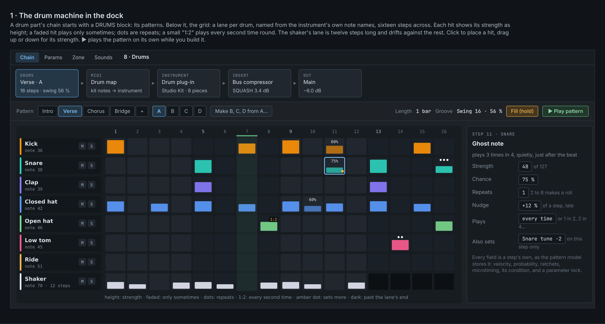
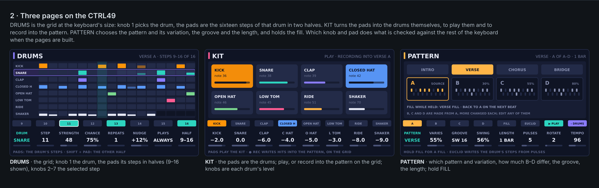

# HoSTage: the drum machine

*Design with mockups, approved by the owner on 2026-11-19 ("1. A. 2. Yes. 3. Yes"). Nothing built. Feature 1 of
`hostage-build-features-2.md`. Mockups: `hostage-drums-mockups.html`, pictures
`docs/media/hostage-drums-1.png` (the dock) and `-2.png` (the three CTRL49 pages). When this and
the code disagree, the code is right.*

## What it is for

Building a drum part the way a drum machine does: a grid of drums against steps, a hit placed with
a click or a pad, each hit with its own strength, chance and repeats; patterns for each part of the
song, variations of them, and a fill on a held button. Then playing it from the CTRL49 like a drum
machine.

## What is there today

HoSTage's **patterns** already do the sequencing (`PatternModel.h`):

- **Drum lanes**: one drum each, on one fixed note (`LaneType::drum`, `drumNote`), sent to a part.
- **Each step**: on or off, strength (velocity), chance (probability), repeats (ratchets, 1 to 8),
  a nudge early or late (microtiming), a condition (every Nth time round), and a parameter lock (a
  setting changed on that step only, through a hidden lock lane).
- **Each lane its own length**, so a twelve-step shaker drifts against a sixteen-step beat
  (polymeter).
- **Euclidean fill** (pulses spread evenly over the steps, as a button that writes real steps),
  **groove templates** (timing and strength feel), **variations** B, C and D made from A, and the
  **held fill** (a related pattern played while a button or pedal is held).
- Patterns play as **clips**, launched by scenes and sections, on the bar.

They are edited in the Performance workspace (`PatternStepRows.svelte`), not where a drum part is
built, and the CTRL49 has no page for them. The Chain tab design already settled that a sequence
playing without keys held **is** a pattern, and that no module repeats one. So the drum machine is a
new face on the patterns, not a second engine. The **drum map** module (first round, effects 7)
translates a kit's notes for an instrument that expects others.

## 1. In the dock

- **A DRUMS block at the head of the chain** of a drum part: the pattern playing and its variation,
  its length and swing. Selecting it opens the grid underneath, as every block opens its editor.
- **The pattern bar**: the song's parts (Intro, Verse, Chorus, Bridge), each its own pattern; A to
  D; **Make B, C, D from A**; the length; the groove; **Fill (hold)**; **▶ Play pattern**, which
  plays it on its own while building, in Build only.
- **The grid**: a lane per drum, named from the instrument's own note names where it reports them,
  from the drum map otherwise, from the General MIDI drum names last. Each lane has mute, solo and
  its length. Each hit shows its strength as height; a faded hit plays only sometimes; dots are
  repeats; "1:2" plays every second time; an amber dot sets something more. Steps past a lane's
  end are dark.
- **Editing**: click to place a hit, drag up or down for its strength; select a step and its
  settings open on the right, in words first ("Ghost note: plays 3 times in 4, quietly, just after
  the beat"), then the fields the step already stores.

## 2. On the CTRL49

- **DRUMS**: the grid at the keyboard's size. Knob 1 picks the drum, the pads are its steps in two
  halves (Shift for the other half), the other knobs the selected step's strength, chance, repeats,
  nudge and condition.
- **KIT**: the pads are the drums. Play them; with **● Rec**, the hits are written into the pattern,
  on the grid. The knobs are each drum's level.
- **PATTERN**: the song part's pattern and its variation, how much B to D differ from A, the groove,
  the swing, the length, the Euclidean pulses and rotation for the selected drum; pads for A to D,
  **FILL** while held, **EUCLID**, ▶ and back.
- The mockups show one possible assignment of knobs and pads; which does what is checked against
  everything else the keyboard does when the pages are built (`hostage-build-features-2.md`, the
  rules carried over).

## What it needs

- **The dock view and the three pages** over the pattern model as it is: no new sequencing.
- **The DRUMS block**: a drum part's patterns found by their lanes' target part.
- **Drum names**: the instrument's note names where a plug-in reports them, the drum map, then the
  General MIDI names.
- **Recording from KIT**: hits written to the nearest step, strength from the pad.
- **▶ Play pattern** in Build: the pattern's clip launched on its own, with the transport.
- **No sound of its own** (decision 1): a drum part needs a drum instrument loaded, a plug-in or a
  hardware drum machine, like any other part.

## Decisions (owner, 2026-11-19)

1. **The sounds: (a).** It plays any drum instrument you load, a plug-in or a hardware drum
   machine, and has no sounds of its own, as the first round's decision 3 says. The alternative,
   drum sounds of its own, was declined.
2. **Built on the existing patterns**, one engine for melody and drums, shown in the dock as the
   drum part's DRUMS block. **Yes.**
3. **The three CTRL49 pages**, DRUMS, KIT and PATTERN, as drawn, with their knobs and pads settled
   when built. **Yes.**
