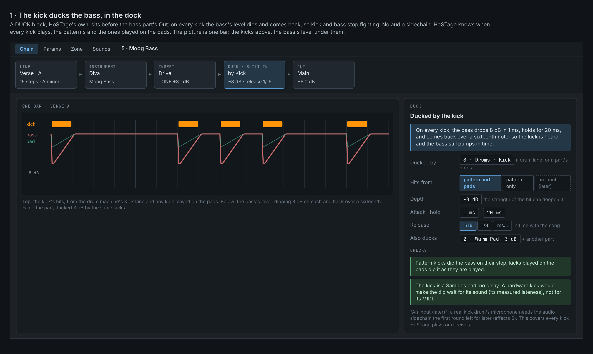
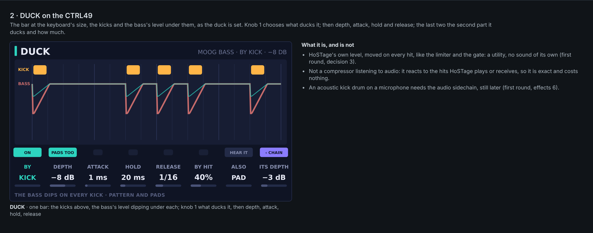

# HoSTage: the kick ducks the bass

*Design with mockups for the owner to approve, 2026-11-19. Nothing built. Feature 10 of
`hostage-build-features-2.md`, taken. Mockups: `hostage-duck-mockups.html`, pictures
`docs/media/hostage-duck-1.png` (the dock) and `-2.png` (the DUCK page on the CTRL49). When this and
the code disagree, the code is right.*

## What it is for

The bass (and, a little, the pads) dipping on every kick and coming back, so kick and bass stop
fighting for the same room and the bass pumps in time: what a sidechain compressor does in a studio.

## Why not an audio sidechain

The first round lists **sidechain ducking** as later (effects 6), because a compressor listening to
another part's audio needs sidechain routing HoSTage does not have. But HoSTage **knows when every
kick plays**: the drum machine's hits, and the kicks played on the pads. So the duck is driven by
those hits, not by listening to audio: it is exact, it costs nothing, and it needs no new routing.
What it dips is the part's **own level**, as the step effects' gate does, ramped so it never clicks:
a utility, no sound of its own (first round, decision 3). An acoustic kick drum on a microphone still
needs the audio sidechain, which stays later.

## 1. In the dock

- **A DUCK block**, built in, before the part's Out: what ducks it and how much.
- **A picture of one bar**: the kick's hits above, the part's level dipping under each, and any other
  part it ducks, fainter.
- **The duck in words first** ("On every kick, the bass drops 8 dB in 1 ms, holds for 20 ms, and comes
  back over a sixteenth note"), then:
  - **Ducked by**: a drum lane (the Kick) or a part's notes;
  - **Hits from**: **pattern and pads** (the default) or **pattern only**; **an input** is shown as
    later, for the audio sidechain;
  - **Depth**, and how much a harder hit deepens it;
  - **Attack** and **hold** in milliseconds; **release** in note values (1/16, 1/8), so it pumps in
    time with the song, or in milliseconds;
  - **Also ducks**: other parts, each with its own depth (the pad, −3 dB).
- **Checks**:
  - a kick from the pattern dips on its step; one played on the pads dips as it is played;
  - **a hardware kick** (a hardware drum machine) is heard later than its MIDI, by the lateness the
    line check measured (building a kit), so the dip waits for the sound, not the MIDI; a kick from
    Samples or a plug-in needs no wait, since HoSTage already lines plug-ins up.

## 2. On the CTRL49

- **DUCK**: the bar at the keyboard's size, the kicks and the level under them. Knob 1 what ducks it,
  then depth, attack, hold, release, how much the hit's strength deepens it, the second part it ducks
  and that part's depth. Pads: on, pads too, hear it, back. Which knob and pad does what is settled
  when the page is built.

## What it needs

- **A level envelope** on a part's own level, started by hits: depth, attack, hold, release (in time
  or milliseconds), ramped.
- **The hits**: the drum machine's lane at its steps, and notes played into the kick's part, as they
  arrive.
- **The hardware wait**: the lateness from the line check, applied to the dip when the kick is a
  hardware part.
- **The DUCK block, the dock view and the page.**

## Decisions for the owner

1. **Ducking from the hits HoSTage plays or receives**, on the part's own level, with the audio
   sidechain for a real kick drum left for later?
2. **Pattern and pads** by default, **pattern only** as the choice?
3. **Release in note values** by default, milliseconds as the choice; **other parts ducked** too, each
   with its own depth?
4. **A hardware kick's dip waits for its sound**, by its measured lateness?
5. **The DUCK page** on the CTRL49?
