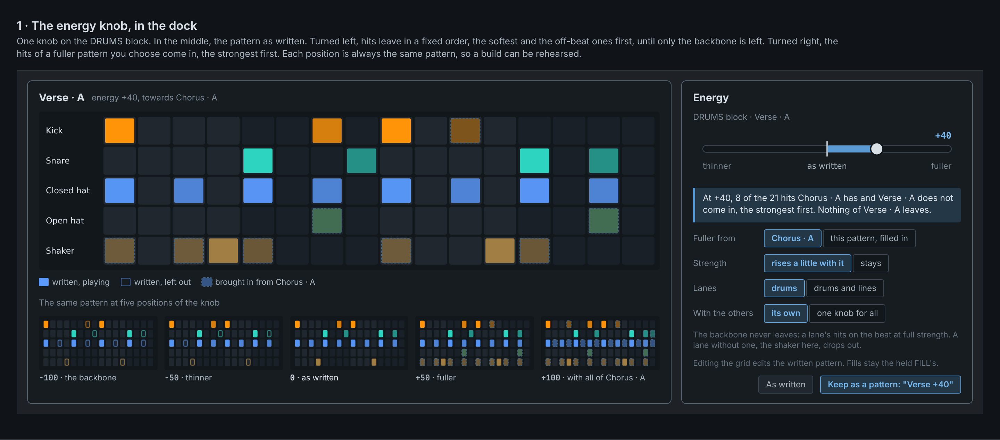
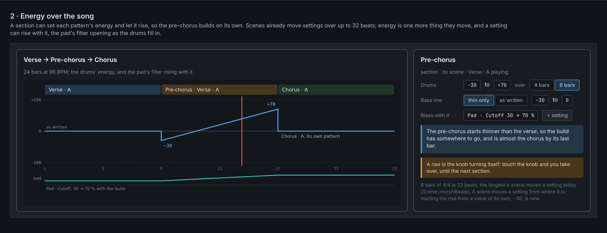
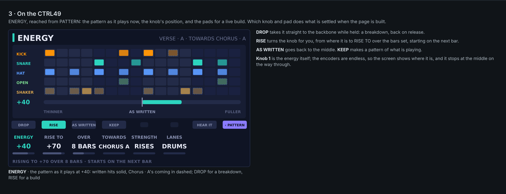

# HoSTage: the energy knob

*Design with mockups, approved by the owner on 2026-11-19 as recommended ("Document it").
Nothing built. Feature 5 of
`hostage-build-features-2.md`, taken. The record's first idea, building on variations B, C and D,
was checked against the code and fails, so the design does it another way and says why. Mockups:
`hostage-energy-mockups.html`, pictures `docs/media/hostage-energy-1.png` (the knob in the dock),
`-2.png` (energy over the song) and `-3.png` (the ENERGY page on the CTRL49). When this and the code
disagree, the code is right.*

## What it is for

One knob that thins a pattern out or fills it in while it plays, so a verse can drop to a breakdown
or build towards the chorus without changing pattern, live or set per section.

## What is there today

- **Variations B, C and D** made from A (`makePatternVariation`, `PatternModel.cpp`), each its own
  pattern:
  - **B** changes the feel (strength, length, nudge) and adds or removes no hits;
  - **C** removes hits at random, 18 to 60 % of them, the kick on the one included, and moves some
    notes an octave;
  - **D** adds hits **only in the last quarter** of each lane, with ratchets: a fill.
- **Playback checks every hit as it plays**: each compiled hit carries its own probability and
  condition, rolled from the pattern's seed (`CompiledEvent`, `eventPlays`, `CompiledPattern.h`),
  so the same seed gives the same performance.
- **Scenes move settings over time**: a scene's continuous values morph from where they are to its
  own over up to 32 beats (`Scene::morphBeats`, `PatternModel.h`).
- **The held fill** plays a related pattern while a button is held (drum machine design).

## Where the easy version fails

- **Fading from A through B, C and D**, as the features record first put it: B brings in nothing, C
  takes hits away at random, and D adds hits only at the end of the bar. Turning the knob up would
  give a new feel, then holes, then a fill every loop: not a build.
- **Thinning by probability**: each loop rolls again, so at half energy the pattern is different
  every bar and stops being a groove; and nothing protects the kick on the one.
- **Rebuilding the pattern as the knob turns**: a knob is turned continuously, live; recompiling the
  song on every movement is the wrong cost for a performance control.

## 1. The knob, in the dock

- **On the DRUMS block**, one knob per pattern. **The middle is the pattern as written.**
- **Left: thinner.** Hits leave in a **fixed order**: the softest first (ghost notes), then those
  off the beat, then the eighths. **The backbone never leaves**: a lane's hits on the beat at full
  strength. A lane without one (a shaker) drops out. All the way left is the backbone.
- **Right: fuller**, from one of two sources:
  - **a pattern you choose** (the default when there is one, "towards Chorus · A"): its hits this
    one lacks come in, the strongest first;
  - **this pattern, filled in**: each lane's hits between its own, softly, the most regular lanes
    first (eighth hats become sixteenths before the kick gains any).
- **The same position is always the same pattern**: the order is fixed, not rolled, so a build can
  be rehearsed. Ties are settled by the pattern's seed.
- **The grid shows it**: written hits solid, hits left out hollow, hits brought in dashed. **Five
  small grids** show the pattern at −100, −50, 0, +50 and +100, so the range is seen before it is
  played.
- **Choices**: strength **rises a little with it** or stays; **drums** only, or **drums and lines**
  (a line machine's lane only thins, keeping its notes on the beat); **its own** knob or **one knob
  for all** the patterns playing.
- **Editing the grid edits the written pattern.** **Keep as a pattern** makes a new one from what
  plays now ("Verse +40"). **Fills stay the held FILL's**: energy is how dense, not a fill.

## 2. Energy over the song

- **A section sets each pattern's energy**, and can **let it rise**: the pre-chorus starts at −30
  and rises to +70 over 8 bars, on its own.
- **A setting can rise with it**: the pad's filter opening as the drums fill in, as scenes already
  move settings.
- **Touch the knob and you take over**, until the next section.
- **8 bars of 4/4 is 32 beats**, the longest a scene moves a setting today. A scene moves a setting
  from where it is, so **starting the rise from a value of its own** is new.

## 3. On the CTRL49

- **ENERGY**, from PATTERN: the pattern as it plays now, and the knob's position from thinner to
  fuller.
- **Pads**: **DROP** goes to the backbone while held, a breakdown, and comes back on release;
  **RISE** turns the knob to RISE TO over the bars set, from the next bar; **AS WRITTEN**; **KEEP**.
- **Knob 1 is the energy.** The encoders are endless, so the screen shows where it is, and it stops
  at the middle on the way through. The other knobs: rise to, over, towards, strength, lanes.
- Which knob and pad does what is settled when the page is built.

## What it needs

- **An energy level on every hit**: where it leaves when thinning, or where it comes in, worked out
  when the pattern is compiled. The knob is then **one live value** the engine compares each hit
  with, beside the probability check it already makes: turning it rebuilds nothing.
- **The two orders**: thinning by strength and place in the bar, with the backbone kept; filling
  from the chosen pattern, or between a lane's own hits.
- **Strength with energy**, the line machine's thin-only rule, and one knob for all.
- **Per section**: an energy value and a rise, with a starting value of its own, carried by the
  section's scene.
- **The block's knob, the five small grids, Keep as a pattern, and the ENERGY page.**

## Decisions (owner, 2026-11-19: "Document it and make it a download")

1. **Not built on B, C and D**, for the reasons above; instead a knob whose middle is the pattern as
   written, thinning in a fixed order to the backbone, filling from a pattern you choose or from the
   pattern itself. **Yes.**
2. **Fixed, not random**: each position always the same pattern, so a build can be rehearsed.
   **Yes.**
3. **The choices in the program**: strength with it, drums or drums and lines, its own knob or one
   for all. **Yes**, with the defaults drawn.
4. **Per section**: energy and a rise over up to 8 bars, a setting rising with it, the knob taking
   over when touched. **Yes.**
5. **The ENERGY page** with DROP, RISE, AS WRITTEN and KEEP. **Yes.**
