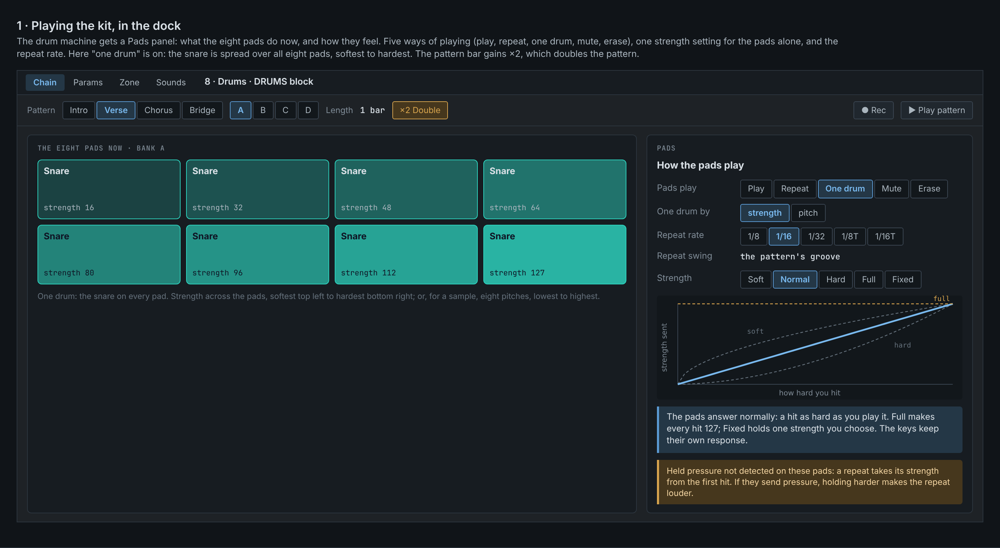
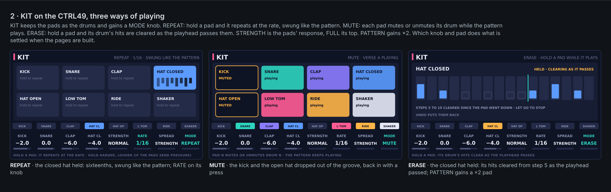

# HoSTage: playing the kit

*Design with mockups for the owner to approve, 2026-11-19. Nothing built. It draws seven features
of `hostage-build-features-2.md` that live on the drum machine's pads, all taken: 2 (note repeat)
and 13 to 18 (full strength, one drum on every pad, erase while it plays, mute drums from the pads,
pad response, double the pattern). They are decided; this record decides only how they look and
behave. Mockups: `hostage-kit-mockups.html`, pictures `docs/media/hostage-kit-1.png` (the dock) and
`-2.png` (KIT on the CTRL49). When this and the code disagree, the code is right.*

## What it is for

Playing the drum machine from pads the way a pad drum machine is played: rolls and hats by holding
a pad, a beat programmed evenly at full strength, a snare roll that swells across the pads, drums
dropped out of a groove and back in, a pattern tidied while it plays, and pads that feel right
without changing how the keys feel.

## What it builds on

The drum machine design (`hostage-drums-design.md`): the DRUMS block, its grid and pattern bar, and
the KIT page where the pads are the drums. The CTRL49 has eight pads in four banks (MPK-style
playing, in the features record). Whether its pads send pressure is not known yet; the design works
either way.

## 1. In the dock: the Pads panel

The drum machine's editor gains a **Pads** panel: what the eight pads do now, and how they feel.

- **Pads play** one of five ways:
  - **Play**: each pad its drum, as KIT is today.
  - **Repeat** (feature 2): hold a pad and it repeats at the **repeat rate** (1/8, 1/16, 1/32 and the
    triplets), swung by the pattern's own groove. Held harder, louder, if the pads send pressure;
    otherwise each repeat takes the first hit's strength, and the panel says so.
  - **One drum** (14): the selected drum on all eight pads, **by strength** (softest to hardest) or,
    for a sample, **by pitch** (eight pitches, lowest to highest).
  - **Mute** (16): each pad mutes or unmutes its drum while the pattern plays.
  - **Erase** (15): hold a pad and its drum's hits are cleared as the playhead passes them; let go
    to stop. Undo puts them back.
- **Strength** (17 and 13): how the pads answer, for the pads alone; the keys keep their own
  response. **Soft** (a light touch gives more), **Normal**, **Hard** (it takes a harder hit),
  **Full** (every hit 127: feature 13) or **Fixed** (one strength you choose). Drawn as a curve,
  how hard you hit against the strength sent.
- **×2 Double** (18) in the pattern bar: the pattern's bar copied to make two, ready to vary the
  second, within the line's 64 steps.

## 2. On the CTRL49: KIT with a MODE knob

- **KIT keeps the pads as the drums** and gains a **MODE** knob (play, repeat, one drum, mute,
  erase), a **RATE** knob for repeat, a **SPREAD** knob for one drum (strength or pitch) and a
  **STRENGTH** knob for the response, with FULL at its top. The first four knobs stay the drums'
  levels.
- **REPEAT** shows the held pad's repeats as they play. **MUTE** shows each drum playing or muted.
  **ERASE** shows the held drum's lane, the hits cleared since the pad went down, and the playhead.
- **PATTERN** gains a **×2** pad.
- Which knob and pad does what is settled when the pages are built (the record's rules carried
  over); the mockups show one possibility.

## What it needs

- **Note repeat**: notes generated at the rate on the transport's grid while a pad is held, with
  the pattern's groove, the strength from pressure where it arrives and from the first hit
  otherwise.
- **One drum**: the pads remapped to one lane's note at eight strengths, or to a sample at eight
  pitches (Samples design).
- **Mute and erase**: a lane's mute, and its steps cleared in real time as the playhead passes, as
  one undo step per press.
- **Strength**: a curve applied to the pads' velocity only, before the drum machine and Samples
  see it.
- **Double**: a pattern's steps copied into a second bar.
- **The pad pressure test** on the owner's CTRL49 (features record, MPK-style playing).

## Decisions for the owner

1. **Five ways for the pads to play** (play, repeat, one drum, mute, erase), chosen in the dock and
   with a MODE knob on KIT?
2. **One strength setting for the pads alone** (soft, normal, hard, full, fixed), the keys keeping
   their own?
3. **Note repeat swung by the pattern's groove**, louder when held harder only if the pads send
   pressure?
4. **×2 in the pattern bar and on PATTERN**, within the 64 steps?
