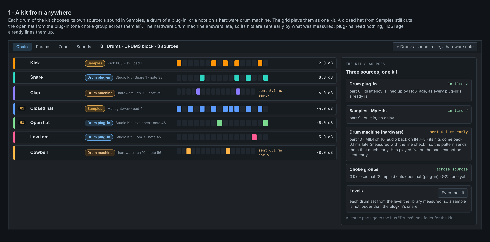
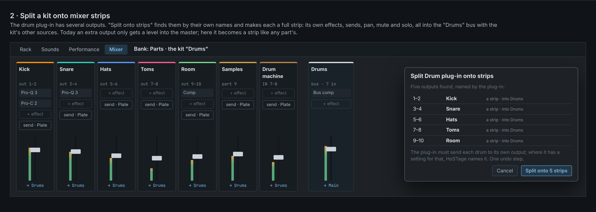

# HoSTage: building a kit

*Design with mockups, approved by the owner on 2026-11-19 as recommended ("Do what you recommend").
Nothing built. Features 3 (a kit from
anywhere) and 4 (split a kit onto mixer strips) of `hostage-build-features-2.md`, taken, drawn
together because both are about one kit made of several instruments and outputs. Each easy version
was checked for where it fails first. Mockups: `hostage-kitbuild-mockups.html`, pictures
`docs/media/hostage-kitbuild-1.png` (a kit from anywhere) and `-2.png` (split onto strips). When this
and the code disagree, the code is right.*

## What it is for

A kit put together from what sounds best: a kick sample of your own, the snare of a drum plug-in, a
clap and a cowbell from a hardware drum machine, played as one kit from one grid; and a drum plug-in's
drums each on their own mixer strip, with their own effects, all into one fader for the kit.

## What is there today

- **Each drum lane aims at its own part** (`Lane::targetPartId`, `PatternModel.h`), so a kit can
  already play several instruments; nothing shows or builds it that way.
- **Plug-ins are already lined up in time.** The audio graph compensates every plug-in's latency
  (`InstrumentRackHost.h`: JUCE's graph adds the delays itself, and a test pins it), so a kick from
  one plug-in and a snare from another arrive together.
- **A hardware drum machine is not.** Its hits go out as MIDI and come back as audio, later by the
  MIDI, the machine and the converters; nothing in HoSTage offsets that.
- **No choke groups across instruments**: the Samples design has them inside Samples only.
- **Buses exist** (a part's destination bus), one fader for several parts.
- **A multi-output instrument's extra outputs** get only a level into the master path (`ExtraOut`,
  `RackModel.h`): no effects, no sends, no bus. The first pair always takes the part's own chain and
  fader.

## 1. A kit from anywhere

- **Each drum chooses its source**, shown on its lane: **Samples** (a pad of the built-in sampler),
  **a plug-in's drum** (a part and its note), or **a hardware note** (a hardware part, its channel and
  note). **+ Drum** adds one from a sound, a file dropped on it, or a hardware note.
- **The grid plays them as one kit**, with the drum machine's every feature: patterns, variations,
  the fill, the pads.
- **In time.** Plug-ins need nothing. A **hardware** drum machine's lateness is **measured** (the line
  check sends a note and times the audio coming back), and the **pattern's hits are sent that much
  early**, so they land with the rest. Hits played live on the pads cannot be sent early, and the
  sources panel says so.
- **Choke groups across sources**: a closed hat from Samples cuts the open hat from a plug-in. HoSTage
  sends the note-off itself, so it works whatever each instrument can do.
- **Even the kit**: each drum's level set from what the library measured, so a loud sample does not
  bury a plug-in's snare (the first round's "even levels").
- **One bus**: the kit's parts go to a bus, "Drums", one fader for the kit.

## 2. Split a kit onto mixer strips

- **Split onto strips**, on a multi-output drum plug-in: HoSTage lists its outputs **by the names the
  plug-in gives them** (Kick, Snare, Hats, Toms, Room) and makes each a strip.
- **Each a full strip**, not today's level into the master: its own effects, sends, pan, mute and
  solo, and a destination, the "Drums" bus with the kit's other sources. The first output stays the
  part's own strip.
- **The plug-in must send each drum to its own output.** Where it names a setting for that, HoSTage
  says which; otherwise the dialog says to set it in the plug-in.
- One undo step. The desk's banks (desk design) show the strips like any part's.

## What it needs

- **The kit view**: each lane's source shown and chosen; + Drum from a sound, a file or a note.
- **Hardware timing**: the lateness measured by the line check (Audio & MIDI design), and pattern
  notes to that part sent early by it.
- **Choke groups across parts**: HoSTage ending the other notes of a group.
- **Even the kit**: the library's measured levels, as even levels uses them.
- **Extra outputs as full strips**: effects, sends, pan, mute, solo and a destination for each extra
  pair, which `ExtraOut` does not have today; the outputs' names read from the plug-in.

## Decisions (owner, 2026-11-19: "Do what you recommend")

1. **Each drum chooses its source** (Samples, a plug-in's drum, a hardware note), one grid playing
   them as one kit. **Yes.**
2. **A hardware drum machine's pattern hits sent early** by its measured lateness, live hits as they
   are. **Yes.**
3. **Choke groups across sources**, done by HoSTage. **Yes.**
4. **Extra outputs as full strips**, named by the plug-in, all into one bus for the kit. **Yes.**
5. **Even the kit** from the library's measured levels. **Yes.**
