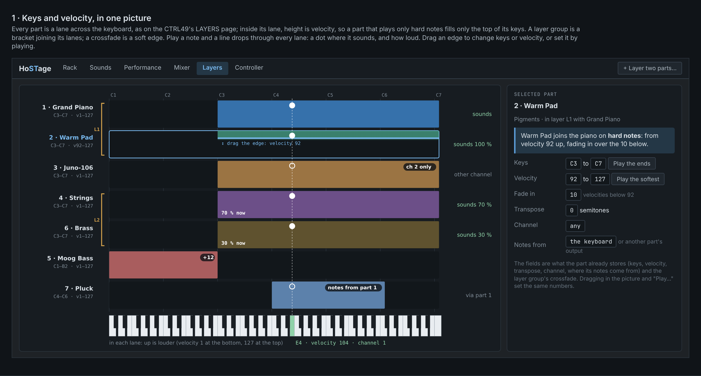
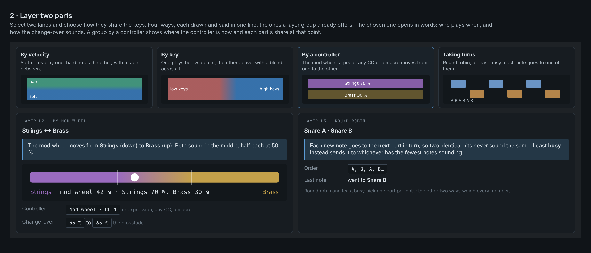
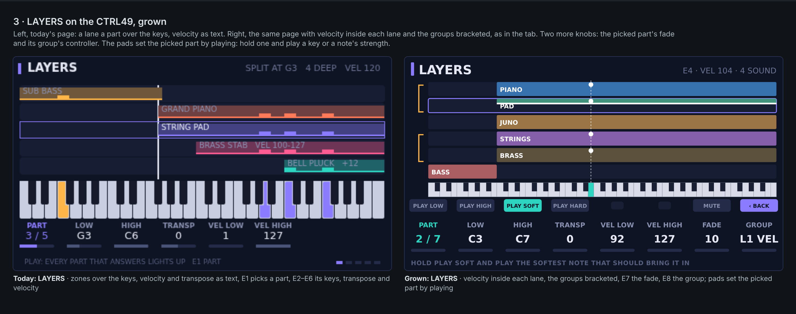

# HoSTage: the Layers tab

*Design with mockups, approved by the owner on 2026-11-18 as drawn. Nothing built. The owner asked to expand
on layers, building on what exists. Mockups: `hostage-layers-mockups.html`, pictures
`docs/media/hostage-layers-1.png` to `-3.png`. When this and the code disagree, the code is right.*

## What it is for

How the parts share the keyboard: which keys each one plays, how hard a note must be for it to
sound, and how two sounds take over from each other (soft notes a piano, hard notes piano and pad;
the mod wheel moving from strings to brass).

## What is there today

- **Each part's zone** (`PartMidiRules.h`): its channel, its lowest and highest key, its lowest and
  highest velocity, and a transpose. A part's notes can also come from another part's output instead
  of the keyboard (`midiSourcePartId`), after that part's zone and arpeggiator.
- **Layer groups** (`LayerGroup` in `RackModel.h`): parts that share one decision per note. Either
  all of them sound, weighed by a source (velocity, key, a controller, expression or a macro, with a
  crossfade at each edge), or one of them takes each note (round robin, or least busy). Up to 32
  groups; a part is in one group at most, and a part fed by another part is in none.
- **The Layers tab** (`LayerGroupsPanel.svelte`, `LayerGroupEditor.svelte`): one editor per group,
  its members as bands on the source's range, with handles and number fields.
- **The keys** are drawn on the rack's keyboard when Range is pressed.
- **The CTRL49's LAYERS page**: every part as a lane over the keys, the velocity range and transpose
  as text, the groups as tags, the notes held; knob 1 picks a part, knobs 2 to 6 set its keys,
  transpose and velocity.

What is missing is one picture: the keys, the velocity and the groups are in three places, velocity
is never drawn, and nothing shows what a played note reaches.

## 1. Keys and velocity, in one picture

- **A lane per part across the keyboard**, as on the CTRL49 page. **Inside the lane, height is
  velocity**: a part that plays only hard notes fills only the top of its keys.
- **A crossfade** is a soft edge; **a layer group** is a bracket joining its lanes, with its name.
- **Tags** say what else matters: "ch 2 only", "+12", "notes from part 1".
- **Play a note** and a line drops through every lane: a filled dot where it sounds, a hollow one
  where it does not, and at the end of each lane, in words, "sounds", "sounds 70 %", "other
  channel", "via part 1". The same answers as "why is this not sounding?" (Rack design, section 3).
- **Edit by dragging**: a lane's sides for its keys, its top and bottom for its velocity, the soft
  edge for the crossfade. Or **by playing** (smaller Build features, section 1): "Play the ends",
  "Play the softest".
- **The selected part** on the right, in words first ("Warm Pad joins the piano on hard notes: from
  velocity 92 up, fading in over the 10 below"), then the fields it already stores.

## 2. Layer two parts

Select two lanes, **Layer two parts…**, and choose one of four ways. They are the combinations a
layer group already offers, named for what they do:

| Way | What happens | Today's settings |
| --- | --- | --- |
| **By velocity** | soft notes play one, hard notes the other, with a fade between | all, by velocity |
| **By key** | one below a point, the other above, with a blend across it | all, by key |
| **By a controller** | the mod wheel, a pedal, any controller or a macro moves from one to the other | all, by a controller, expression or a macro |
| **Taking turns** | each note goes to one of them: in turn, or the least busy | round robin, least busy |

The group then opens **in words**: who plays when, and how the change-over sounds. A group by a
controller shows where the controller is now and each part's share at that point; one taking turns
shows which part had the last note.

## 3. LAYERS on the CTRL49, grown

- **The same picture at the keyboard's size**: velocity inside each lane, the groups bracketed, the
  note being played through every lane, and how many parts it sounds on.
- **Knobs**: as today (the part, its keys, transpose, velocity), plus **fade** (its crossfade in its
  group) and **group** (which group it is in).
- **Pads**: hold **PLAY LOW**, **PLAY HIGH**, **PLAY SOFT** or **PLAY HARD** and play a key or a
  note's strength to set the picked part; **MUTE**; back. Which knob and pad does what is checked
  against the rest of the keyboard when the page is built, as for every page.

## What it needs

- **The picture**: the lanes drawn from the zones and groups that exist; a played note's result per
  part, which "why is this not sounding?" computes anyway (Rack design).
- **Editing**: the same commands the fields and the CTRL49 knobs send today; the play-to-set capture
  of the smaller Build features.
- **Layer two parts**: the four ways mapped onto today's allocation and source; nothing new in the
  model.
- **LAYERS**: today's page payload with each part's velocity range and fade added, two more knobs,
  the pads.

## Decisions (owner, 2026-11-18: "Approved.")

1. **The Layers tab as one picture**: velocity inside each part's lane, groups as brackets, a played
   note shown through every lane. **Yes.**
2. **Layering two parts** by choosing one of four ways, said in words. **Yes.**
3. **LAYERS on the CTRL49** grown the same way, with fade and group knobs and play-to-set pads.
   **Yes.**
