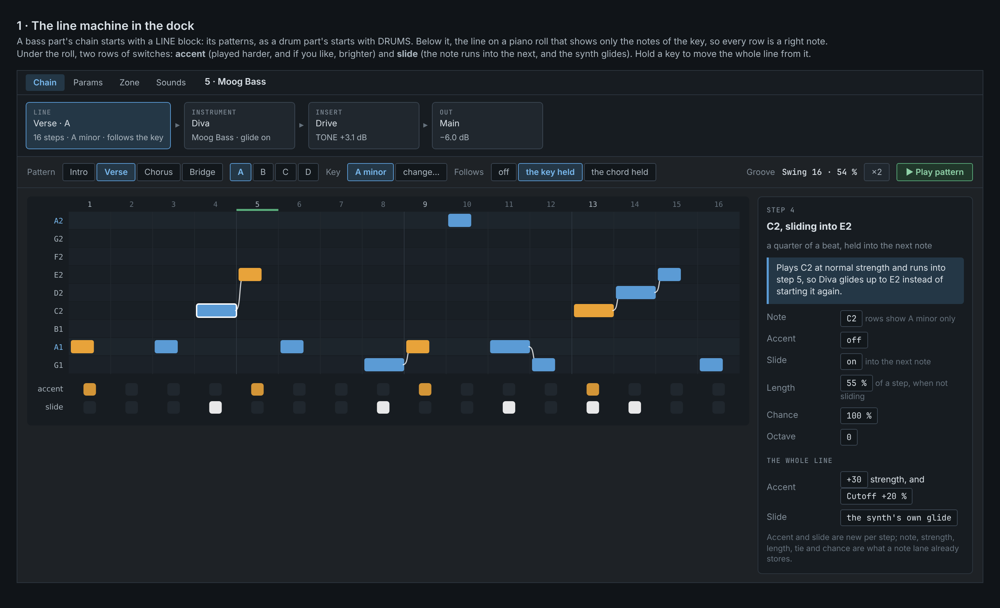
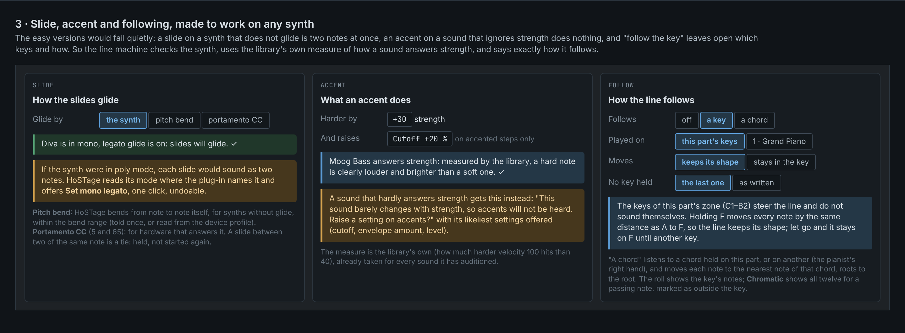

# HoSTage: the line machine

*Design with mockups, approved on 2026-11-19 at the owner's word: "Do what you think is recommended
but do not take the easy way." So the four recommendations were taken, and each was first checked for
where its easy version would fail; sections 3 and 4 are the result. Nothing built. Feature 11 of
`hostage-build-features-2.md`: the drum grid's twin for basslines and synth lines. Mockups:
`hostage-line-mockups.html`, pictures `docs/media/hostage-line-1.png` (the dock), `-2.png` (the LINE
page on the CTRL49) and `-3.png` (slide, accent and following). When this and the code disagree,
the code is right.*

## What it is for

Building a bassline or a synth line step by step, the way the drum machine builds a beat: a note on
each step, some played harder (accent), some running into the next so the synth glides (slide),
in the song's key, playing with the song. Hold a key and the whole line moves to it.

## What is there today

- **Note lanes** in the pattern model (`PatternModel.h`, `LaneType::note`): one note a step, with
  strength, length (gate), tie, chance, repeats, nudge and conditions, played by a part like the
  drum lanes. Patterns, variations, grooves and the held fill are shared with the drum machine.
- **No accent and no slide** as a step's own setting. Those are the new pieces.
- **The step sequencer module** (Chain design) plays a melody while keys are held, like the
  arpeggiator. The line machine is not that: it is a **pattern**, which plays with the song,
  started by its sections, and a held key only moves it. The Chain design already settled that a
  sequence playing without keys held is a pattern.

## 1. In the dock

- **A LINE block at the head of the chain**, as DRUMS heads a drum part's: the pattern playing, its
  length, its key, and what it follows.
- **The pattern bar**: the drum machine's (the song's parts, A to D, the groove, ×2, ▶ Play
  pattern), plus **Key** (a root and a scale) and **Follows**:
  - **off**: plays as written;
  - **the key held**: holding a key moves the whole line from its root, so A becomes F when F is held;
  - **the chord held**: fits the line's notes to the chord being held.
- **The piano roll shows only the key's notes**, so every row is a right note; the root's rows are
  marked. A note as long as its length; a slide drawn as a line into the next note.
- **Accent and slide**, two rows of switches under the roll:
  - **Accent**: the step played harder, by an amount for the whole line, and if wanted brighter, by a
    setting raised on accented steps only (a parameter lock, as the drum machine's steps have).
  - **Slide**: the note held into the next one, so a synth set to glide glides to it instead of
    starting it again. The glide is the synth's own; HoSTage only makes the notes overlap.
- **A selected step** opens in words first ("Plays C2 at normal strength and runs into step 5, so Diva
  glides up to E2 instead of starting it again"), then its note, accent, slide, length, chance and
  octave.

## 2. On the CTRL49

- **LINE**, the one new page: the line at the keyboard's size, in the key's rows, accents and slides
  marked. Knob 1 walks the steps; the next set the step's note, accent, slide, length, octave and
  chance.
- **The pads on three layers**, a half of the steps at a time: **A** each step on or off, **B** its
  accent, **C** its slide. One press per step, instead of a knob turned per step: the pads already
  have four layers with their own colours (Controller design).
- **NOTES** is the step sequencer's page (Chain design), for writing the melody on the whole keyboard.
- **PATTERN** is the drum machine's page, the same for drums and lines.
- Which knob and pad does what is settled when the pages are built (the record's rules carried
  over).

## 3. Slides that glide on any synth

The easy slide, overlapping two notes, only glides on a synth set to mono with legato glide; on a
polyphonic synth it is two notes at once. So:

- **Glide by**, for the line: **the synth** (overlapping notes, its own glide), **pitch bend**
  (HoSTage bends from one note to the next itself, for a synth without glide, within its bend range,
  told once or read from the device profile), or **portamento CC** (controllers 5 and 65, for hardware
  that answers them). Nothing in HoSTage handles either of the last two today; both are new.
- **The synth is checked**: where a plug-in names its voice mode and glide, the line says whether
  slides will glide ("Diva is in mono, legato glide is on ✓") and, if not, offers **Set mono legato**,
  one click, undoable.
- **A slide between two of the same note is a tie**, held and not started again, as note lanes
  already have.

## 4. Accents that are heard, and following that is exact

**Accent.** The easy accent, more strength, does nothing on a sound that hardly answers strength. The
library already measures that for every sound it has auditioned (`SonicProfile::dynamics` in
`Library.h`: how much harder velocity 100 hits than 40). So the accent says whether it will be heard,
and when the sound barely changes with strength, offers to raise a setting on accented steps instead,
the likeliest first (cutoff, envelope amount, level).

**Follow.** "Follows the key held" leaves four things open; each is settled:

- **Which keys steer it**: this part's own keys (its zone), which then steer and do not sound
  themselves; or **another part's**, so the line follows the chord the pianist's right hand holds.
- **How it moves**: **keeps its shape** (every note moves by the same distance, A to F) or **stays in
  the key** (moves along the scale).
- **With no key held**: **the last one** (it stays on F until another key) or **as written**.
- **A chord**: each note moves to the nearest note of the held chord, the line's root to the chord's
  root.

**Notes outside the key.** The roll shows the key's notes; **Chromatic** shows all twelve, for a
passing note, marked as outside the key.

## What it needs

- **Accent and slide on a step**: two new step settings, the accent's amount and optional setting
  for the line, and the slide by overlap, pitch bend or portamento CC.
- **The synth check**: the plug-in's voice mode and glide read by name where it names them, and the
  one-click fix; the accent's check from the library's dynamics measure.
- **Key and follow** for a note lane: the rows from the key (and chromatic), the transposition from
  a held key by shape or by scale, the latch, the fitting to a held chord, and the keys taken from
  this part's zone or another part's (the step sequencer's follow does part of this while keys are
  held).
- **The LINE block, the dock view and the LINE page** over the pattern model.

## Decisions (owner, 2026-11-19: "Do what you think is recommended but do not take the easy way")

1. **A pattern that plays with the song**, not a module played by held keys, with a LINE block at
   the head of the chain. **Yes.**
2. **Accent and slide**: **yes, made to work on any synth**: slides glide by the synth, pitch bend or
   portamento CC, with the synth checked and a one-click fix; accents checked against the library's
   measure of how the sound answers strength, with a setting to raise when it does not (section 3
   and 4).
3. **Key and follow**: **yes, settled exactly**: which keys steer (this part's or another's), how it
   moves (shape or key), what it does with no key held, how a chord is fitted, and chromatic notes
   when wanted (section 4).
4. **One new page, LINE**, with NOTES and PATTERN shared: **yes**, with the pads on three layers for
   steps, accents and slides (section 2).
