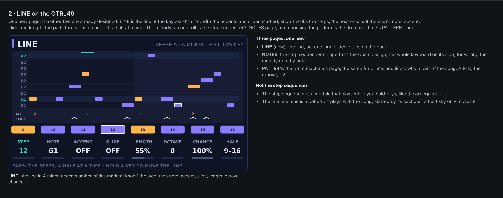

# HoSTage: the line machine

*Design with mockups for the owner to approve, 2026-11-19. Nothing built. Feature 11 of
`hostage-build-features-2.md`, taken: the drum grid's twin for basslines and synth lines. Mockups:
`hostage-line-mockups.html`, pictures `docs/media/hostage-line-1.png` (the dock) and `-2.png` (the
LINE page on the CTRL49). When this and the code disagree, the code is right.*

## What it is for

Building a bassline or a synth line step by step, the way the drum machine builds a beat: a note on
each step, some played harder (accent), some running into the next so the synth glides (slide),
in the song's key, playing with the song. Hold a key and the whole line moves to it.

## What is there today

- **Note lanes** in the pattern model (`PatternModel.h`, `LaneType::note`): one note a step, with
  strength, length (gate), tie, chance, repeats, nudge and conditions, played by a part like the
  drum lanes. Patterns, variations, grooves and the held fill are shared with the drum machine.
- **No accent and no slide** as a step's own setting. Those are the new pieces.
- **The step sequencer module** (Chain design) plays a melody while keys are held, like the
  arpeggiator. The line machine is not that: it is a **pattern**, which plays with the song,
  started by its sections, and a held key only moves it. The Chain design already settled that a
  sequence playing without keys held is a pattern.

## 1. In the dock

- **A LINE block at the head of the chain**, as DRUMS heads a drum part's: the pattern playing, its
  length, its key, and what it follows.
- **The pattern bar**: the drum machine's (the song's parts, A to D, the groove, ×2, ▶ Play
  pattern), plus **Key** (a root and a scale) and **Follows**:
  - **off**: plays as written;
  - **the key held**: holding a key moves the whole line from its root, so A becomes F when F is held;
  - **the chord held**: fits the line's notes to the chord being held.
- **The piano roll shows only the key's notes**, so every row is a right note; the root's rows are
  marked. A note as long as its length; a slide drawn as a line into the next note.
- **Accent and slide**, two rows of switches under the roll:
  - **Accent**: the step played harder, by an amount for the whole line, and if wanted brighter, by a
    setting raised on accented steps only (a parameter lock, as the drum machine's steps have).
  - **Slide**: the note held into the next one, so a synth set to glide glides to it instead of
    starting it again. The glide is the synth's own; HoSTage only makes the notes overlap.
- **A selected step** opens in words first ("Plays C2 at normal strength and runs into step 5, so Diva
  glides up to E2 instead of starting it again"), then its note, accent, slide, length, chance and
  octave.

## 2. On the CTRL49

- **LINE**, the one new page: the line at the keyboard's size, in the key's rows, accents and slides
  marked. Knob 1 walks the steps; the next set the step's note, accent, slide, length, octave and
  chance. The pads turn steps on and off, a half at a time.
- **NOTES** is the step sequencer's page (Chain design), for writing the melody on the whole keyboard.
- **PATTERN** is the drum machine's page, the same for drums and lines.
- Which knob and pad does what is settled when the pages are built (the record's rules carried
  over).

## What it needs

- **Accent and slide on a step**: two new step settings, the accent's amount and optional setting
  for the line, and the slide as an overlap into the next note.
- **Key and follow** for a note lane: the rows from the key, the transposition from the held key,
  and the fitting to a held chord (the step sequencer's follow does the same while keys are held).
- **The LINE block, the dock view and the LINE page** over the pattern model.

## Decisions for the owner

1. **A pattern that plays with the song**, not a module played by held keys, with a LINE block at
   the head of the chain?
2. **Accent and slide** as drawn: accent harder and optionally brighter, slide by overlapping notes
   so the synth's own glide plays?
3. **Key and follow**: rows of the key only, and the line following off, the key held, or the chord
   held?
4. **One new page, LINE**, with NOTES and PATTERN shared with the step sequencer and the drum
   machine?
