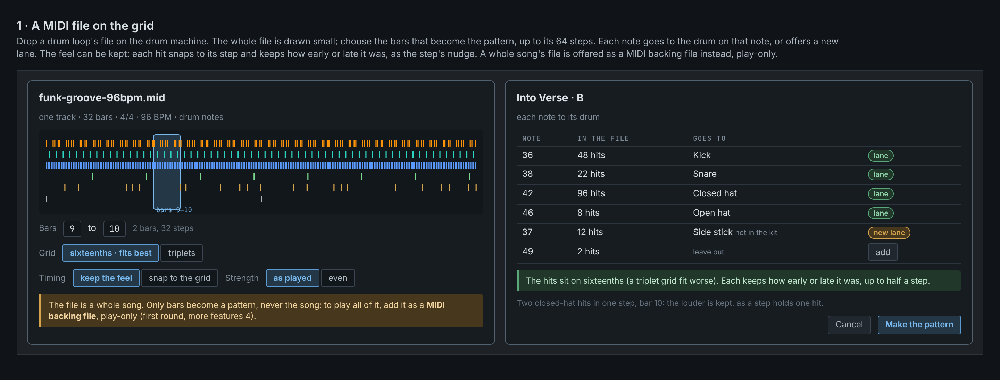
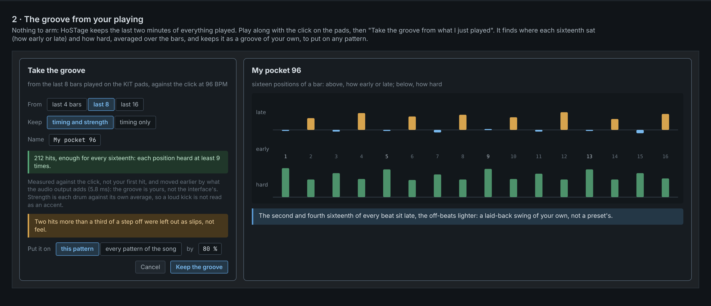
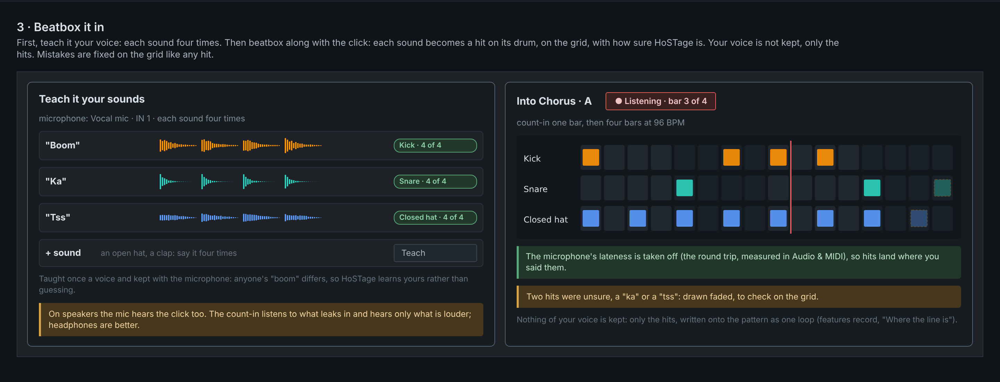
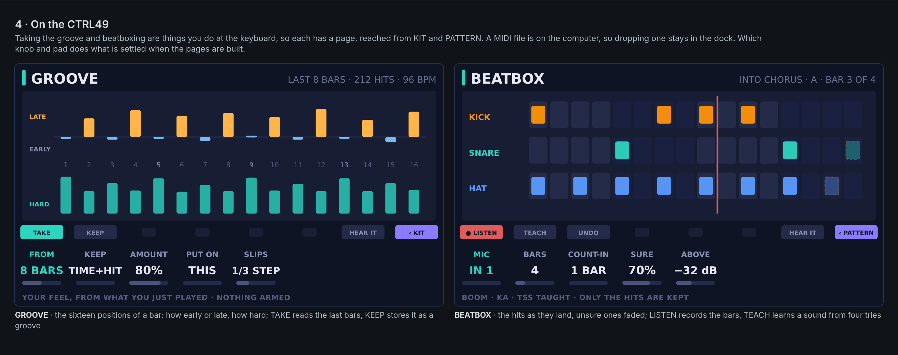

# HoSTage: getting patterns in

*Design with mockups, for the owner to decide. Nothing built. Features 6 (drop a MIDI file on the
grid), 7 (take the groove from your playing) and 8 (beatbox it in) of
`hostage-build-features-2.md`, taken, and drawn together because all three put a pattern on the
grid without placing steps by hand. Each easy version was checked for where it fails first.
Mockups: `hostage-patterns-in-mockups.html`, pictures `docs/media/hostage-patterns-in-1.png` (a
MIDI file), `-2.png` (the groove), `-3.png` (beatbox) and `-4.png` (the CTRL49 pages). When this and
the code disagree, the code is right.*

## What it is for

Three quicker ways to a pattern than clicking steps: a drum loop you already have as a file, the
feel of your own hands on the pads, and your voice.

## What is there today

- **Steps keep their feel.** Each step has a nudge, how early or late it lands, up to half a step
  either way, and a strength (`PatternStep::microtiming`, `velocity`, `PatternModel.h`).
- **Grooves exist.** A groove is a nudge and a strength multiplier per position
  (`GrooveTemplate`); `applyGrooveTemplate` puts one on a pattern, and `grooveFromLane` reads one
  back out of a lane.
- **What is played is always kept**, the last 120 seconds (`MidiCaptureJournal.h`), and
  **retrospective capture** already turns it into a pattern (`captureRecentMidi`, in
  `InstrumentHostService.cpp`).
- **No MIDI file reader.** The first round found the same for Practice mode and MIDI backing files.
- **The library measures sounds**: brightness and attack among them (`SonicProbe.h`).

## Where the easy version fails

- **A MIDI file, snapped to sixteenths.** A shuffle written in triplets lands on the wrong steps;
  the off-grid feel that makes a loop worth having is thrown away; a 3/4 loop is cut into 4/4 bars;
  a drum the kit does not have is lost without a word; and a whole song's file is far longer than
  a pattern.
- **The groove, from retrospective capture and `grooveFromLane`.** Five failures, from the code:
  - capture measures from **the first note played**, not the bar line, so a first hit 20 ms late
    makes the whole groove read 20 ms early;
  - `grooveFromLane` reads **each step once**, so one slip becomes part of the groove;
  - capture puts every note of a channel on **one chord lane**, where a step keeps one hit's
    timing: the kick and the hat on the same sixteenth give one reading;
  - strength is read across all drums, so **the kick, being louder, reads as an accent**;
  - **the interface's own lateness** reads as feel: you play to a click you hear late by what the
    audio output adds.
- **Beatbox, by loudness and brightness.** "Ka" and "tss" are both bright; on speakers the mic
  hears the click and the drums and writes them as hits; the mic adds its own lateness; and every
  voice's "boom" is different.

## 1. A MIDI file on the grid

- **Drop a file on the drum machine.** The whole file is drawn small; **choose the bars** that
  become the pattern, up to its 64 steps. A bar is the file's bar, so a 3/4 loop gives 12 steps.
- **The grid that fits.** HoSTage tries sixteenths and triplets and offers the one the hits sit on
  best, saying why; you can choose the other.
- **Keep the feel** (the default) or **snap to the grid**: kept, each hit snaps to its nearest step
  and keeps how early or late it was as the step's nudge. Strength **as played** or **even**.
- **Each note to its drum**: a note the kit has goes to its lane; one it does not is offered as a
  **new lane**, named by the General MIDI drum name, or left out.
- **What did not fit is counted**, not lost silently: two hits of one drum in one step keep the
  louder, and the dialog says so.
- **Into which pattern**: the one open, or its variation (B to D).
- **The file's tempo is not taken**: the pattern is in beats and plays at the song's tempo.
- **A whole song** is offered as a **MIDI backing file**, play-only (first round, more features 4),
  never as one long pattern (features record, "Where the line is").
- **A bassline's file** goes to the line machine (feature 11) the same way, notes and lengths kept.

## 2. The groove from your playing

- **Nothing to arm.** Play along with the click on the KIT pads, then **Take the groove**: it is
  read from what HoSTage already kept, the last 4, 8 or 16 bars.
- **Measured against the click**, not your first hit, and **moved earlier by what the audio output
  adds**, so the groove is yours, not the interface's. It needs the transport running: with it
  stopped there is no beat to measure against, and the dialog says so.
- **Averaged over the bars**, per position of a bar: each sixteenth's nudge from every time it was
  played, and **slips** (more than a third of a step off) left out and counted. A position heard too
  few times is left straight and named.
- **Strength, each drum against its own average**, so a loud kick is not read as an accent.
- **Timing and strength** or **timing only**, named, and kept as a groove of your own beside the
  factory ones, shown as early/late and strength bars with one sentence on what it does.
- **Put it on** this pattern or every pattern of the song, **by** an amount.

## 3. Beatbox it in

- **Teach it your sounds** first: each sound four times, each tied to a drum of the kit; more
  sounds can be added (an open hat, a clap). Kept with the microphone, so it is taught once per
  voice.
- **Told apart by several measures**, not one: brightness and attack as the library measures them,
  how noisy, and how much low end. Each new hit goes to the taught sound it is nearest to.
- **Then listen**: a one-bar count-in, then the bars you chose, at the song's tempo. Each sound
  becomes a hit on its drum, on the grid, with its nudge and strength.
- **Unsure hits are drawn faded**, to check; mistakes are fixed on the grid like any hit, and UNDO
  takes the whole take back.
- **In time**: the mic's lateness, the round trip the line check measured (Audio & MIDI design), is
  taken off, so hits land where you said them.
- **Speakers**: the count-in listens to what leaks into the mic with only the click playing, and
  only louder sounds count. Headphones are better, and the dialog says so.
- **Only the hits are kept**, never your voice (features record, "Where the line is").

## 4. On the CTRL49

- **GROOVE**, from KIT: the sixteen positions, early/late above and strength below. Pads TAKE and
  KEEP; knobs for how many bars, timing and strength or timing only, the amount, where it goes and
  what counts as a slip.
- **BEATBOX**, from PATTERN: the lanes filling as you go. Pads LISTEN, TEACH and UNDO; knobs for the
  mic input, the bars, the count-in, how sure a hit must be, and the level a hit must pass.
- **A MIDI file stays in the dock**: the file is on the computer.
- Which knob and pad does what is settled when the pages are built.

## What it needs

- **A MIDI file reader** (JUCE's own reads the format), shared with Practice mode and MIDI backing
  files.
- **Grid fitting**: the rate the hits sit on best, with the bar fixed by the file.
- **The beat at each moment.** The journal keeps when each hit happened in samples, not where it was
  in the bar; HoSTage must keep the transport's position beside it, so hits can be measured against
  the click.
- **A groove from many bars**: per-position averages, slips left out, strength per drum, the output's
  lateness removed.
- **Beatbox**: hits found on a live input, the four-try teaching, the measures above, the leak level
  from the count-in, and the round trip from the line check.
- **The dialogs and the two pages.**

## Decisions for the owner

1. **A MIDI file**: only the chosen bars, up to 64 steps, on the grid that fits best, **keeping the
   feel** by default; a whole song offered as a MIDI backing file. *Recommended: yes.*
2. **Drums the kit does not have** offered as new lanes by their General MIDI names, or left out.
   *Recommended: yes.*
3. **The groove from your playing**, read from what is already kept, measured against the click with
   the interface's lateness removed, averaged with slips left out, strength per drum; only with the
   transport running. *Recommended: yes.*
4. **Beatbox, taught to each voice** (four tries per sound), several measures to tell sounds apart,
   unsure hits faded, only the hits kept. *Recommended: yes.*
5. **On speakers**, the leak heard in the count-in and ignored, headphones advised. *Recommended:
   yes.*
6. **Two CTRL49 pages**, GROOVE (from KIT) and BEATBOX (from PATTERN); a MIDI file in the dock only.
   *Recommended: yes.*
