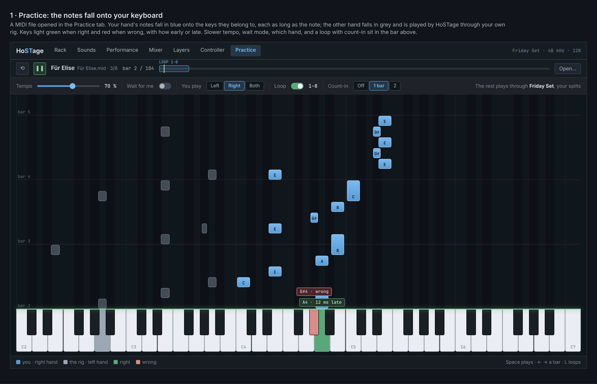
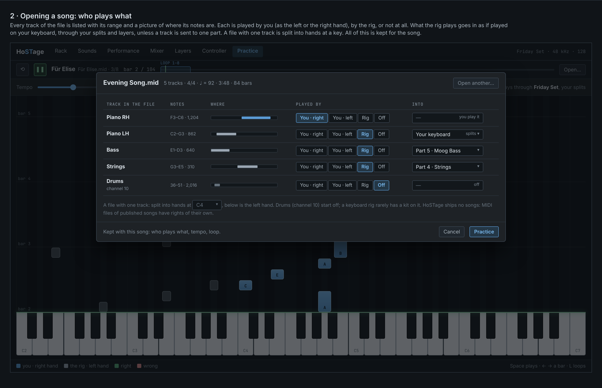
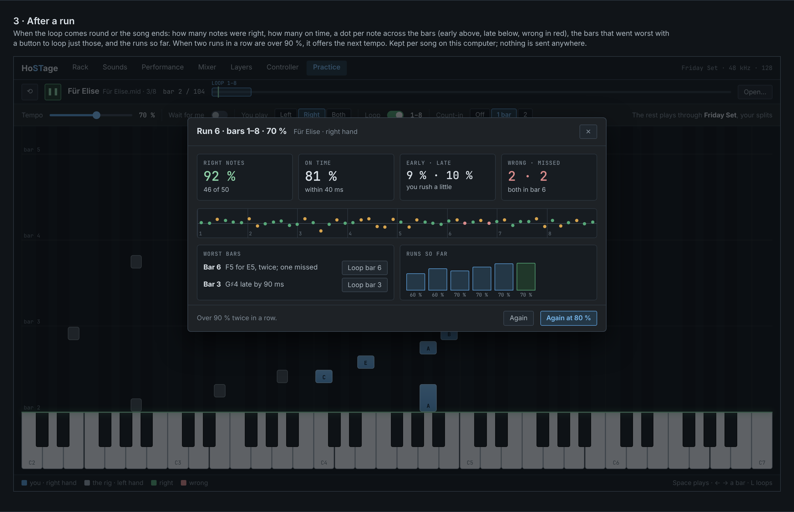
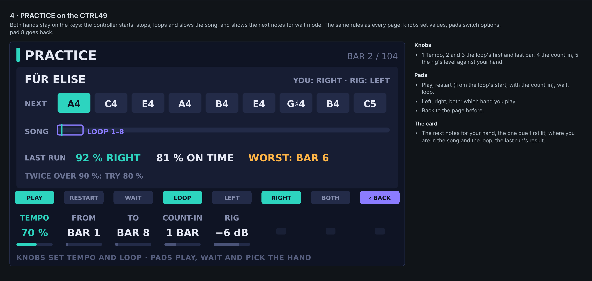

# HoSTage: Practice mode

*Design with mockups, approved by the owner on 2026-11-17 as drawn ("this is terrific"). Nothing built. It draws "Practice mode"
from `hostage-wider-not-a-daw.md`, which is taken; this record decides only how it looks and
behaves. Mockups: `hostage-practice-mockups.html`, pictures `docs/media/hostage-practice-1.png` to
`-4.png`. When this and the code disagree, the code is right.*

## What it is

A way to learn any song, the way piano-learning apps teach: notes fall onto the keyboard, each
landing on its key when it is due. What HoSTage adds is that both hands sound through the player's
own rig, with their own sounds. Nothing is edited, so it stays on the right side of the line.

## 1. The Practice tab

- **Its own tab, the whole window.** The falling notes over the on-screen keyboard
  (`HostKeyboard.svelte`, grown to fill the width). The rig loaded now is the one that sounds.
- **The falling notes.** Your hand in blue, each bar as long as its note and named; the other hand
  in grey, narrower, played by HoSTage. Bar lines and bar numbers across.
- **Right and wrong.** A key you play lights green when it is a note that is due, red when it is
  not, with a tag: "A4 · 12 ms late", "G♯4 · wrong". The rig's keys light grey as they sound.
- **The bar above**:
  - **Tempo**, from slow to full speed. MIDI changes tempo without changing pitch.
  - **Wait for me.** The song, the rig's hand included, stops at each note until you play it.
    Timing is not scored while waiting; right and wrong still are.
  - **You play**: left, right or both. The rest is the rig's.
  - **Loop** a range of bars, set by dragging on the song's position bar, with a **count-in** of
    one or two bars on the click (decision 3).
- Keys: Space plays and stops, the arrows move a bar, L loops.

## 2. Opening a song

- **Any `.mid` file.** HoSTage ships no songs: MIDI files of published songs have their own rights.
- **Every track** is listed with its range, its number of notes and a strip showing where on the
  keyboard it lies. Each is played by **you** (as the left or the right hand), by **the rig**, or
  **off**.
- **Into.** What the rig plays goes in **through your keyboard**, as if you played it, so your
  splits and layers decide the sound. A track can be sent to **one part** instead (the bass track
  to the bass part).
- **Drums** (MIDI channel 10) start off: a keyboard rig rarely has a kit on it.
- **A file with one track** is split into hands at a key, C4 to begin with.
- **Kept with the song** on this computer: who plays what, the tempo and the loop. Opening it again
  starts where you left off.

## 3. After a run

When the loop comes round, or the song ends:

- **Right notes**, **on time** (within 40 ms), **early and late**, **wrong and missed**.
- **A dot per note** across the bars: early above the line, late below, wrong in red.
- **The worst bars**, each with **Loop bar N** to practise just that bar.
- **The runs so far** for this song, with the tempo of each.
- After **two runs in a row over 90 %**, it offers the next tempo ("Again at 80 %"). Offered, never
  automatic.
- Kept per song on this computer. Nothing is sent anywhere.

## 4. PRACTICE on the CTRL49

Both hands stay on the keys. Drawn once at 480 × 272 in the original look, and the same rules as
every page:

- **Knobs**: 1 tempo, 2 and 3 the loop's first and last bar, 4 the count-in, 5 the rig's level
  against your hand.
- **Pads**: play, restart (from the loop's start, with the count-in), wait, loop; left, right,
  both; back.
- **The card**: the next notes for your hand, the one due first lit (what wait mode waits for);
  where you are in the song and the loop; the last run's result.

## What it needs

- **A MIDI file reader**, shared with the MIDI backing files (more features, 4): JUCE's
  `MidiFile` reads them.
- **Playback of the rig's tracks** into the keyboard's input or into one part, with tempo scaled and
  a wait that holds the clock.
- **Scoring**: what you played is already recorded all the time (`MidiCaptureJournal.h`); a run is
  compared with the file's notes for your hand. A pure function, tested without a device: the
  notes due, the notes played, the tolerance, to right, wrong, missed, early and late.
- **Kept per song**: who plays what, tempo, loop and the runs, in the data folder.
- **The CTRL49 page**, in the page list beside the others.

## Decisions (owner, 2026-11-17)

1. **Practice as a tab of its own**, the whole window, with the rig loaded now sounding both hands.
   **Yes.**
2. **The rig's tracks go through your keyboard** (your splits) by default, with one part per track
   as the option, and drums off. **Yes.**
3. **Results kept per song**, and the next tempo offered after two runs over 90 %. **Yes.**
4. **The PRACTICE page on the CTRL49.** **Yes.**
