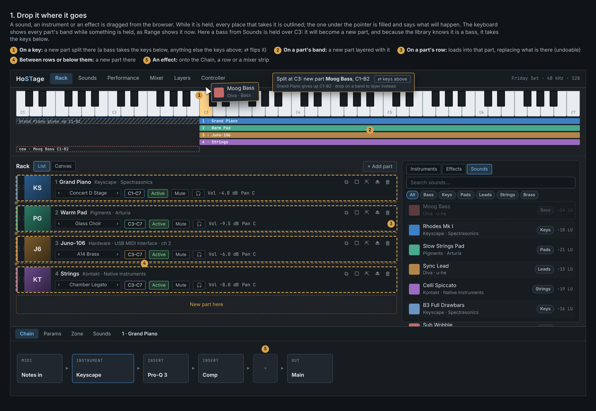
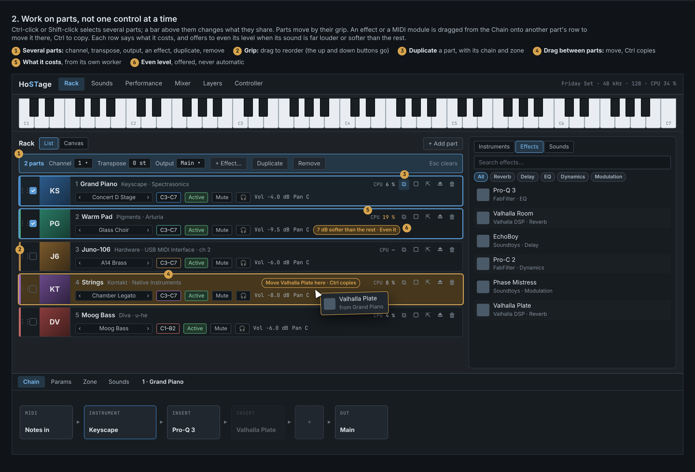
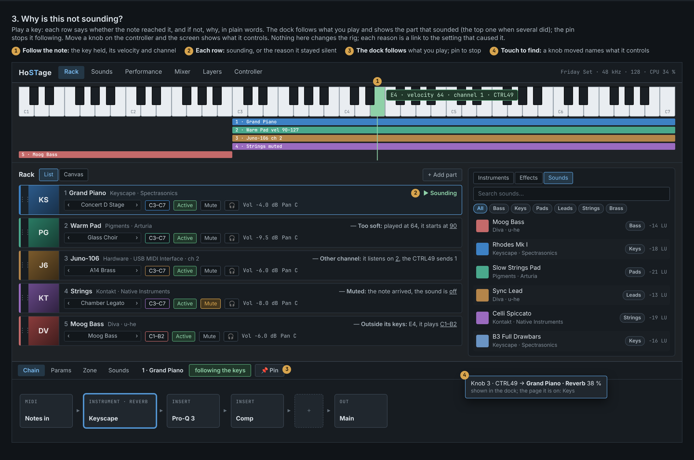

# HoSTage: the Rack in Build mode

*Design with mockups for the owner to approve, 2026-11-17. Nothing built. It draws the ease-of-use
features the owner took in `hostage-wider-not-a-daw.md` that live on the Rack tab: "Ease of use" 1
to 7, "More ease of use" 1, 2 and 4, "Even more ease of use" 1, "Build mode" 3 (even levels) and
"Build mode, further" 5 (what each part costs). Those are decided; this record decides only how
they look and behave. Mockups: `hostage-rack-build-mockups.html`, pictures
`docs/media/hostage-rack-build-1.png` to `-3.png`. When this and the code disagree, the code is
right.*

## Why

From the code (`InstrumentHostView.svelte`): only the Canvas view takes drops; in the List view, the
default, an instrument is loaded with its Load button. Parts move with up and down buttons. An effect
can be dragged only within its own chain. Nothing selects several parts, nothing says why a key is
silent, and the processor load is shown only for the whole program. Building a rig is a lot of
clicking for things a player thinks of in one gesture: "bass on the left hand", "this reverb on the
strings too".

## 1. Drop it where it goes

Anything dragged from the browser (an instrument, a sound or an effect) outlines every place that
takes it. The place under the pointer fills, and says in words what the drop will do. While
something is held, the keyboard shows every part's band, as Range does today.

| Dropped on | An instrument or a sound | An effect |
| --- | --- | --- |
| **A key** of the keyboard | a new part, **split** at that key | — |
| **A part's band** under the keyboard | a new part **layered** with that part (same keys) | — |
| **A part's row** | loads into that part, replacing what is there | the end of that part's chain |
| **Between rows**, or the space below | a new part there | — |
| **The Chain** in the dock | — | there, between the blocks it falls between |
| **A mixer strip** | — | the end of that strip's chain |

- **A split is a real split.** The parts already on those keys give them up; the tooltip says
  which ("Grand Piano gives up C1–B2"). To keep them, drop on a band instead and it layers.
- **Which side.** The library knows a sound's kind (the Bass, Keys, Pads chips). A bass takes the
  keys below the key it is dropped on; anything else takes the keys above. **⇄** in the tooltip
  flips it before letting go. That is the whole of smart placement: offered, never forced.
- **An instrument** brings its default sound; **a sound** brings the plug-in with that sound.
- **Replacing** a part's instrument by dropping asks first, until undo covers loading ("Build
  mode", 1); then it just happens and is undone like anything else.
- **Files from the computer** use the same outlines: a preset file onto a part, a `.syx` patch onto
  a hardware part, a Scala `.scl` scale onto Tuning, a show file onto the window to open it.
- The Canvas view keeps its drops and follows the same rules.

## 2. Work on parts, not one control at a time

- **Several parts.** Ctrl-click, or the tick box at a row's left, adds a part to the selection;
  Shift-click adds a run of them. A bar
  above the rack changes what they share: channel, transpose, output, + Effect (added to each),
  Duplicate, Remove. A value they do not share shows "—" until it is set. Esc clears.
- **Reorder by the grip** on each row's left edge. The up and down buttons go.
- **Duplicate** (⧉, first of the row's actions): a copy below, with its chain, zone and sound.
- **Drag between parts.** An effect or a MIDI module dragged from the Chain onto another part's row
  moves there; with Ctrl held it is copied. The row says which ("Move Valhalla Plate here · Ctrl
  copies").
- **What it costs.** Each row shows its part's processor load, measured in that plug-in's own
  worker; amber when one part takes far more than the others. A hardware part shows "—".
- **Even level.** When a part's sound is more than 6 dB louder or softer than the rest of the rack
  (from the level the library already measured), the row offers "Even it", which sets the part's
  gain. Never automatic.

## 3. Why is this not sounding?

- **Follow the note.** While a key is held, and for a few seconds after, the keyboard shows the
  key, its velocity, its channel and where it came from; a line runs down through the bands.
- **Each row says** "Sounding", or the first reason it stayed silent, in this order: off (not
  Active), other channel, outside its keys, too soft or too hard for its velocity range, muted
  ("the note arrived, the sound is off"). Each reason links to the setting that caused it. Nothing
  is changed.
- **The dock follows what you play.** It shows the part that sounded, the top one when several did.
  **Pin** stops it following, so a part can be edited while others are played.
- **Touch to find.** A knob moved on the controller shows for a moment what it controls and on
  which page, and lights that control in the dock.
- This is on the Rack tab only, which is where a rig is built; the Stage screen stays as it is.

## Not on this screen

The command palette, undo, drag to modulate, ranges by showing, hold to compare, drag to assign in
Performance and the other taken features live elsewhere and get their own pages when their turn
comes. "Try a MIDI module before adding it" belongs to the Chain tab's "+ Add module…".

## What it needs

- **The drops**: drag sources in the browser, the dock's Chain, the mixer and the operating system;
  drop targets on the keyboard, the bands, the rows and the gaps.
- **Two pure functions, tested without a device**: the split (the rack, the key, the sound's kind,
  the side) to the new key ranges; and follow the note (a part's settings and one note) to
  "sounding" or the reason.
- **Several parts**: a selection in the rack's state and one command that applies to each part, as
  one undo step.
- **What it costs**: each plug-in worker reporting its processing time.
- **Even level**: the library's measured level, which exists, and the part's gain.

## Decisions for the owner

1. **A drop on a key makes a real split** (the parts there give up those keys), and a drop on a band
   layers?
2. **The up and down buttons go**, replaced by the grip?
3. **Replacing by dropping asks first** until undo covers loading?
4. **"Why is this not sounding?" on the Rack tab only**, not on the Stage screen?
