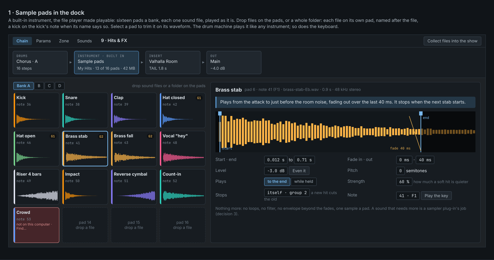
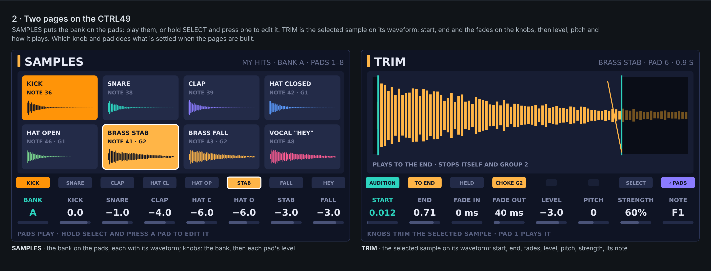

# HoSTage: sample pads

*A proposal with mockups for the owner to approve, 2026-11-19. Nothing built. Feature 12 of
`hostage-build-features-2.md`, asked for as "what about a sampler?" and then "give me a proposal".
Mockups: `hostage-sampler-mockups.html`, pictures `docs/media/hostage-sampler-1.png` (the dock) and
`-2.png` (two CTRL49 pages). When this and the code disagree, the code is right.*

## What it is for

Playing short sound files from pads and keys: a horn stab, a riser, a vocal shout, a count-in, an
impact, your own drum hits. The drum machine can play them like any instrument, and so can the
keyboard.

## Why sample pads, and not a sampler

**Today** HoSTage plays no sound files of its own; the library reads files only for its sound
previews. The first round already allows two things close to this: a **file player** among the
built-in utilities (decision 3) and **backing tracks, play-only** (decision 1). Decision 3 rules
out built-in synths, and the drum machine's decision 1 kept it to the instruments you load.

A "sampler" is two different things:

- **Sample pads (one-shots)**: one file a pad, played as it is. This is the file player made
  playable: the files arrive finished and nothing is synthesised, so it is on the right side of the
  line. It also matters on Linux, where few sampler plug-ins exist, which was one of decision 3's
  reasons.
- **A full sampler instrument**: many samples across keys and velocities, loops, envelopes,
  filters. That is a synth in all but name; it stays with plug-ins (Kontakt, Decent Sampler, SFZ
  players).

This proposal is the first only. It is the one built-in that makes sound, and it extends the file
player decision 3 already allows rather than adding a synth.

## 1. In the dock

- **A built-in instrument**, "Sample pads", in a part's chain like any instrument, before its
  effects. Its block says the kit's name, how many pads are used and how much memory it takes.
- **Sixteen pads a bank, four banks**, each pad one file, with its name, its note and its waveform.
- **Getting files in**: drop files on pads, or a whole folder: each file on its own pad, named after
  the file, and a file whose name says kick, snare, hat or clap goes on that drum's General MIDI note.
  From the library too, where a set of pads is saved as a kit.
- **Each pad**, in words first ("Plays from the attack to just before the room noise, fading out over
  the last 40 ms. It stops when the next stab starts"), then: start and end on the waveform; a fade
  in and out; level (with **Even it**, as for parts); pitch in semitones; **plays to the end** or
  **while held**; how much a soft hit is quieter; **stops** itself or a group (the closed hat cuts the
  open one); its note, set by **Play the key**.
- **Nothing more**: no loops, no filter, no envelope beyond the fades, one sample a pad.

## 2. On the CTRL49

- **SAMPLES**: the bank on the pads, each with its waveform; play them, or hold SELECT and press one
  to edit it. Knobs: the bank, then each pad's level.
- **TRIM**: the selected sample on its waveform: start, end, the fades, level, pitch, strength and
  its note on the knobs; pads to hear it, choose how it plays and its group.
- Which knob and pad does what is settled when the pages are built (the second round's rules).

## 3. Files that travel with the show

- The show names its files; **Collect files into the show** copies them into the show's folder, so a
  show, a USB stick player or another computer has them.
- A file that cannot be found is a red pad, "not on this computer · Find…", as a missing plug-in is
  named today, and the rest of the kit plays.
- **Every file is loaded into memory when the show opens**, never read from the disk while playing;
  the block shows how much memory the kit takes.

## What it needs

- **A built-in instrument** that plays files from memory: start, end, fades, level, pitch,
  held or to the end, choke groups; in the audio thread, no worker, so no isolation block
  (decision 7 applies to plug-ins only).
- **Reading sound files**: JUCE's audio format readers, as the library already uses for previews.
- **The kit's place in the show**, the collect command, and the missing-file state.
- **The dock view and the two pages.**

## Decisions for the owner

1. **Sample pads only, as the built-in file player made playable**: one file a pad, no loops,
   filters or envelopes, a full sampler left to plug-ins?
2. **The pad's settings as listed**: start and end, fades, level, pitch, to the end or while held,
   strength, choke groups, a note?
3. **Files collected into the show**, missing ones shown like a missing plug-in, everything in
   memory when the show opens?
4. **SAMPLES and TRIM** on the CTRL49, as drawn?
