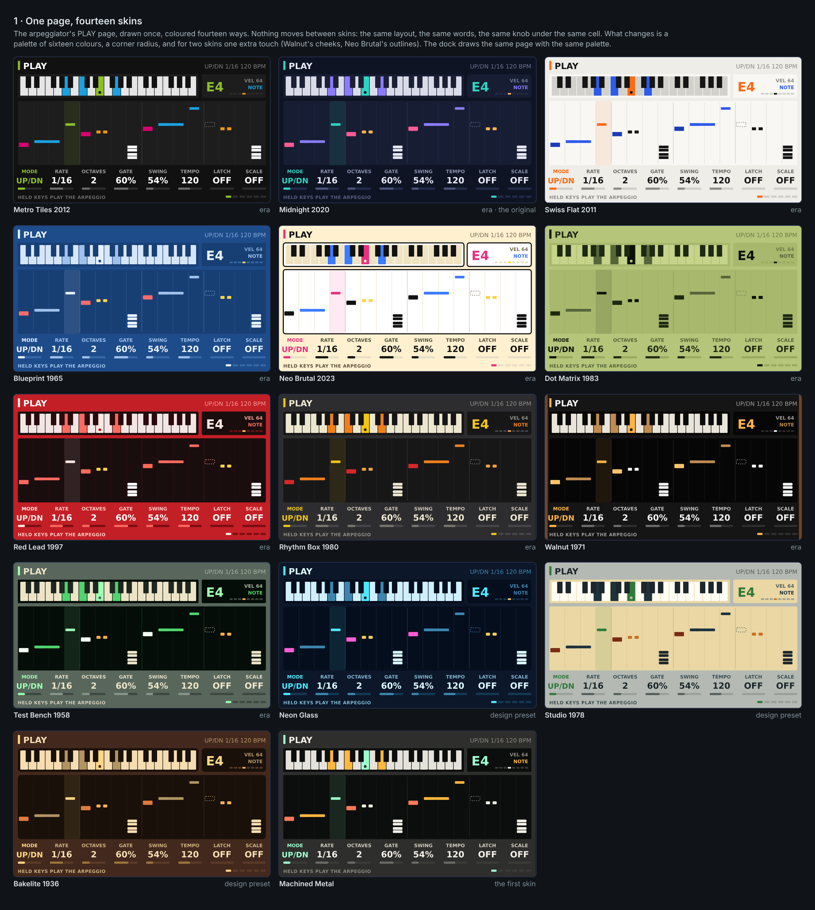
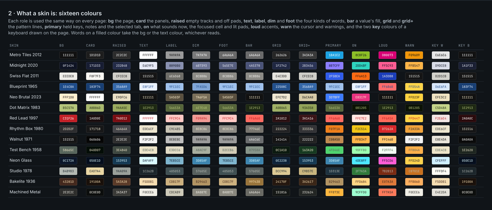

# HoSTage: the CTRL49 skins as colour

*Design with mockups, approved by the owner on 2026-11-17. Decision 3 became three choices of skin:
the CTRL49's, the program's and the Stage screen's ("The whole program" below). Nothing built. It does what the Chain
tab design left for later: the other thirteen skins on HoSTage's CTRL49 pages, "just a colour
change" (`hostage-dock-chain-design.md`, decision 3). Mockups: `hostage-skins-mockups.html`,
pictures `docs/media/hostage-skins-1.png` and `-2.png`. When this and the code disagree, the code
is right.*

## The fourteen skins

They live in `tools/ctrl49/screen-lab`. Each draws its own pages (Controls, Mixer, Envelope, the
arpeggiator) with its own materials baked into images: Walnut's wood, Bakelite's knobs, Test
Bench's glowing tubes.

| Kind | Skins |
| --- | --- |
| Era presets (`era-presets/`) | Metro Tiles 2012, Midnight 2020 (the original), Swiss Flat 2011, Blueprint 1965, Neo Brutal 2023, Dot Matrix 1983, Red Lead 1997, Rhythm Box 1980, Walnut 1971, Test Bench 1958 |
| Design presets (`design-presets/`) | Neon Glass, Studio 1978, Bakelite 1936 |
| The first skin | Machined Metal (`machined-metal/`) |

HoSTage's own pages (PLAY, STEPS, CHORDS, EFFECT, INSTRUMENT, LINE CHECK, PRACTICE and the rest)
were drawn in Midnight only.

## What a skin is, on HoSTage's pages

**Sixteen colours, a corner radius, and at most one extra touch.** Nothing else changes between
skins: the same layout, the same words, the same knob under the same cell. The dock draws the same
page with the same colours, so the two screens still match.

| Role | Used for |
| --- | --- |
| **bg**, **card**, **raised** | the page; its panels; empty tracks and pads that are off |
| **text**, **label**, **dim**, **foot** | the four kinds of words: values, cell names, headers, the footer |
| **bar** | a value's fill under its cell |
| **grid**, **grid+** | the pattern lines; every fourth step |
| **primary** | held keys, notes, the selected tab |
| **on** | what sounds now, the focused cell, lit pads |
| **loud** | accents |
| **warn** | the cursor and warnings |
| **key w**, **key b** | the white and black keys of a keyboard drawn on a page |

- **Words on a filled colour** (a lit pad, a selected tab, a sounding key) take the bg or the text
  colour, whichever is readable on it. No skin has to name a colour for each fill.
- **The extra touch**, for two skins only: **Walnut** keeps its wooden cheeks as a strip down each
  side; **Neo Brutal** keeps its black outlines round the panels. Every other skin is colour and
  radius alone (Metro Tiles, Swiss Flat and Dot Matrix have square corners, as they do now).

## Where each palette comes from

From the skin's own colour table, not made up: the era presets' `Skin.lua` (its title, label,
head, foot, off dot, bar, playhead, loud note and cursor colours); the design presets' `THEMES` in
`make_designs.py`; Machined Metal's amber and mint in `make_assets.py`. The background and panel
colours are sampled from each skin's `panels.png`, where it paints its surfaces.

Where a skin's table has no word for a role, the colour was chosen to read in that skin; these are
the places to look first if one looks wrong:

- **Swiss Flat**: notes in its blue, the playhead in its orange, the cursor in black.
- **Neo Brutal**: what sounds now in its pink, accents in black, the cursor in its yellow.
- **Dot Matrix**: two greens, as an LCD has: held keys mid, sounding keys darkest.
- **Red Lead**: the lit pad as a near-white LED on the red.
- **Neon Glass**: a pink for accents, not in its table, to sit beside its cyan.

## What stays the skin's own

The skin's own pages keep everything they have: knob images, materials, glow. Only HoSTage's
pages take a skin as colour. They draw no knob images (a cell is a word and a bar), so nothing on
them needs a material.

The rest of HoSTage's window takes a skin of its own, chosen separately: see "The whole program"
below.

## What it needs

- **Each skin's palette as data**: the sixteen colours, the radius and the touch, written beside
  the skin and read by both the keyboard and the dock.
- **Every HoSTage page drawing from the roles only.** The Midnight mockups still have a few fixed
  colours (the keys' white and black, the piano roll's black rows); those become roles.
- **A contrast check** run over every palette: text on bg and on card, the focused value on bg,
  so that no skin makes words unreadable. A skin that fails is shown which pair.
- **The recolouring the owner's Linux branch does** for the Meters, Cue and Browse pages, used for
  these pages too. It is not on `main`, so it is not described here.

## The whole program (decision 3)

**Taken, 2026-11-17: three choices of skin, each its own.** "It is its own choice. So, for the
CTRL49 (and the pages/dock) should apply. The HoSTage skin could be a different one." And for the
Stage screen: "Same as 1."

| Choice | What it colours | Default |
| --- | --- | --- |
| **CTRL49 skin** | the CTRL49's pages, on the keyboard and in the dock | Midnight 2020 |
| **HoSTage skin** | the program's own window: the Build screens and the dock's frame around the pages | HoSTage (today's look) |
| **Stage skin** | the Stage screen | the same as the HoSTage skin |

Any of the fifteen can be chosen for each: the fourteen and "HoSTage". So a dark Midnight
keyboard, a Walnut program and a light Swiss Flat stage for an outdoor gig are one setting each.
Danger stays HoSTage's own red in all of them (decision 5).

What it takes, as worked out before the owner chose:

The owner, on whether the skin should stop at the CTRL49 pages: "No, it is not a skin for HoSTage,
but as you mentioned, it could be applied to the dock, so it raises the question whether it could
skin the entire program." What that would take, from the code:

- **HoSTage already has one place for its colours**: 32 `--host-*` tokens in `hostage-theme.css`.
  The sixteen roles fill most of them directly (bg, surface, raised, the four text colours, the
  lines, accent, active, pending); the rest are mixes of those (hover, field, the tinted surfaces).
  So a skin can colour the whole window with no more data than it already has.
- **But many screens do not use the tokens yet.** About 470 colours are written straight into
  HoSTage's screens against about 220 uses of the tokens: `InstrumentHostView.svelte` 169 against
  76, `StageView.svelte` 49 against 2, `HostKeyboard.svelte` 29 against none. Each has to become a
  token first. That is most of the work, and worth doing anyway: it is what lets the dock's frame
  match the pages inside it.
- **HoSTage has only ever been dark** (`color-scheme: dark`). Four skins are light (Swiss Flat,
  Neo Brutal, Dot Matrix, Studio), so every screen needs checking in a light skin. A plug-in's own
  window is the vendor's and never follows.
- **The Stage screen** is read from metres away. A light skin can dazzle in a dark venue, and is
  the better one on an outdoor stage in daylight. So the Stage screen could have a skin of its
  own.
- **Colours that mean something** must keep their meaning: on (green-ish), warn (amber) and
  danger. Danger (remove, missing, clip) has no role in the sixteen; it would stay HoSTage's own
  red in every skin, so it always stands out. Dot Matrix cannot tell green from amber, so a status
  must also be a word or an icon, as most already are. The part colours stay HoSTage's six, checked
  against each skin's background.
- **HoSTage's current look becomes a fifteenth entry**, "HoSTage", and the default: nothing
  changes for anyone who does not choose a skin.
- Only HoSTage: the tokens are scoped to `.host-workspace`, so CEditor's panel editor is not
  touched.

## Decisions (owner, 2026-11-17)

1. **A skin on HoSTage's pages is sixteen colours and a radius**, with Walnut's cheeks and Neo
   Brutal's outlines as the only extras, on the keyboard and in the dock. **Yes.**
2. **The palettes as drawn**, taken from each skin's own colours. **Yes.**
3. **The skin colours only the CTRL49 pages.** **No.** Three choices, each its own: the CTRL49
   skin (its pages, on the keyboard and in the dock), the HoSTage skin (the program's window) and
   the Stage skin. See "The whole program".
4. **A contrast check** over every palette. **Yes.**
5. **Danger stays HoSTage's red** in every skin. **Yes.**
