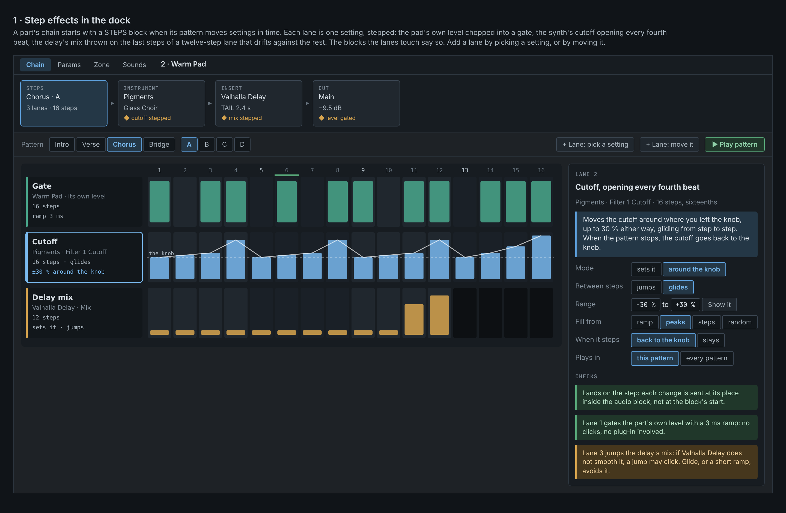
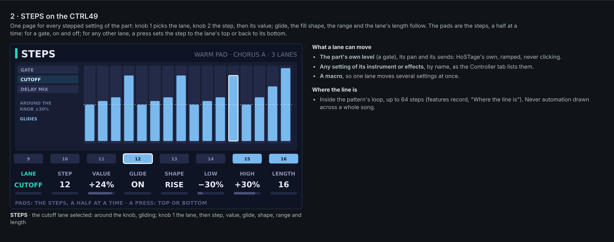

# HoSTage: step effects

*Design with mockups, approved by the owner on 2026-11-19: "Do the recommendations or make it a choice
in the program." Each recommendation is taken, and where a reasonable alternative exists it is a
setting in HoSTage, the recommendation its default (Decisions). Nothing built. Feature 9 of
`hostage-build-features-2.md`, taken: a lane that changes an effect's setting step by step. Drawn as
the line machine was, with each easy version checked for where it fails first. Mockups:
`hostage-steps-mockups.html`, pictures `docs/media/hostage-steps-1.png` (the dock) and `-2.png` (the
STEPS page on the CTRL49). When this and the code disagree, the code is right.*

## What it is for

Effects that move in time with the song: a pad chopped into a rhythm (a gate), a filter that opens
every fourth beat, a delay thrown on the last steps of a bar. The third face on the pattern engine,
after the drum machine and the line machine.

## What is there today

- **Parameter lanes** in the pattern model (`PatternModel.h`, `LaneType::parameter`): a lane aimed at
  a part, an effect or a macro (`targetId`) and one of its settings (`parameterId`, including a part's
  own level, `@gain`), a value a step (`PatternStep::value`), its own length and rate (polymeter), and
  **glide** between steps (`Lane::glide`). The plug-in's identity is kept beside the address
  (`targetCeId`), as for control pages.
- **Shapes**: factory gesture shapes (`GestureShape::factoryShapes`), curves to fill a lane from.
- **No face** for them: they are edited in Performance, not where the sound is built, and the CTRL49
  has no page.

## Where the easy version fails, from the code

1. **Timing.** A changed setting reaches an isolated plug-in as a parameter event with a place in
   the audio block (`ParameterEvent::sampleOffset`, `PluginWorkerDataPlane.h`), but the proxy sends
   every one at the block's start (`IsolatedPluginProxy::collectParameterEvents` writes 0). A step's
   change can land up to a block early. **Step effects fill in the place**, so a change lands on its
   step.
2. **Clicks.** A setting that jumps (a level, a mix) clicks unless the plug-in smooths it, and not
   every plug-in does. So a **gate** chops the part's **own level**, HoSTage's, with a short ramp (a
   few milliseconds) and never a plug-in's; any other lane **jumps or glides**, and a lane that jumps
   a setting likely to click says so.
3. **Where the setting is left.** A lane that set a value and then stopped would leave the effect
   there. So every lane is either **sets it** (it owns the setting while the pattern plays) or
   **around the knob** (it moves the setting up and down from where you left the knob), and **when the
   pattern stops, the setting goes back to the knob**: the modulation matrix already keeps this "base
   value" for its cables (`ModulationRoute::baseValue`, `RackModel.h`), and the lanes do the same.

## 1. In the dock

- **A STEPS block at the head of the chain** when a part's pattern moves settings: the pattern, its
  lanes and length. Each block a lane touches carries a mark ("◆ cutoff stepped").
- **A lane a setting**: its name, what it moves (part, plug-in, setting), its length and rate, and
  its mode in words. A gate's steps are on or off; any other lane's are values, with the knob's place
  drawn as a line for lanes moving around it.
- **Adding a lane**: **pick a setting** from the part's instrument, effects, level, pan, sends and
  macros, or **move it** (move the setting, the lane is made for it).
- **The selected lane**, in words first ("Moves the cutoff around where you left the knob, up to 30 %
  either way, gliding from step to step. When the pattern stops, the cutoff goes back to the knob"),
  then: **mode** (sets it, around the knob), **between steps** (jumps, glides), **range** (by numbers,
  or **Show it** by moving the setting to each end, as ranges by showing does), and **fill from** a
  shape (ramp, peaks, steps, random).
- **When it stops**: **back to the knob** (the default) or **stays** where the lane left it.
- **Plays in**: **this pattern** (the default, so it follows the song's sections and A to D) or
  **every pattern** of the part (a gate that runs through the whole song).
- **Checks**, on the lane: whether changes land on the step, whether a gate is ramped, whether a jump
  may click.

## 2. On the CTRL49

- **STEPS**, one page for every stepped setting of the part. Knob 1 picks the lane, knob 2 the step,
  then its value; glide, the fill shape, the range and the lane's length follow.
- **The pads are the steps**, a half at a time: on a gate, on and off; on any other lane, a press sets
  the step to the lane's top or back to its bottom.
- Which knob and pad does what is settled when the page is built (the record's rules).

## Where the line is

Inside the pattern's loop, up to 64 steps, started by sections; never automation drawn across a whole
song (features record, "Where the line is").

## What it needs

- **The STEPS block, the dock view and the STEPS page** over the parameter lanes that exist.
- **The place in the block** filled in for parameter events (`sampleOffset`), so changes land on the
  step through plug-in isolation.
- **The gate on the part's own level**, ramped.
- **Sets it or around the knob**, with the base value kept and the setting returned when the pattern
  stops.
- **The checks**: ramps, jumps likely to click, and the lane offered to the new plug-in when one is
  swapped (Build mode, further, keeping the mappings).

## Decisions (owner, 2026-11-19: "Do the recommendations or make it a choice in the program")

Each recommendation is taken. Where a reasonable alternative exists, it is a setting in HoSTage, with
the recommendation as its default; where the alternative would only be wrong, there is no setting.

1. **A STEPS block at the head of the chain**, its lanes part of the part's pattern. **Taken.** A
   choice per lane: **plays in this pattern** (default: it follows the sections and A to D) or **every
   pattern** of the part.
2. **Sets it, or around the knob**: already a choice per lane, as drawn. **The setting goes back to
   the knob when the pattern stops**: **taken as the default**, with **stays** as the choice per lane.
3. **A gate on the part's own level, ramped**: **taken.** The ramp is a choice (a few milliseconds by
   default). A gate on a plug-in's setting is allowed as a choice, with the click warning. Jumps or
   glides is a choice per lane, as drawn.
4. **Changes land on the step**: **taken, no choice.** Landing a block early is never wanted.
5. **The STEPS page** on the CTRL49, the pads as steps: **taken**, its knobs and pads settled when
   built.
